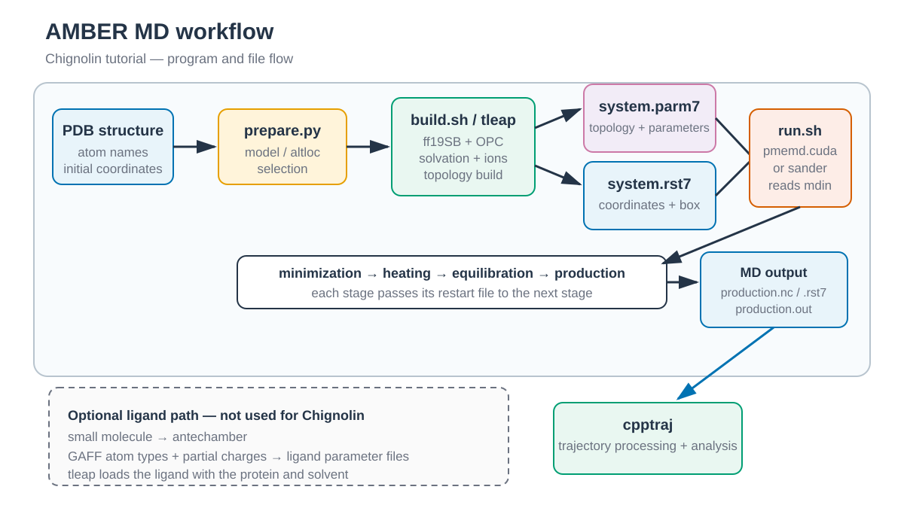

# Chignolin conventional MD / Chignolin 일반 MD

*PDB를 정리한 뒤 `tleap`으로 topology와 initial coordinate file을 만들고, MD engine이 stage별 restart를 이어받아 trajectory를 생성합니다. `cpptraj`은 topology와 trajectory를 함께 읽어 분석합니다. / After PDB preparation, `tleap` creates the topology and initial coordinate file. The MD engine passes restart files between stages, and `cpptraj` reads the topology and trajectory for analysis.*

## 한국어

PDB 1UAO의 첫 NMR model로 10-residue chignolin system을 만듭니다.
Force field는 ff19SB, water model은 OPC입니다.
계산은 minimization, 200 ps heating, 100 ps NPT equilibration, 1 ns production 순으로 진행됩니다.

Conventional MD에서는 모든 원자가 같은 physical Hamiltonian과 bath temperature를 따릅니다.
이 작은 protein 예제는 구조 준비, explicit-solvent build와 initial/restart input의 차이를 배우는 기준 workflow입니다.

### AMBER program과 전체 흐름

AmberTools에는 `tleap`, `sander`, `antechamber`와 `cpptraj`이 포함됩니다.
성능 최적화 engine인 `pmemd`와 GPU용 `pmemd.cuda`는 별도의 Amber installation에
포함됩니다.

| Program | 역할 |
| --- | --- |
| `tleap` | PDB를 읽고 residue template와 force-field parameter를 연결합니다. 이 예제에서는 ff19SB protein에 OPC water와 ion을 추가하고 `parm7`/`rst7`을 생성합니다. |
| `sander` | AmberTools에 포함된 기본 minimization/MD engine입니다. 다양한 기능을 지원하며 CPU에서 짧은 test를 실행할 때 사용할 수 있습니다. |
| `pmemd`, `pmemd.cuda` | `sander`와 거의 같은 input을 사용하는 성능 최적화 MD engine입니다. `pmemd.cuda`는 GPU를 사용하며 이 예제의 기본 production engine입니다. |
| `antechamber` | Small organic molecule의 GAFF/GAFF2 atom type과 partial charge를 준비합니다. Protein-only Chignolin에는 사용하지 않습니다. Protein–ligand workflow에서는 `parmchk2`로 누락 parameter를 확인한 뒤 ligand file을 `tleap`에 전달합니다. |
| `cpptraj` | `parm7`과 trajectory/restart를 함께 읽어 imaging, alignment, frame 추출과 RMSD 같은 분석을 수행합니다. Simulation을 전파하는 engine은 아닙니다. |

이 예제의 file 흐름은 다음과 같습니다.

1. `download.sh`와 `prepare.py`가 raw PDB에서 첫 NMR model을 선택해 `chignolin.pdb`를 만듭니다.
2. `build.sh`가 `tleap`을 호출해 water와 ion을 추가하고 `system.parm7`과 `system.rst7`을 만듭니다.
3. `run.sh`가 같은 `parm7`을 유지한 채 minimization → heating → equilibration → production 순서로 계산합니다. 각 `rst7`은 다음 stage의 coordinate input입니다. Heating이 velocity를 생성하고 equilibration과 production은 이를 이어받습니다.
4. Production은 `production.nc`, `production.rst7`과 `production.out`을 남깁니다. 이후 [analysis tutorial](../../../2_Analysis/README.md)의 `cpptraj` workflow는 `system.parm7`과 `production.nc`를 함께 사용합니다.

| File type | 포함하는 정보 |
| --- | --- |
| PDB | Atom/residue 이름과 한 frame의 원자 좌표를 담습니다. Amber force-field parameter 전체를 담는 file은 아닙니다. |
| `parm7` | Atom type, partial charge, mass, residue/molecule 구성, bond connectivity, bonded/nonbonded parameter와 exclusion 등 Hamiltonian 계산에 필요한 topology를 담습니다. Periodic system metadata도 포함할 수 있지만 trajectory frame의 좌표는 저장하지 않습니다. |
| `rst7` | 한 frame의 원자 좌표, 선택적인 velocity와 periodic box 정보를 담습니다. Initial coordinate file과 stage continuation에 모두 사용되며 force-field parameter는 `parm7`에서 읽습니다. |
| `inputs/*.in` | `mdin` control file입니다. Timestep, step 수, thermostat, pressure coupling, restraint와 output 주기 등 계산 방법을 지정합니다. |
| `*.out`, `*.info` | Engine log와 진행 상황입니다. Energy, temperature, pressure, warning과 종료 상태를 확인합니다. |
| `*.nc` | 여러 frame의 좌표와 time/box 정보를 저장하는 NetCDF trajectory입니다. 분석할 때 대응하는 `parm7`이 필요합니다. |

### Script 역할

| 파일 | 역할 | 주요 input과 output |
| --- | --- | --- |
| `download.sh` | 1UAO PDB와 mmCIF download 및 checksum 기록 | `structure/1UAO.raw.pdb`, `1UAO.cif`, `SHA256SUMS` |
| `prepare.py` | 첫 NMR model과 허용된 alternate location 선택 | raw PDB → `structure/chignolin.pdb` |
| `build.sh` | ff19SB/OPC solvation, neutralization과 topology build | prepared PDB → `work/system.parm7`, `system.rst7`, `system.pdb` |
| `run.sh` | minimization부터 production까지의 계산 실행 | topology/restart → `work/*.out`, `*.rst7`, `*.nc` |

### 실행

Terminal state, protonation state, disulfide bond의 존재 유무 등은 build 전에 확인합니다.

~~~bash
cd 1_Simulation/1_MD/1.1_Soluble_Protein
./download.sh
python3 prepare.py structure/1UAO.raw.pdb structure/chignolin.pdb
./build.sh structure/chignolin.pdb
./run.sh
~~~

필요한 program과 계산량은 [상위 README](../README.md#준비-사항)에 있습니다.
기본 engine은 `pmemd.cuda`이며 다른 실행 파일은 `AMBER_ENGINE`으로 지정합니다.
`build.sh` 뒤에는 `work/leap.log`에서 unknown residue, missing atom과 net charge를 확인합니다.

Production이 완료된 `work`에서 다시 실행하면 engine을 실행하지 않고
`Skipping completed production`을 출력한 뒤 정상 종료합니다.
실행 상태, 실패 후 재실행, 동시 실행 보호는 [GUIDE.md 부록](../../../GUIDE.md#4-부록-실행-상태와-복구)을 참고합니다.

### 주요 output과 완료 확인

| Stage | Input | 길이 | Positional restraint | Trajectory |
| --- | --- | --- | --- | --- |
| Solvent minimization | `min-solvent.in` | `maxcyc=5000`, 처음 `ncyc=2500`은 steepest descent | Protein heavy atom, 10 kcal·mol⁻¹·Å⁻² | 없음 |
| Whole-system minimization | `min-all.in` | `maxcyc=5000`, 처음 `ncyc=2500`은 steepest descent | 없음 | 없음 |
| NVT heating | `heat.in` | `nstlim=100000`, 200 ps, 20→300 K | 5 kcal·mol⁻¹·Å⁻² | `heat.nc` 20 frame |
| NPT equilibration | `equil.in` | `nstlim=50000`, 100 ps | 1 kcal·mol⁻¹·Å⁻² | `equil.nc` 10 frame |
| NPT production | `production.in` | `nstlim=500000`, 1 ns | 없음 | `production.nc` 100 frame |

정상 종료하면 terminal 마지막 두 줄이 다음과 같습니다.

~~~text
Completed: 1 ns production (work/production.out)
Production trajectory: work/production.nc
~~~

`cpptraj -p work/system.parm7 -y work/production.nc -tl`은 `Frames: 100`을
출력합니다. 다음은 [RMSD/RMSF/Rg analysis](../../../2_Analysis/2_Basic/2.1_RMSD_RMSF_Rg/README.md)입니다.
결과 판단 기준은 [상위 README](../README.md#결과-판단)를 참고합니다.

### 주요 option

| Option | 의미 |
| --- | --- |
| `nstlim`, `dt=0.002` | Simulation의 길이를 정합니다. SHAKE를 사용하므로 timestep은 2 fs입니다. |
| `temp0=300.0`, `tempi=20.0` | 목표 온도 300 K입니다. Heating은 `&wt TEMP0`로 200 ps 동안 20 K에서 300 K까지 올립니다. |
| `pres0=1.0`, `taup=2.0` | NPT stage의 목표 압력 1 bar와 pressure relaxation time 2 ps입니다. |
| `cut=10.0` | Direct-space nonbonded cutoff 10 Å입니다. |
| `restraint_wt` | Positional restraint 세기입니다. 10 → 5 → 1 kcal·mol⁻¹·Å⁻²로 줄이고 production은 `ntr=0`입니다. |
| `ntwx=5000`, `ntpr=5000`, `ntwr=50000` | Trajectory frame과 energy를 10 ps마다, restart를 100 ps마다 기록합니다. |
| `ntt=3`, `gamma_ln=1.0` | Langevin thermostat와 collision frequency를 설정합니다. |
| `ntb=2`, `ntp=1`, `barostat=2` | Equilibration과 production에서 isotropic NPT와 Monte Carlo barostat을 사용합니다. |
| `ntc=2`, `ntf=2` | 수소가 포함된 bond를 SHAKE로 고정하고 해당 bond force 계산을 생략합니다. |
| `restraintmask` | Solvent minimization, heating과 equilibration에서 solvent와 ion을 제외한 protein heavy atom을 restraint합니다. |
| `irest`, `ntx` | Heating은 새 velocity를 만들고 이후 stage는 restart의 좌표와 velocity를 읽습니다(`irest=1`, `ntx=5`). |

1 ns production 결과는 folding equilibrium이나 수렴 판단에 사용하지 않습니다.

### 자주 생기는 문제

`run.sh` message는 [상위 README](../README.md#자주-생기는-문제)에 정리했습니다.

| Message | 조치 |
| --- | --- |
| `curl not found: curl` | `curl`을 설치하거나 `CURL`에 executable 경로를 지정합니다. |
| `Input PDB not found: structure/chignolin.pdb` | `prepare.py`를 먼저 실행합니다. |
| `tleap failed. See work/tleap.stdout.log and work/leap.log` | `leap.log`에서 unknown residue와 missing atom을 확인하고 prepared PDB를 고칩니다. |

## English

The first NMR model of PDB 1UAO is built as a 10-residue chignolin system with
ff19SB and OPC. The workflow runs minimization, 200 ps heating, 100 ps NPT
equilibration, and 1 ns production.

Conventional MD propagates one physical Hamiltonian at one bath temperature.
This small protein provides a baseline for structure preparation, explicit
solvation, and the distinction between initial and continuation inputs.

### AMBER programs and overall workflow

AmberTools includes `tleap`, `sander`, `antechamber`, and `cpptraj`. The
performance-optimized `pmemd` and GPU-enabled `pmemd.cuda` engines are supplied
with a separate Amber installation.

| Program | Role |
| --- | --- |
| `tleap` | Reads the PDB, assigns residue templates and force-field parameters, adds OPC water and ions, and writes `parm7`/`rst7`. |
| `sander` | The general minimization and MD engine included with AmberTools. It can be used for short CPU tests when the selected input features are supported. |
| `pmemd`, `pmemd.cuda` | Performance-optimized engines that use nearly the same inputs as `sander`. The GPU-enabled `pmemd.cuda` is the default production engine here. |
| `antechamber` | Prepares GAFF/GAFF2 atom types and partial charges for small organic molecules. It is not used for protein-only Chignolin. Protein–ligand workflows check missing parameters with `parmchk2` before passing the ligand files to `tleap`. |
| `cpptraj` | Reads a topology together with trajectories or restarts for imaging, alignment, frame extraction, and analyses such as RMSD. It does not propagate MD. |

The workflow is PDB preparation → `tleap` system build → minimization → heating
→ equilibration → production → `cpptraj` analysis. `build.sh` creates
`system.parm7` and `system.rst7`. `run.sh` keeps the topology fixed and passes
each restart to the next stage as its coordinate input. Heating creates
velocities, which equilibration and production continue. Production writes
`production.nc`, `production.rst7`, and `production.out`; the downstream
[`cpptraj` tutorials](../../../2_Analysis/README.md) read `system.parm7`
together with `production.nc`.

| File type | Contents |
| --- | --- |
| PDB | Atom/residue names and one coordinate frame, but not the complete Amber force-field parameters. |
| `parm7` | Atom types, partial charges, masses, residues/molecules, bond connectivity, bonded and nonbonded parameters, exclusions, and other topology data required to evaluate the Hamiltonian. It can include periodic-system metadata but not trajectory-frame coordinates. |
| `rst7` | One coordinate frame, optional velocities, and periodic-box data. It supplies initial or continuation state; force-field parameters remain in `parm7`. |
| `inputs/*.in` | `mdin` controls for timestep, step count, thermostat, pressure coupling, restraints, and output intervals. |
| `*.out`, `*.info` | Text output and progress information used to inspect energies, temperature, pressure, warnings, and completion. |
| `*.nc` | A NetCDF trajectory containing multiple coordinate frames plus time/box data. Analysis requires the matching `parm7`. |

### Script roles

| File | Role | Main inputs and outputs |
| --- | --- | --- |
| `download.sh` | Downloads the 1UAO PDB/mmCIF files and records checksums. | `structure/1UAO.raw.pdb`, `1UAO.cif`, `SHA256SUMS` |
| `prepare.py` | Selects the first NMR model and supported alternate locations. | raw PDB → `structure/chignolin.pdb` |
| `build.sh` | Builds the solvated, neutralized ff19SB/OPC topology and restart. | prepared PDB → `work/system.parm7`, `system.rst7`, `system.pdb` |
| `run.sh` | Runs minimization, heating, equilibration, and production. | topology/restart → `work/*.out`, `*.rst7`, `*.nc` |

### Running

Check terminal states, protonation states, and disulfide bonds before building
the system.

~~~bash
cd 1_Simulation/1_MD/1.1_Soluble_Protein
./download.sh
python3 prepare.py structure/1UAO.raw.pdb structure/chignolin.pdb
./build.sh structure/chignolin.pdb
./run.sh
~~~

Required programs and the computational cost are listed in the
[parent README](../README.md#prerequisites). `run.sh` uses `pmemd.cuda`;
`AMBER_ENGINE` overrides it. After `build.sh`, check
`work/leap.log` for unknown residues, missing atoms, and the net charge.

Rerunning after a completed production skips the engine, prints
`Skipping completed production`, and exits 0.
See [GUIDE.md appendix](../../../GUIDE.md#4-appendix-run-state-and-recovery) for run state, reruns after failure and
concurrent-run protection.

### Main outputs and completion check

| Stage | Input | Length | Positional restraint | Trajectory |
| --- | --- | --- | --- | --- |
| Solvent minimization | `min-solvent.in` | `maxcyc=5000`, first `ncyc=2500` steepest descent | Protein heavy atoms, 10 kcal·mol⁻¹·Å⁻² | None |
| Whole-system minimization | `min-all.in` | `maxcyc=5000`, first `ncyc=2500` steepest descent | None | None |
| NVT heating | `heat.in` | `nstlim=100000`, 200 ps, 20→300 K | 5 kcal·mol⁻¹·Å⁻² | `heat.nc`, 20 frames |
| NPT equilibration | `equil.in` | `nstlim=50000`, 100 ps | 1 kcal·mol⁻¹·Å⁻² | `equil.nc`, 10 frames |
| NPT production | `production.in` | `nstlim=500000`, 1 ns | None | `production.nc`, 100 frames |

A successful run ends with these two lines:

~~~text
Completed: 1 ns production (work/production.out)
Production trajectory: work/production.nc
~~~

`cpptraj -p work/system.parm7 -y work/production.nc -tl` prints
`Frames: 100`. Continue with the
[RMSD/RMSF/Rg analysis](../../../2_Analysis/2_Basic/2.1_RMSD_RMSF_Rg/README.md).
See the [parent README](../README.md#judging-the-result) for how to judge the
result.

### Key options

| Option | Meaning |
| --- | --- |
| `nstlim`, `dt=0.002` | Sets the stage length. SHAKE allows a 2 fs timestep. |
| `temp0=300.0`, `tempi=20.0` | 300 K target. Heating ramps from 20 to 300 K over 200 ps with `&wt TEMP0`. |
| `pres0=1.0`, `taup=2.0` | 1 bar target pressure and 2 ps pressure relaxation time in NPT stages. |
| `cut=10.0` | 10 Å direct-space nonbonded cutoff. |
| `restraint_wt` | Positional-restraint strength, reduced 10 → 5 → 1 kcal·mol⁻¹·Å⁻²; production uses `ntr=0`. |
| `ntwx=5000`, `ntpr=5000`, `ntwr=50000` | Trajectory frames and energies every 10 ps, restarts every 100 ps. |
| `ntt=3`, `gamma_ln=1.0` | Langevin thermostat and collision frequency. |
| `ntb=2`, `ntp=1`, `barostat=2` | Isotropic NPT with a Monte Carlo barostat during equilibration and production. |
| `ntc=2`, `ntf=2` | SHAKE constrains bonds to hydrogen and omits their bond forces. |
| `restraintmask` | Restrains protein heavy atoms, excluding solvent and ions, during solvent minimization, heating, and equilibration. |
| `irest`, `ntx` | Heating creates velocities; later stages read coordinates and velocities from the restart (`irest=1`, `ntx=5`). |

The 1 ns production result is not evidence of folding equilibrium or
convergence.

### Common problems

`run.sh` messages are listed in the [parent README](../README.md#common-problems).

| Message | Action |
| --- | --- |
| `curl not found: curl` | Install `curl` or set `CURL` to the executable path. |
| `Input PDB not found: structure/chignolin.pdb` | Run `prepare.py` first. |
| `tleap failed. See work/tleap.stdout.log and work/leap.log` | Check `leap.log` for unknown residues and missing atoms, then fix the prepared PDB. |

## References / 참고 자료

- [RCSB PDB 1UAO](https://www.rcsb.org/structure/1UAO)
