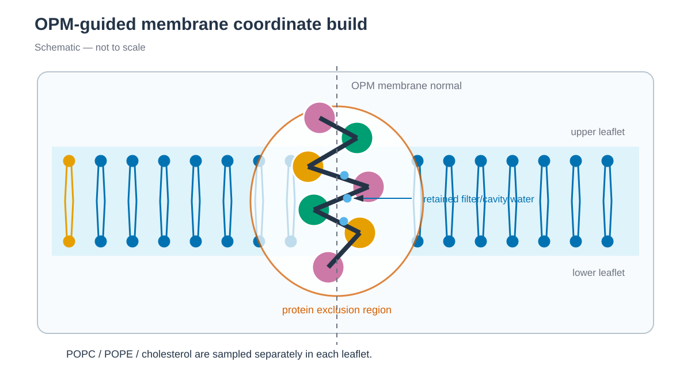

# Stage 1: coordinate build / 1단계: coordinate build

*OPM membrane normal을 유지하면서 protein exclusion 영역 밖에 두 leaflet을 배치합니다. / Two leaflets are placed outside the protein exclusion region while retaining the OPM membrane normal.*

## 한국어

OPM에서 membrane normal에 맞춰 배향한 KcsA를 equilibration된 Lipid21 bilayer에 삽입합니다.
나머지 lipid를 무작위로 채우지 않고, 기존 bilayer unit cell을 x·y 방향으로 복제합니다.

### 파일 역할

| 파일 | 역할 |
| --- | --- |
| `download.sh` | OPM KcsA 구조와 Lipid21 bilayer coordinate를 `structure/`에 받습니다. |
| `prepare.py` | OPM 1K4C에서 KcsA tetramer, filter K+와 water를 선택하고 3EFF side chain으로 missing atom을 채웁니다. |
| `run.sh` | Composition과 padding 설정을 정하고 `build_membrane.py`를 호출합니다. |
| `build_membrane.py` | Bilayer unit cell 복제, protein 삽입, overlap lipid 제거와 POPE·cholesterol 치환을 수행합니다. `run.sh`가 자동으로 호출합니다. |

`download.sh`가 받는 input은 다음과 같습니다.

| 파일 | 용도 |
| --- | --- |
| `1K4C-opm.pdb` | OPM 기준으로 membrane에 배치된 2.0 Å KcsA 구조입니다. Membrane boundary는 z=±15.0 Å입니다. |
| `3EFF-opm.pdb` | 1K4C에서 빠진 Ser22 OG와 Arg117 side chain의 초기 conformer를 가져옵니다. |
| `POPC.gro`, `POPE.gro`, `CHOL15.gro` | 공개 Lipid21 bilayer coordinate입니다. |

`prepare.py`는 OPM 1K4C의 chain C·F·I·L을 KcsA tetramer로 선택합니다.
Filter K+ 7개와 filter·cavity water 16개를 유지하고, Fab과 bulk crystal water는 제거합니다.
Neutral-pH baseline은 E71=`GLH`, D80=`ASP`, H25=`HIE`, E118/E120=`GLU`입니다.
Side chain이 불완전한 terminal H124는 제외합니다.

1K4C의 Ser22 OG와 Arg117 side chain은 tleap이 만들게 두지 않습니다.
`prepare.py`가 closed KcsA 3EFF의 해당 side chain을 residue local backbone에 alignment해 추가합니다.
tleap internal coordinate만 사용하면 Arg117이 이웃 subunit과 비물리적으로 겹칠 수 있습니다.

`build_membrane.py`는 protein x·y 크기와 padding으로 필요한 unit-cell 복제 수를 계산합니다.
Protein과 겹치는 lipid를 분자 단위로 제거한 뒤 POPC 일부를 POPE와 cholesterol로 치환합니다.
Protein footprint가 leaflet마다 다르므로 lipid 수를 인위적으로 맞추지 않습니다.

### 실행

~~~bash
cd 1_Simulation/1_MD/1.3_Membrane_Protein/1_Coordinate_Build
./download.sh
python3 prepare.py \
    structure/1K4C-opm.pdb \
    work/kcsa.pdb \
    structure/3EFF-opm.pdb
./run.sh work/kcsa.pdb
~~~

이 단계는 Python 3, NumPy와 `curl`만 사용하고 GPU를 쓰지 않습니다.
`work/system-coordinates.pdb`가 이미 있으면 빈 파일이어도 `run.sh`가 거부합니다.
Input인 `work/kcsa.pdb`는 이 검사에서 제외합니다. 실행 상태와 재실행은
[GUIDE.md 부록](../../../../GUIDE.md#4-부록-실행-상태와-복구)을 참고합니다.

### 주요 output

정상 종료하면 마지막 줄에 `Coordinate build output: work/system-coordinates.pdb`가
출력됩니다. KcsA에서 box는 124.072×124.686×105.054 Å, leaflet 조성은 upper 186/10/10과
lower 196/11/11 POPC/POPE/cholesterol입니다.
정수로 반올림하므로 정확히 90%/5%/5%가 아닐 수 있습니다.

VMD 등으로 protein orientation, leaflet, lipid tail piercing, hydrophobic
core의 bulk water, filter K+·water를 확인한 뒤 2단계로 넘어갑니다.

### 주요 option

`run.sh` 상단에서 다음 값을 바꿉니다.

| 값 | 기본값 | 의미 |
| --- | ---: | --- |
| `composition` | `POPC=90,POPE=5,CHOL=5` | 각 leaflet의 목표 지질 비율입니다. |
| `xy_padding` | 25 Å | Protein 폭에 더해 unit-cell 복제 수를 정합니다. |
| `water_padding` | 20 Å | Protein z 경계 밖의 water 두께입니다. |
| `protein_lipid_distance` | 2.0 Å | Protein heavy atom과 이 거리 안에 든 lipid를 제거합니다. |

Cholesterol은 box 경계에서 5 Å 안쪽의 lipid만 치환 후보로 쓰고,
이웃 lipid heavy atom과 1.8 Å, 모든 atom과 0.9 Å 이상 떨어진
배향을 15° 간격으로 찾습니다. 이 값은
ring이 periodic boundary를 관통하는 초기 구조를 피하기 위한 geometry
조건입니다.

### 다른 protein에 적용

`build_membrane.py`는 KcsA residue number를 사용하지 않습니다. 다른 OPM
protein에도 사용하려면 system에 맞는 preparation script로 assembly,
missing atom, protonation과 보존할 ligand를 먼저 정리합니다. Protein은 OPM
orientation을 유지하고 다음 형식의 첫 줄을 포함해야 합니다.

~~~text
REMARK OPM MEMBRANE HALF-THICKNESS 15.000 ANGSTROM
~~~

Builder는 membrane normal이 z인 orthorhombic system만 다룹니다. OPM data가
없을 때 protein orientation을 예측하는 기능은 포함하지 않습니다.

### PACKMOL과 coordinate builder

Membrane system은 PACKMOL이나 PACKMOL-Memgen으로도 만들 수 있습니다.
여러 분자를 지정한 영역에 배치할 수 있어 lipid 종류와 조성을 바꾸기
편리합니다. Packing으로 만든 coordinate는 protein–lipid contact,
periodic boundary의 lipid piercing과 initial energy를 별도로 확인해야 합니다.

이 tutorial에서는 PACKMOL input을 제공하지 않고 `build_membrane.py`를
사용합니다. OPM orientation과 equilibration된 Lipid21 bilayer patch를 활용해
box, overlap cutoff과 lipid 치환 과정을 code에서 직접 확인하고 수정할 수
있게 구성했습니다.

### 자주 생기는 문제

| Message | 조치 |
| --- | --- |
| `Cannot import NumPy. Activate the ambertools26 environment.` | NumPy가 있는 환경을 불러옵니다. |
| `Bilayer coordinate input missing: structure/POPC.gro. Run ./download.sh first.` | `download.sh`를 먼저 실행합니다. |
| `KcsA PDB not found: work/kcsa.pdb` | `prepare.py`를 먼저 실행합니다. |
| `Too few cholesterol replacement sites are far from the box edges.` | Box 경계에서 떨어진 치환 후보가 부족합니다. `xy_padding`을 늘리거나 `composition`의 cholesterol 비율을 줄입니다. |
| `Coordinate build output already exists` | Message의 `mv` command로 기존 output을 옮긴 뒤 다시 실행합니다. |

## English

This stage inserts KcsA, oriented along the membrane normal by OPM, into
replicated, equilibrated Lipid21 bilayer patches. It tiles an existing bilayer
unit cell in x and y instead of randomly packing the remaining lipids.

### File roles

| File | Role |
| --- | --- |
| `download.sh` | Downloads the OPM KcsA structures and Lipid21 bilayer coordinates into `structure/`. |
| `prepare.py` | Selects the KcsA tetramer, filter K+ ions, and waters from OPM 1K4C and fills missing atoms from 3EFF side chains. |
| `run.sh` | Sets composition and padding and calls `build_membrane.py`. |
| `build_membrane.py` | Replicates the bilayer unit cell, inserts the protein, removes overlapping lipids, and substitutes POPE and cholesterol. Called automatically by `run.sh`. |

`download.sh` retrieves these inputs:

| File | Purpose |
| --- | --- |
| `1K4C-opm.pdb` | The 2.0 Å KcsA structure positioned in the membrane by OPM. The membrane boundary is z=±15.0 Å. |
| `3EFF-opm.pdb` | Source conformers for Ser22 OG and the Arg117 side chain missing from 1K4C. |
| `POPC.gro`, `POPE.gro`, `CHOL15.gro` | Public Lipid21 bilayer coordinates. |

`prepare.py` selects chains C, F, I, and L of OPM 1K4C as the KcsA tetramer. It
keeps seven filter K+ ions and 16 filter/cavity waters and removes the Fab and
bulk crystallographic waters. The neutral-pH baseline is E71=`GLH`, D80=`ASP`,
H25=`HIE`, and E118/E120=`GLU`. Terminal H124 is omitted because its side chain is
incomplete.

The missing Ser22 OG and Arg117 side-chain atoms are not left for tleap to build.
`prepare.py` aligns the corresponding side chains of closed KcsA 3EFF on the local
residue backbone. With tleap internal coordinates alone, Arg117 can overlap a
neighboring subunit unphysically.

`build_membrane.py` derives the number of x/y unit-cell copies from the protein
size and padding. It removes complete overlapping lipids and then converts part of
the POPC to POPE and cholesterol. It preserves the natural leaflet asymmetry
produced by the protein footprint instead of forcing equal lipid counts.

### Running

~~~bash
cd 1_Simulation/1_MD/1.3_Membrane_Protein/1_Coordinate_Build
./download.sh
python3 prepare.py \
    structure/1K4C-opm.pdb \
    work/kcsa.pdb \
    structure/3EFF-opm.pdb
./run.sh work/kcsa.pdb
~~~

This step uses only Python 3, NumPy, and `curl`; it does not use a GPU.
An existing `work/system-coordinates.pdb`, even an empty one, makes `run.sh`
refuse to build. The prepared input `work/kcsa.pdb` is exempt. See
[GUIDE.md appendix](../../../../GUIDE.md#4-appendix-run-state-and-recovery) for run state and reruns.

### Main output

A successful run ends with
`Coordinate build output: work/system-coordinates.pdb`. The default KcsA box is
124.072×124.686×105.054 Å, with 186/10/10 POPC/POPE/cholesterol in the upper
leaflet and 196/11/11 in the lower leaflet. Integer molecule counts mean that the
composition may differ slightly from exactly 90%/5%/5%.

Inspect protein orientation, leaflets, lipid-tail piercing, bulk water in the
hydrophobic core, and the filter K+ ions and waters, for example in VMD, before
moving to stage 2.

### Key options

Edit these values near the top of `run.sh`.

| Value | Default | Meaning |
| --- | ---: | --- |
| `composition` | `POPC=90,POPE=5,CHOL=5` | Target lipid fractions in each leaflet. |
| `xy_padding` | 25 Å | Added to the protein width to set the number of unit-cell copies. |
| `water_padding` | 20 Å | Water thickness beyond the protein z boundary. |
| `protein_lipid_distance` | 2.0 Å | Lipids within this distance of protein heavy atoms are removed. |

Cholesterol substitution uses only lipids at least 5 Å inside the box boundary.
Orientations are searched in 15° steps and must stay at least 1.8 Å from
neighboring lipid heavy atoms and 0.9 Å from all atoms. These geometric conditions
avoid initial structures in which a ring pierces the periodic boundary.

### Using another protein

The builder itself does not use KcsA residue numbers. Another OPM protein can be
supplied after a system-specific preparation step has selected the assembly,
repaired missing atoms, assigned protonation, and kept required ligands. The
protein must keep its OPM orientation and start with a line of this form:

~~~text
REMARK OPM MEMBRANE HALF-THICKNESS 15.000 ANGSTROM
~~~

The builder assumes an orthorhombic system with the membrane normal along z; it
does not predict orientation when OPM data are absent.

### PACKMOL and coordinate builders

PACKMOL and PACKMOL-Memgen can also construct membrane systems and are useful
when changing molecular components or lipid composition. Their packed
coordinates still require inspection for protein–lipid contacts, lipid piercing
across periodic boundaries, and initial energy.

This tutorial does not provide PACKMOL inputs. It instead provides
`build_membrane.py`, so learners can inspect and modify how OPM orientation and
equilibrated Lipid21 patches set the box, overlap cutoffs, and lipid
substitution.

### Common problems

| Message | Action |
| --- | --- |
| `Cannot import NumPy. Activate the ambertools26 environment.` | Load an environment that provides NumPy. |
| `Bilayer coordinate input missing: structure/POPC.gro. Run ./download.sh first.` | Run `download.sh` first. |
| `KcsA PDB not found: work/kcsa.pdb` | Run `prepare.py` first. |
| `Too few cholesterol replacement sites are far from the box edges.` | Too few substitution candidates lie away from the box edges. Increase `xy_padding` or lower the cholesterol fraction in `composition`. |
| `Coordinate build output already exists` | Move the existing output with the `mv` command in the message and rerun. |

## References / 참고 자료

- [RCSB PDB 1K4C](https://www.rcsb.org/structure/1K4C)
- [RCSB PDB 3EFF](https://www.rcsb.org/structure/3EFF)
- [OPM database](https://opm.phar.umich.edu/)
- [Lipid21](https://doi.org/10.1021/acs.jctc.1c01217)
- [PACKMOL-Memgen](https://doi.org/10.1021/acs.jcim.9b00269)
- [PACKMOL user guide](https://m3g.github.io/packmol/userguide.shtml)
