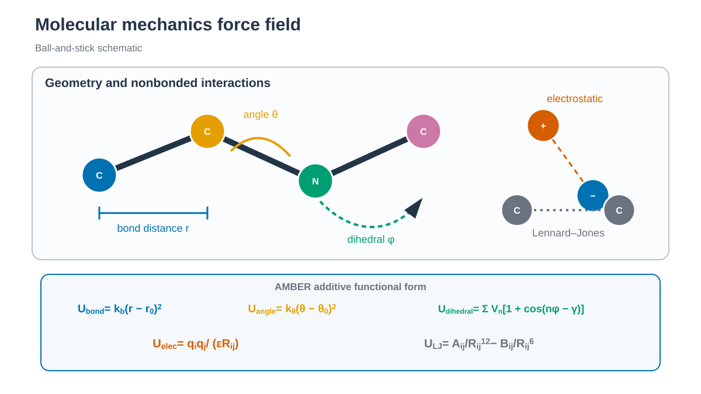

# System-based conventional MD / 시스템별 일반 MD

*Bond, angle, dihedral과 nonbonded interaction이 force-field energy를 구성합니다. / Bonded and nonbonded terms make up the force-field energy.*

## 한국어

세 가지 system으로 AMBER conventional MD를 연습합니다. Production은 모두
1 ns이며 workflow 학습을 위한 길이입니다.

Conventional MD는 추가 bias나 replica 교환 없이 선택한 force field의
Hamiltonian으로 시간에 따른 원자 운동을 계산합니다. Minimization으로 큰 steric
clash를 줄이고, heating에서 velocity를 만든 뒤, equilibration에서 온도와 밀도를
안정화하고 production trajectory를 수집합니다.

위 그림은 AMBER의 기본 additive force-field 식을 bond, angle, dihedral,
electrostatic과 Lennard-Jones 항으로 나눠 표시합니다. 실제 energy는 topology에
정의된 모든 bonded term과 nonbonded atom pair에 대해 합산됩니다.

| System | 구조 | 추가 요소 |
| --- | --- | --- |
| [수용성 단백질](1.1_Soluble_Protein/README.md) | chignolin (PDB 1UAO) | 기준 workflow |
| [단백질–리간드](1.2_Protein_Ligand/README.md) | T4 lysozyme–JZ4 (PDB 3HTB) | GAFF2/AM1-BCC ligand parameter |
| [막 단백질](1.3_Membrane_Protein/README.md) | KcsA (PDB 1K4C) | Lipid21 bilayer, anisotropic pressure coupling |

각 `download.sh`가 RCSB 구조와 checksum을 저장합니다. Protonation, missing
atom, 결정학적 첨가물과 force field는 build 전에 확인합니다. 세 system 모두
OPC를 사용하며, KcsA에는 Lipid21을 추가합니다. 기본 engine은 `pmemd.cuda`입니다.

Download와 전처리 구조는 `structure/`, AMBER control file은 `inputs/`, 생성된
topology·restart·trajectory는 `work/`에 둡니다. 각 system README가 script의
input, output과 주요 option을 설명합니다.

### 준비 사항

| 필요한 것 | 사용하는 곳 |
| --- | --- |
| Bash 4.4 이상, `curl`, Python 3 | 모든 `download.sh`, `prepare.py`와 자동 호출되는 `helpers/` |
| AmberTools 26 `tleap`, `cpptraj` | 모든 topology build와 이후 analysis |
| AmberTools 26 `antechamber`, `parmchk2` | 1.2 `prepare.sh`의 JZ4 parameter |
| NumPy | 1.3 `1_Coordinate_Build/run.sh` |
| Amber 26 `pmemd.cuda`와 NVIDIA GPU | 기본 MD engine입니다. 다른 executable은 `AMBER_ENGINE`으로 지정합니다. |

설치는 [저장소 README](../../README.md)의 AmberTools 26 설치 section을 따릅니다.

### 계산량

| System | Engine 실행 | Dynamics 길이 | `production.nc` |
| --- | --- | --- | --- |
| 1.1 Chignolin | 5회: minimization 2, heating, equilibration, production | 0.2 + 0.1 + 1.0 = 1.3 ns | 100 frame |
| 1.2 T4 lysozyme–JZ4 | 5회: 1.1과 같음 | 1.3 ns | 100 frame |
| 1.3 KcsA | 7회: minimization 2, heating, equilibration 3, production | 0.2 + 0.1 + 1.0 = 1.3 ns | 100 frame |

Stage는 순서대로 실행되고, 각 stage는 `pmemd.cuda` process 하나가 GPU 하나로
계산합니다. 실행 시간은 GPU와 atom 수에 따라 달라집니다. KcsA membrane system은
atom 수가 가장 많고 12 Å cutoff를 사용합니다.

### 결과 판단

다음은 conventional MD 결과를 볼 때의 일반적인 확인 순서입니다. 적정 범위는
system마다 다르므로 숫자 기준 대신 추세를 봅니다([Grossfield et al., 2018](https://doi.org/10.33011/livecoms.1.1.5067)).

- `heat.out`, `equil*.out`, `production.out`의 `TEMP(K)`가 목표 온도 주변에서 요동하는지 봅니다.
- NPT stage의 `Density`와 `VOLUME`이 한 방향으로 계속 변하지 않는지 봅니다.
- `Etot` 평균이 production 동안 한 방향으로 drift하지 않는지 봅니다.
- [2_Analysis](../../2_Analysis/README.md)의 RMSD가 plateau에 도달하는지 봅니다. 1 ns에서 plateau가 보여도 수렴을 뜻하지 않습니다.

### 자주 생기는 문제

세 system의 `run.sh`는 같은 message를 출력합니다.

| Message | 조치 |
| --- | --- |
| `AMBER engine not found: pmemd.cuda` | Amber 26 환경을 불러오거나 `AMBER_ENGINE`에 executable을 지정합니다. |
| `Run preflight: topology or restart missing` | Build 단계(`build.sh`, 1.3은 `2_Topology_Build/run.sh`)를 먼저 실행합니다. |
| `<stage> failed; engine output: work/<stage>.out` | 함께 출력된 마지막 20줄과 `work/engine.<stage>.log`를 봅니다. Heating에서 바로 실패하면 `leap.log`와 초기 구조의 atom overlap을 먼저 확인합니다. |
| `Partial <stage> output is retained` | Message의 `mv` command로 남은 파일을 옮긴 뒤 같은 command를 다시 실행합니다. |
| `input changed` | 실행 뒤 `inputs/*.in`이나 topology를 고쳤습니다. `mv work work.old` 후 그 `work`를 만든 단계부터 다시 실행합니다. |
| `output already exists` (build 단계) | 이미 build한 `work`입니다. `mv work work.old` 후 다시 build합니다. |

실행 상태, 실패 후 재실행, 동시 실행 보호는 [GUIDE.md 부록](../../GUIDE.md#4-부록-실행-상태와-복구)을
참고합니다.

## English

Three systems cover the basic AMBER conventional-MD workflow. Each production
run is 1 ns, a length chosen for learning the workflow.

Conventional MD propagates one force-field Hamiltonian without an added bias or
replica exchange. Minimization removes large steric clashes, heating creates
velocities, equilibration stabilizes temperature and density, and production
collects the trajectory.

The figure separates the basic additive AMBER force-field expression into bond,
angle, dihedral, electrostatic, and Lennard-Jones terms. The actual energy sums
these terms over the bonded interactions and nonbonded atom pairs defined by the
topology.

| System | Structure | Added element |
| --- | --- | --- |
| [Soluble protein](1.1_Soluble_Protein/README.md) | chignolin (PDB 1UAO) | Baseline workflow |
| [Protein–ligand](1.2_Protein_Ligand/README.md) | T4 lysozyme–JZ4 (PDB 3HTB) | GAFF2/AM1-BCC ligand parameters |
| [Membrane protein](1.3_Membrane_Protein/README.md) | KcsA (PDB 1K4C) | Lipid21 bilayer, anisotropic pressure coupling |

Each `download.sh` records the RCSB source and checksum. Check protonation,
missing atoms, crystallographic additives, and force-field choices before the
build. All three systems use OPC, and KcsA additionally uses Lipid21. The default
engine is `pmemd.cuda`.

Source and prepared structures use `structure/`, AMBER control files use
`inputs/`, and generated topology, restart, and trajectory files use `work/`.
Each system README documents its scripts, inputs, outputs, and key options.

### Prerequisites

| Requirement | Used by |
| --- | --- |
| Bash 4.4 or newer, `curl`, Python 3 | Every `download.sh`, `prepare.py`, and the automatically called `helpers/` |
| AmberTools 26 `tleap`, `cpptraj` | Every topology build and the later analysis |
| AmberTools 26 `antechamber`, `parmchk2` | JZ4 parameters in 1.2 `prepare.sh` |
| NumPy | 1.3 `1_Coordinate_Build/run.sh` |
| Amber 26 `pmemd.cuda` and an NVIDIA GPU | Default MD engine; `AMBER_ENGINE` selects another executable. |

Follow the AmberTools 26 installation section of the
[repository README](../../README.md).

### Computational cost

| System | Engine runs | Dynamics length | `production.nc` |
| --- | --- | --- | --- |
| 1.1 Chignolin | 5: two minimizations, heating, equilibration, production | 0.2 + 0.1 + 1.0 = 1.3 ns | 100 frames |
| 1.2 T4 lysozyme–JZ4 | 5: same as 1.1 | 1.3 ns | 100 frames |
| 1.3 KcsA | 7: two minimizations, heating, three equilibrations, production | 0.2 + 0.1 + 1.0 = 1.3 ns | 100 frames |

Stages run in order, each as one `pmemd.cuda` process on one GPU. Run time
depends on the GPU and the atom count. The KcsA membrane system has the most
atoms and uses a 12 Å cutoff.

### Judging the result

This is a general checking order for conventional MD. Acceptable ranges depend
on the system, so look at trends rather than fixed numbers
([Grossfield et al., 2018](https://doi.org/10.33011/livecoms.1.1.5067)).

- `TEMP(K)` in `heat.out`, `equil*.out`, and `production.out` fluctuates around the target temperature.
- `Density` and `VOLUME` in NPT stages do not keep drifting in one direction.
- The mean `Etot` does not drift in one direction during production.
- The RMSD from [2_Analysis](../../2_Analysis/README.md) reaches a plateau. A plateau within 1 ns does not mean convergence.

### Common problems

The three `run.sh` scripts print the same messages.

| Message | Action |
| --- | --- |
| `AMBER engine not found: pmemd.cuda` | Load the Amber 26 environment or set `AMBER_ENGINE` to an executable. |
| `Run preflight: topology or restart missing` | Run the build step first (`build.sh`; `2_Topology_Build/run.sh` for 1.3). |
| `<stage> failed; engine output: work/<stage>.out` | Read the last 20 lines printed with it and `work/engine.<stage>.log`. If heating fails immediately, check `leap.log` and atom overlaps in the starting structure first. |
| `Partial <stage> output is retained` | Move the retained files with the `mv` command in the message and rerun the same command. |
| `input changed` | `inputs/*.in` or the topology was edited after a run. Run `mv work work.old` and restart from the step that created that `work`. |
| `output already exists` (build step) | `work` already holds a build. Run `mv work work.old` and build again. |

See [GUIDE.md appendix](../../GUIDE.md#4-appendix-run-state-and-recovery) for run state, reruns after failure and
concurrent-run protection.
