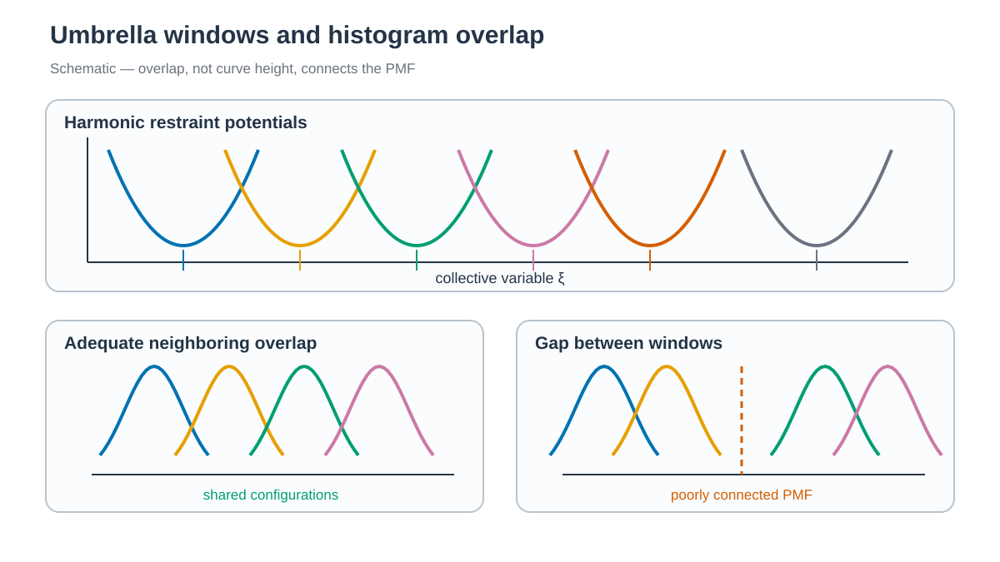

# Ratchet MD and umbrella sampling / Ratchet MD와 US



*인접 window의 histogram이 겹쳐야 CV 구간 사이의 PMF를 연결할 수 있습니다. / Neighboring histograms must overlap to connect the PMF across the CV range.*

## 한국어

Chignolin terminal Cα distance를 CV로 사용해 umbrella sampling을 실행합니다.

Umbrella sampling은 하나의 trajectory가 넘기 어려운 reaction-coordinate 영역을
여러 harmonic window로 나누어 sampling합니다.
Window마다 biased distribution을 얻은 뒤 overlap을 확인하고 WHAM 같은 estimator로 unbiased PMF를 복원합니다.
이 예제에서는 ratchet MD가 window 초기 구조만 공급하며 PMF에는 umbrella production만 사용합니다.

1. PLUMED `ABMD`를 이용한 ratchet MD에서 thermal fluctuation으로 end-to-end distance가 증가하는 경로를 생성합니다.
2. Ratchet MD trajectory에서 ordered seed를 추출하고, 모두 동일한 AMBER topology를 사용하는 umbrella window를 실행합니다.

Ratchet MD는 target-directed simulation이지만 constant-velocity pulling과는 다릅니다.
목표 방향의 thermal fluctuation은 허용하고 반대 방향 fluctuation은 ratchet-and-pawl bias로 억제합니다.
Conventional Steered MD는 이 tutorial에서 다루지 않습니다.

### 준비 사항

| 필요한 것 | 사용하는 곳 |
| --- | --- |
| Bash 4.4 이상, `curl`, Python 3 | `download.sh`, `prepare.py`, `rmd/anal.py`와 자동 호출되는 `helpers/` |
| AmberTools 26 `tleap`, `cpptraj` | `prepare.sh`, `rmd/anal.py` |
| `plumed=1`을 지원하도록 PLUMED와 연결한 AMBER engine | `rmd/run.sh`. PLUMED input은 PLUMED 2.10 manual 기준입니다. |
| Amber 26 `pmemd.cuda`와 NVIDIA GPU | `us/run.sh`(PLUMED 불필요)와 `rmd/run.sh`의 기본 engine. 다른 executable은 `AMBER_ENGINE`으로 지정합니다. |
| NumPy | PMF analysis(`2_Analysis/7_Enhanced_Sampling/7.1_Umbrella_Sampling`) |

설치는 [저장소 README](../../README.md)의 AmberTools 26 설치 section을 따릅니다.

### Script 흐름

| 위치 | 역할 |
| --- | --- |
| `download.sh` | RCSB에서 1UAO PDB/mmCIF를 받고 checksum을 저장합니다. |
| `prepare.py` | 첫 NMR model을 선택해 Chignolin PDB를 만듭니다. |
| `prepare.sh` | Ratchet MD와 모든 window가 공유할 ff19SB/OPC topology를 만듭니다. |
| `rmd/run.sh` | ABMD pathway를 생성합니다. |
| `rmd/anal.py` | Ordered first-crossing frame을 umbrella seed로 추출합니다. |
| `us/build.sh` | Seed, 공통 topology와 restraint로 19개 window를 만듭니다. |
| `us/run.sh` | Window별 restrained simulation을 실행합니다. |

```bash
cd 1_Simulation/2_US
./download.sh
python3 prepare.py structure/1UAO.raw.pdb structure/chignolin.pdb
./prepare.sh structure/chignolin.pdb

cd rmd
./run.sh
python3 anal.py

cd ../us
./build.sh
./run.sh
```

- [Ratchet MD와 seed 추출](rmd/README.md)
- [Umbrella window](us/README.md)

실행 상태, 실패 후 재실행, 동시 실행 보호는 [GUIDE.md 부록](../../GUIDE.md#4-부록-실행-상태와-복구)을
참고합니다. 서로 다른 window의 `us/run.sh`는 함께 실행할 수 있습니다.

### 공통 topology

`prepare.sh`가 만든 ff19SB/OPC `system.parm7`을 ratchet MD와 모든 umbrella
window가 공유합니다. Window별 solvation은 하지 않습니다. CV, atom index,
ABMD target, window 범위와 force constant는 chignolin용 설정입니다.

`inputs/tleap.in`은 20 Å OPC buffer를 추가한 뒤 atom center로 계산한 box에
0.25 Å padding을 둡니다. AmberTools 26에서 초기 density는 약
0.93 g/cm³였고, 0.8 Å 미만의 periodic overlap은 없었습니다. Padding을
제거하거나 box를 더 줄이면 반대편 water가 겹칠 수 있습니다.

Histogram overlap, PMF와 uncertainty는
[`2_Analysis/7_Enhanced_Sampling/`](../../2_Analysis/7_Enhanced_Sampling/README.md)에서
계산합니다.

### 계산량

| 단계 | Engine 실행 | Dynamics 길이 |
| --- | --- | --- |
| `rmd/run.sh` | 5회: minimization 2, heating, equilibration, ratchet MD | 0.2 + 0.1 + 1.0 = 1.3 ns |
| `us/run.sh` | Window 19개 × 4회(minimization, heating, equilibration, production) = 76회 | Window당 0.2 + 0.1 + 1.0 = 1.3 ns, 합계 24.7 ns(production 19 ns) |

각 engine 실행은 `pmemd.cuda` process 하나가 GPU 하나로 계산합니다. `us/run.sh`는
window를 차례로 실행합니다. GPU가 여러 개이면 `./run.sh --window N`을 별도
process로 실행하고, 각 process가 쓸 GPU를 scheduler나 `CUDA_VISIBLE_DEVICES`로
정합니다. 실행 시간은 GPU에 따라 달라집니다.

### 결과 판단

다음은 US 결과를 볼 때 일반적으로 쓰는 확인 항목입니다([Kästner, 2011](https://doi.org/10.1002/wcms.66);
[Grossfield et al., 2018](https://doi.org/10.33011/livecoms.1.1.5067)).

- `rmd/work/ratchet.dat`의 distance가 6–24 Å window 범위를 모두 지나가야 seed를 고를 수 있습니다.
- 각 window의 `distance.dat` 분포가 center 근처에 있고, 인접 window histogram이 겹치는지 analysis의 `overlap.tsv`로 봅니다.
- Production 앞·뒤 절반으로 각각 계산한 PMF가 비슷한지 비교합니다. 차이가 크면 window당 sampling이 부족합니다.

### 자주 생기는 문제

| Message | 조치 |
| --- | --- |
| `AMBER engine not found: pmemd.cuda` | Amber 환경을 불러오거나 `AMBER_ENGINE`에 executable을 지정합니다. |
| `Run ../prepare.sh first.` | 상위 directory에서 `prepare.sh`를 먼저 실행합니다. |
| `Partial <stage> output is retained` | Message의 `mv` command로 남은 파일을 옮긴 뒤 같은 command를 다시 실행합니다. |
| `input changed` | 실행 뒤 input이나 topology를 고쳤습니다. 해당 `work`를 옮기고 그 단계부터 다시 실행합니다. |

`rmd/`와 `us/`에만 해당하는 message는 각 README에 있습니다.

## English

The terminal Cα distance of chignolin is the CV for umbrella sampling.

Umbrella sampling partitions a difficult reaction-coordinate range into
harmonically restrained windows. Overlapping biased distributions are later
combined, for example with WHAM, to recover an unbiased PMF. Ratchet MD supplies
only starting structures here; PMF estimation uses umbrella production data.

1. PLUMED ABMD ratchet MD generates a pathway along which thermal fluctuations
   increase the end-to-end distance.
2. Ordered seeds are extracted from that trajectory and run as umbrella windows
   that all share one AMBER topology.

Ratchet MD belongs broadly to target-directed or steered simulations, but it
is not constant-velocity pulling. The ratchet-and-pawl bias permits motion
toward the target and damps backward fluctuations. This repository does not
provide a separate conventional Steered-MD tutorial.

### Prerequisites

| Requirement | Used by |
| --- | --- |
| Bash 4.4 or newer, `curl`, Python 3 | `download.sh`, `prepare.py`, `rmd/anal.py`, and the automatically called `helpers/` |
| AmberTools 26 `tleap`, `cpptraj` | `prepare.sh`, `rmd/anal.py` |
| AMBER engine linked with PLUMED so that `plumed=1` works | `rmd/run.sh`; the PLUMED input follows the PLUMED 2.10 manual. |
| Amber 26 `pmemd.cuda` and an NVIDIA GPU | Default engine for `us/run.sh` (no PLUMED needed) and `rmd/run.sh`; `AMBER_ENGINE` selects another executable. |
| NumPy | PMF analysis (`2_Analysis/7_Enhanced_Sampling/7.1_Umbrella_Sampling`) |

Follow the AmberTools 26 installation section of the
[repository README](../../README.md).

### Script flow

| Location | Role |
| --- | --- |
| `download.sh` | Downloads the 1UAO PDB/mmCIF from RCSB and records checksums. |
| `prepare.py` | Selects the first NMR model as the chignolin PDB. |
| `prepare.sh` | Builds the ff19SB/OPC topology shared by ratchet MD and every window. |
| `rmd/run.sh` | Generates the ABMD pathway. |
| `rmd/anal.py` | Extracts ordered first-crossing frames as umbrella seeds. |
| `us/build.sh` | Creates 19 windows from the seeds, shared topology, and restraints. |
| `us/run.sh` | Runs the restrained simulation of each window. |

```bash
cd 1_Simulation/2_US
./download.sh
python3 prepare.py structure/1UAO.raw.pdb structure/chignolin.pdb
./prepare.sh structure/chignolin.pdb

cd rmd
./run.sh
python3 anal.py

cd ../us
./build.sh
./run.sh
```

- [Ratchet MD and seed extraction](rmd/README.md)
- [Umbrella windows](us/README.md)

See [GUIDE.md appendix](../../GUIDE.md#4-appendix-run-state-and-recovery) for run state, reruns after failure and
concurrent-run protection. `us/run.sh` for different windows can run together.

### Shared topology

The ff19SB/OPC `system.parm7` created by `prepare.sh` is shared by ratchet MD and
every umbrella window. Seed frames are not resolvated. The CV, atom indices,
ABMD target, window range, and restraint strength are specific to chignolin.

`inputs/tleap.in` adds a 20 Å OPC buffer and defines the periodic box from atom
centers with 0.25 Å padding. With AmberTools 26 this produced an initial density
of about 0.93 g/cm³ without periodic contacts below 0.8 Å. Removing the padding
or shrinking the box further can overlap waters across opposite box faces.

Histogram overlap, PMF estimation, and uncertainty are handled under
[`2_Analysis/7_Enhanced_Sampling/`](../../2_Analysis/7_Enhanced_Sampling/README.md).

### Computational cost

| Step | Engine runs | Dynamics length |
| --- | --- | --- |
| `rmd/run.sh` | 5: two minimizations, heating, equilibration, ratchet MD | 0.2 + 0.1 + 1.0 = 1.3 ns |
| `us/run.sh` | 19 windows × 4 (minimization, heating, equilibration, production) = 76 | 1.3 ns per window, 24.7 ns in total (19 ns production) |

Each engine run is one `pmemd.cuda` process on one GPU. `us/run.sh` runs the
windows one after another. With several GPUs, start `./run.sh --window N` as
separate processes and assign each process its GPU through the scheduler or
`CUDA_VISIBLE_DEVICES`. Run time depends on the GPU.

### Judging the result

These are common checks for umbrella sampling
([Kästner, 2011](https://doi.org/10.1002/wcms.66);
[Grossfield et al., 2018](https://doi.org/10.33011/livecoms.1.1.5067)).

- The distance in `rmd/work/ratchet.dat` must pass through the whole 6–24 Å window range before seeds can be selected.
- Each window's `distance.dat` stays near its center, and neighboring histograms overlap; check `overlap.tsv` from the analysis.
- PMFs computed separately from the first and second halves of production agree. A large difference means each window needs more sampling.

### Common problems

| Message | Action |
| --- | --- |
| `AMBER engine not found: pmemd.cuda` | Load the Amber environment or set `AMBER_ENGINE` to an executable. |
| `Run ../prepare.sh first.` | Run `prepare.sh` in the parent directory first. |
| `Partial <stage> output is retained` | Move the retained files with the `mv` command in the message and rerun the same command. |
| `input changed` | An input or the topology was edited after a run. Move that `work` aside and restart that step. |

Messages specific to `rmd/` and `us/` are listed in their READMEs.

## References / 참고 자료

- [PLUMED 2.10 ABMD](https://www.plumed.org/doc-v2.10/user-doc/html/_a_b_m_d.html)
- [PLUMED 2.10 DISTANCE](https://www.plumed.org/doc-v2.10/user-doc/html/_d_i_s_t_a_n_c_e.html)
- [RCSB PDB 1UAO](https://www.rcsb.org/structure/1UAO)
