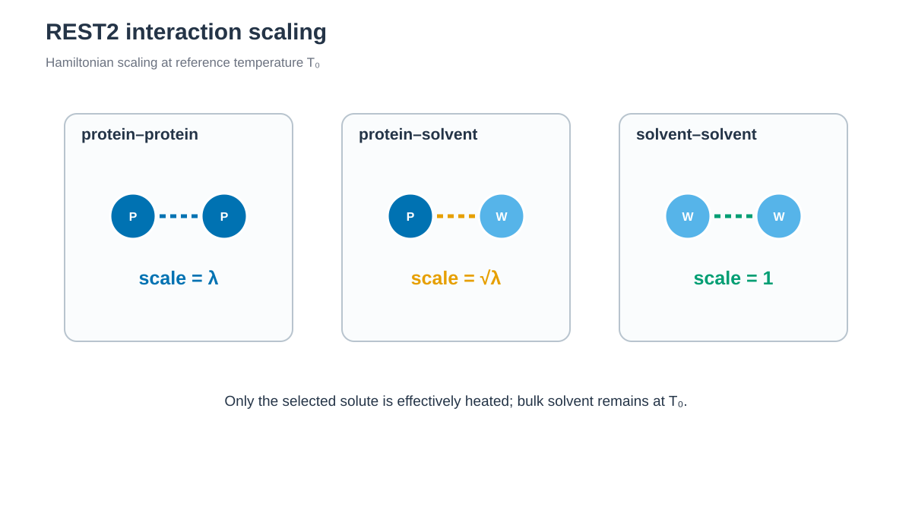

# REST2



*Solute interaction만 단계적으로 scaling하고 bulk solvent interaction은 기준 온도에 유지합니다. / Solute interactions are scaled while bulk-solvent interactions remain at the reference temperature.*


## 한국어

Chignolin을 ff19SB/OPC로 만들고 8-replica REST2를 실행합니다. Protein
Hamiltonian만 300–450 K effective temperature에 맞춰 scaling하며 실제 bath
temperature는 300 K입니다. Equilibration은 100 ps, production은 replica당
1 ns이고 교환은 2 ps마다 시도합니다.

REST2는 전체 solvent를 실제로 가열하지 않고 solute–solute interaction을
`λ=T0/Tm`, solute–solvent interaction을 `sqrt(λ)`로 scaling합니다. Solvent–
solvent interaction은 그대로 유지하므로 T-REMD보다 적은 replica로 solute의
effective-temperature ladder를 구성할 수 있습니다.

### Script 역할

| 파일 | 역할 |
| --- | --- |
| `download.sh` | 1UAO PDB/mmCIF를 받고 checksum을 기록합니다. |
| `prepare.py` | 1UAO의 첫 NMR model을 simulation PDB로 정리합니다. |
| `convert_topology.py` | Tleap의 AMBER topology를 GROMACS 형식으로 변환합니다. |
| `mark_hot.py` | Protein atom type에만 `partial_tempering` marker를 붙입니다. |
| `scale_cmap.py` | ff19SB의 residue별 CMAP section을 복원하고 energy grid를 `lambda`로 scaling합니다. |
| `generate_states.py` | Effective-temperature 목록에서 `lambda_pp`, `lambda_pw`와 seed를 포함한 state table을 생성합니다. `build.sh`가 자동 호출합니다. |
| `validate_states.py` | 생성된 state table의 각 row와 λ 관계를 검사하고 잘못된 column을 표시합니다. |
| `net_charge.py` | `_` marker atom의 charge와 `lambda_pp`로 replica별 예상 net charge를 `work/net_charge.tsv`에 기록합니다. `build.sh`가 자동 호출합니다. |
| `grompp_utils.bash` | `run.sh`가 source하는 `run_grompp`입니다. 예상 net-charge warning 하나만 `-maxwarn 1`로 허용합니다. |
| `build.sh` | Temperature file을 state table로 변환하고 row마다 scaled topology와 MDP input을 만듭니다. Build의 TPR은 processed topology를 만드는 preprocessing용과 scale-one energy 검사용이며, 계산용 TPR은 `run.sh`가 만듭니다. |
| `compare_energy.py` | 원본과 scale 1.0 rerun potential 차이를 허용 오차와 비교합니다. |
| `run.sh` | 300 K pre-production과 PLUMED-patched GROMACS HREX를 실행합니다. |
| `anal.py` | Exchange, occupancy와 effective-temperature별 구조 지표를 계산합니다. |

### 실행

준비 사항: [family README의 준비 사항](../README.md#준비-사항)에 있는
PLUMED-patched `GROMACS 2024.3`(`gmx`, `gmx_mpi`)과 MPI launcher, AMBER 26
`tleap`, PLUMED CLI `plumed`, `requirements.txt`의 ParmEd·MDAnalysis·numpy가
필요합니다.

```bash
python3 -m pip install -r requirements.txt
./download.sh
python3 prepare.py structure/1UAO.raw.pdb structure/chignolin.pdb
./build.sh structure/chignolin.pdb
./run.sh --cpus 48 --gpus 8
python3 anal.py
```

`build.sh`는 `TLEAP`, `GROMACS`, `PLUMED`를, `run.sh`는 `GROMACS`,
`GROMACS_MPI`, `MPI_LAUNCHER`를 executable override로 읽습니다.

### 계산 resource와 길이

| 항목 | 값 |
| --- | --- |
| Replica | 8개(`inputs/temperatures.txt`의 값 개수) |
| `--cpus N` | Job에 할당한 총 CPU thread입니다. 8의 배수여야 하며 replica마다 `N/8` thread(`-ntomp`)를 씁니다. |
| `--gpus N` | 1–8입니다. Minimization과 equilibration은 replica를 최대 N개씩 동시에 `gmx mdrun -ntmpi 1 -gpu_id (replica index mod N)`로 실행합니다. |
| Production | `mpirun -np 8 gmx_mpi mdrun -multidir work/000 … work/007 -hrex -replex 1000`입니다. Replica마다 external-MPI rank 하나를 쓰고 `-gpu_id 0,…,N-1`의 GPU에 rank가 배치됩니다. |
| Replica당 길이 | Minimization 최대 5,000 steps, equilibration 50,000 steps × 2 fs = 100 ps, production 500,000 steps × 2 fs = 1 ns |
| 전체 길이 | Equilibration 0.8 ns, production 8 ns(8 replica 합계) |
| Exchange | 1,000 steps(2 ps)마다 시도합니다. 짝수/홀수 neighbour pair를 번갈아 시도하므로 pair당 약 250회입니다. |

`--gpus 1`로도 실행할 수 있지만 8개 replica가 GPU 하나를 공유하므로 느립니다.
Scheduler는 할당한 GPU만 `CUDA_VISIBLE_DEVICES`에 노출해야 합니다. Script의
`-gpu_id 0,1,...`은 그 안에서 다시 매겨진 logical device ID입니다.

실행 상태, 실패 후 재실행, 동시 실행 보호는 [GUIDE.md 부록](../../../GUIDE.md#4-부록-실행-상태와-복구)을
참고합니다.

### Topology scaling

`build.sh`는 AMBER topology를 ParmEd로 GROMACS 형식으로 바꾼 뒤 protein
atom type에만 `_` marker를 붙입니다. PLUMED `partial_tempering`으로
8개 topology를 만들고, scale 1.0 topology와 원본 topology의 potential
energy를 한 frame rerun으로 비교합니다.

이 Chignolin tutorial의 허용값은 `0.1 kJ/mol`이며 범용 기준이 아닙니다.
System 크기, GROMACS precision, hardware와 병렬 energy 합산 순서가 달라지면 같은
topology에서도 수치 차이가 달라질 수 있습니다. NaN/Inf energy, overflow한 차이
또는 음수·non-finite tolerance는 검증 실패이며 기존 비교 output을 교체하지 않습니다.

ff19SB는 residue별 backbone CMAP을 사용합니다. `convert_topology.py`는
ParmEd 변환 중 이 map들이 하나의 `XC` type으로 합쳐지지 않도록 C-alpha
type을 `XC0`, `XC1`처럼 분리합니다. GROMACS 2024.3은
`atomtype-residuetype` CMAP 문법을 지원하지 않으므로 `[ cmaptypes ]`에는
`C N XC0 C N`처럼 atom type만 기록합니다. 고유한 central C-alpha type이
residue별 grid를 구분합니다.

`scale_cmap.py`는 PLUMED가 처리하지 않는 CMAP grid를 각 REST2 state에 맞게
보정합니다. 첫 `grompp` 전에는 ParmEd가 출력한 긴 CMAP 실수도 GROMACS
2024.x가 읽을 수 있는 정밀도로 정규화합니다. `_` marker는 `[ atoms ]`의
nonbonded type에만 붙이고 CMAP bonded type은 바꾸지 않습니다.

### Output

`run.sh`가 `Completed 1 ns REST2: work`를 출력하고 `work/.production.complete`와
모든 `work/NNN/production.gro`가 있으면 production이 끝난 것입니다. 다음 command는
`python3 anal.py`이며 마지막 줄은 `REST2 Analysis results: work`입니다.

| 파일 | 내용 |
| --- | --- |
| `work/NNN/topol.top`, `work/net_charge.tsv` | State별 scaled topology와 예상 net charge |
| `work/NNN/production.xtc` | State NNN의 trajectory입니다. 10 ps 간격이며 시작 frame을 포함해 101 frames입니다. |
| `work/NNN/production.log` | GROMACS log와 exchange 기록 |
| `work/exchange_summary.tsv` | Neighbour state pair별 `attempts`, `accepted`, `ratio` |
| `work/replica_visits.tsv` | Walker별 `min_state`, `max_state`, `round_trips` |
| `work/state_occupancy.tsv` | Walker별 각 state 방문 횟수와 `fraction` |
| `work/structure_by_temperature.tsv` | State별 frame 수, Rg와 protein 양 끝 residue의 Cα distance |

각 `work/NNN`은 effective temperature가 고정된 state입니다. 교환이 accept되면
configuration이 state 사이를 이동하므로 `production.xtc`에는 여러 walker가
섞여 있습니다. `anal.py`의 `replica` column은 state 000–007에서 출발한
walker identity입니다.

`round_trips`는 처음 도달한 endpoint에서 반대 endpoint를 방문한 뒤 처음
endpoint로 돌아온 cycle 수입니다. 편도 이동과 같은 endpoint의 반복 방문은
왕복으로 세지 않습니다.

REST2의 높은 effective temperature에서 나타나는 compaction은 mini-protein
folding sampling을 돕기 위해 사용되어 온 method 특성입니다. 짧은 Chignolin
계산만으로 force field 성능이나 수렴을 판단하지 않습니다.

### Exchange 품질 해석

`anal.py`는 `work/000/production.log`의 `Repl ex` line을 읽습니다. 이 line은
exchange 시도 때마다 현재 replica 순서를 출력하고, 두 label 사이의 `x`가 그
state 경계의 accepted exchange입니다. Run이 끝나면 log 끝의
`Repl average probabilities`에 neighbour pair별 평균 acceptance가 나옵니다.
이 값과 `exchange_summary.tsv`의 `ratio`는 같은 경향이어야 합니다.

| 확인 | 기준 |
| --- | --- |
| `exchange_summary.tsv`의 `ratio` | 0에 가까운 pair가 없어야 합니다. 한 pair만 낮으면 그 구간의 temperature 간격이 넓습니다. |
| `replica_visits.tsv` | 각 walker의 `min_state=0`, `max_state=7`이 이상적입니다. `round_trips`가 모두 0이면 ladder 전체를 왕복하지 못한 것입니다. |
| `state_occupancy.tsv` | 한 walker가 일부 state에만 머물면 state space가 분리된 것입니다. |

목표 acceptance와 round trip의 일반 기준은
[family README의 Exchange 품질 해석](../README.md#exchange-품질-해석)을
참고합니다. 모든 pair의 acceptance가 거의 0이면 PLUMED patch version을
[family README의 준비 사항](../README.md#준비-사항)과 비교합니다. 1 ns에서는
pair당 시도가 약 250회뿐이므로 ratio는 경향만 보여줍니다.

### 주요 option

| Option | 의미 |
| --- | --- |
| `temperatures.txt` | Effective-temperature ladder를 정의합니다. 값의 개수가 replica 수가 되며 bath temperature는 바뀌지 않습니다. |
| `build.sh INPUT.pdb` | 첫 argument의 PDB와 bundled `inputs/temperatures.txt`로 `work/states.tsv`를 생성합니다. |
| Protein `_` marker | `partial_tempering`이 scaling할 hot region을 protein atom으로 제한합니다. |
| `ref-t=300`, `tcoupl=v-rescale`, `tau-t=1.0` | 모든 replica의 physical thermostat는 300 K이고 coupling time은 1.0 ps입니다. |
| `pcoupl=C-rescale`, `ref-p=1.0`, `tau-p=5.0` | Equilibration과 production을 1.0 bar NPT로 계산합니다. Coupling time은 5.0 ps입니다. |
| `nsteps` | Minimization 최대 5,000(`emtol=1000` kJ/mol/nm), equilibration 50,000(100 ps), production 500,000(1 ns)입니다. |
| `-multidir`, `-replex 1000` | 8개 directory를 HREX로 묶고 1,000 steps, 즉 2 ps마다 교환합니다. |
| `constraints=h-bonds`, `dt=0.002` | LINCS로 수소 bond를 고정하고 2 fs timestep을 사용합니다. |
| `rcoulomb=1.0`, `rvdw=1.0` | PME real-space와 vdW cutoff는 1.0 nm입니다. |
| `nstxout-compressed=5000` | 5,000 steps(10 ps)마다 `production.xtc` frame을 씁니다. |
| `--cpus`, `--gpus` | 할당받은 총 CPU thread와 GPU 수입니다. 규칙은 [계산 resource와 길이](#계산-resource와-길이)에 있습니다. |

### Effective-temperature ladder

기본 `inputs/temperatures.txt`에는 Chignolin용 8-state ladder가 들어 있습니다.
Temperature는 comma, semicolon, vertical bar, space, tab 또는 newline으로
구분할 수 있고 `#` 뒤에는 comment를 쓸 수 있습니다.

아래는 구분자 형식을 보여 주는 예시이며, 실제 file의 값을 소수 셋째 자리로 줄였습니다.

```text
# REST2 effective temperatures in K
300.000, 317.890, 336.847, 356.935
378.220; 400.775 | 424.675 450.000
```

Physical bath가 300 K이므로 첫 temperature는 300 K이어야 하며 이후 값은
증가해야 합니다. `build.sh`는 deterministic seed를 붙여 `work/states.tsv`를
생성하고 `run.sh`는 그 data row 수를 replica 수로 사용합니다.

Replica 수는 2 이상의 짝수여야 합니다. `build.sh`와 `run.sh`는 홀수 schedule을
자동 조정하지 않고 거부하며 `run.sh --dry-run`도 같은 검사를 합니다.

새 system의 `effective_temperature_K`는
[remd-temperature-generator](https://virtualchemistry.org/remd-temperature-generator/)에
hot solute atom 수를 protein atom 수로 넣고 water molecule 수를 0으로 두어
초기 ladder를 만듭니다. Water=0은 solvent 자유도를 predictor에서 제외하는
근사이며 REST2 acceptance를 보장하지 않습니다. 짧은 pilot run에서 adjacent
acceptance, state 방문과 round trip을 확인한 뒤 ladder를 조정합니다.

다른 system에는 `3_Templates/3_REMD/3.2_REST2`를 사용합니다. Template가 각
temperature에서 `lambda_pp=T0/Tm`, `lambda_pw=sqrt(lambda_pp)`를 계산합니다.

### Scaled replica의 net charge

REST는 hot solute atom의 charge만 `sqrt(λ)`로 줄이고 water와 counter-ion은
cold로 둡니다. 따라서 scaled replica에는 `Q_ref + q_hot(sqrt(λ) − 1)`의 net
charge가 생깁니다. `Q_ref`는 unscaled topology의 total charge(변환 roundoff
수준)이고 `q_hot`은 `_` marker가 붙은 atom의 원래 charge 합입니다. Chignolin은
`q_hot = −2 e`이므로 replica 001(λ=0.9437)은 +0.057 e, replica 007
(λ=0.6667)은 +0.367 e입니다. PME에서 GROMACS는 균일한 neutralizing
background를 더하고 Ewald net-charge warning 하나를 출력합니다. Solute만
tempering하는 방식은
[PLUMED HREX tutorial](https://www.plumed.org/doc-v2.9/user-doc/html/hrex.html)과
[REST3 parser 예제](https://github.com/koreyr/repex_topology_parser)를
따릅니다.

`build.sh`는 `net_charge.py`로 replica별 예상 charge를 `work/net_charge.tsv`에
기록합니다. `run.sh`는 `grompp_utils.bash`의 `run_grompp`로 `grompp`를 먼저
`-maxwarn` 없이 실행합니다. 실패하면 warning이 net-charge warning 하나뿐이고
log의 `System has non-zero total charge` 값이 해당 replica 예상값 ±0.01 e일
때만 `-maxwarn 1`로 다시 실행합니다. λ=1인 replica 000은 roundoff만
허용합니다. 다른 warning이나 예상과 다른 charge는 replica, 보고된 charge,
예상 charge와 `*.grompp.log` 경로를 남기고 계산을 중단합니다. Build의
processed topology 생성과 scale-one energy check `grompp`는 warning을 허용하지
않습니다. 이 gate는 실제 GROMACS로 실행하지 않았습니다(미검증).

### 문제 해결

| Message 또는 증상 | 원인 | 조치 |
| --- | --- | --- |
| `--cpus must be a positive multiple of 8.`, `--gpus must be between 1 and 8.` | Resource 값이 규칙에 맞지 않습니다. | `--cpus 48 --gpus 8`처럼 CPU는 8의 배수, GPU는 1–8로 지정합니다. |
| `Build did not complete: work/build.done is missing.` | `build.sh`가 topology 생성이나 scale-one energy check에서 멈췄습니다. | `build.sh` error와 `work/energy_check/` log를 확인하고 `mv work work.old` 후 다시 build합니다. |
| `Scale-one energy check failed` | Scale 1.0 topology와 원본의 potential 차이가 0.1 kJ/mol을 넘습니다. | `work/energy_check/*.xvg`를 비교하고 conversion·CMAP 단계 log를 확인합니다. |
| `GROMACS does not recognize -hrex`, `GROMACS is not patched with PLUMED`, `... needs PLUMED 2.10.2 or later` | `gmx_mpi`가 PLUMED 2.10.2 이상의 GROMACS 2024 patch build가 아닙니다. | [준비 사항](../README.md#준비-사항)대로 다시 build하거나 `GROMACS_MPI`로 올바른 executable을 지정합니다. `-hrex`만 지우고 실행하면 acceptance가 틀립니다. |
| `Production tpr generation failed: work/NNN/production.grompp.log` | 예상 net-charge warning 외의 `grompp` warning이나 다른 charge가 나왔습니다. | 출력된 log 마지막 부분과 `work/net_charge.tsv`를 비교합니다. |
| `REST2 production failed; replica logs: ...` | MPI rank 수, GPU 배치 또는 GROMACS runtime error입니다. | 출력된 각 replica `production.log`를 확인합니다. Partial output 정리는 [GUIDE.md 부록](../../../GUIDE.md#4-부록-실행-상태와-복구)을 따릅니다. |

## English

This example runs eight-state REST2 for ff19SB/OPC Chignolin. Only protein
interactions are scaled over effective temperatures of 300–450 K; the physical
bath remains at 300 K. Equilibration is 100 ps, production is one 1 ns segment
per replica, and exchanges are attempted every 2 ps.

REST2 scales solute–solute interactions by `lambda=T0/Tm` and solute–solvent
interactions by `sqrt(lambda)`, while solvent–solvent interactions remain
physical. This creates a solute effective-temperature ladder with fewer
replicas than T-REMD, without heating the full solvent box.

### Script roles

| File | Role |
| --- | --- |
| `download.sh` | Downloads the 1UAO PDB/mmCIF and records checksums. |
| `prepare.py` | Cleans the first 1UAO NMR model into a simulation PDB. |
| `convert_topology.py` | Converts the tleap AMBER topology to GROMACS format. |
| `mark_hot.py` | Adds the `partial_tempering` marker to protein atom types only. |
| `scale_cmap.py` | Restores the residue-specific ff19SB CMAP sections and scales their energy grids by `lambda`. |
| `generate_states.py` | Builds the state table with `lambda_pp`, `lambda_pw` and seeds from the effective-temperature list. Called by `build.sh`. |
| `validate_states.py` | Checks each row and the λ relations of the state table and reports the invalid column. |
| `net_charge.py` | Writes each replica's expected net charge from the `_`-marked charges and `lambda_pp` to `work/net_charge.tsv`. Called by `build.sh`. |
| `grompp_utils.bash` | Provides `run_grompp`, sourced by `run.sh`. Allows only the expected net-charge warning through `-maxwarn 1`. |
| `build.sh` | Converts the temperature file into a state table and writes scaled topology and MDP inputs for each row. Its TPRs are only for topology preprocessing and the scale-one energy check; `run.sh` creates the run-stage TPRs. |
| `compare_energy.py` | Compares the original and scale-1.0 rerun potentials against the tolerance. |
| `run.sh` | Runs 300 K pre-production and PLUMED-patched GROMACS HREX. |
| `anal.py` | Computes exchange, occupancy and structure metrics per effective temperature. |

### Run

Prerequisites: the PLUMED-patched GROMACS 2024.3 (`gmx`, `gmx_mpi`) and MPI
launcher described in the [family README prerequisites](../README.md#prerequisites),
AMBER 26 `tleap`, the PLUMED CLI `plumed`, and ParmEd, MDAnalysis and
numpy from `requirements.txt`.

```bash
python3 -m pip install -r requirements.txt
./download.sh
python3 prepare.py structure/1UAO.raw.pdb structure/chignolin.pdb
./build.sh structure/chignolin.pdb
./run.sh --cpus 48 --gpus 8
python3 anal.py
```

`build.sh` reads `TLEAP`, `GROMACS` and `PLUMED`, and `run.sh` reads `GROMACS`,
`GROMACS_MPI` and `MPI_LAUNCHER` as executable overrides.

### Resources and length

| Item | Value |
| --- | --- |
| Replicas | 8 (the value count in `inputs/temperatures.txt`) |
| `--cpus N` | Total CPU threads of the job. Must be a multiple of 8; each replica gets `N/8` threads (`-ntomp`). |
| `--gpus N` | 1–8. Minimization and equilibration run up to N replicas at once with `gmx mdrun -ntmpi 1 -gpu_id (replica index mod N)`. |
| Production | `mpirun -np 8 gmx_mpi mdrun -multidir work/000 … work/007 -hrex -replex 1000`: one external-MPI rank per replica, mapped onto `-gpu_id 0,…,N-1`. |
| Length per replica | Minimization up to 5,000 steps, equilibration 50,000 steps × 2 fs = 100 ps, production 500,000 steps × 2 fs = 1 ns |
| Total length | 0.8 ns equilibration and 8 ns production over 8 replicas |
| Exchange | Attempted every 1,000 steps (2 ps). Even and odd neighbour pairs alternate, so each pair gets about 250 attempts. |

`--gpus 1` works, but all eight replicas then share one GPU and run slowly. The
scheduler must expose only the allocated devices through
`CUDA_VISIBLE_DEVICES`; the generated `-gpu_id 0,1,...` values are logical IDs
within that visible set.

See [GUIDE.md appendix](../../../GUIDE.md#4-appendix-run-state-and-recovery) for run state, reruns after failure and
concurrent-run protection.

### Topology scaling

`build.sh` converts the AMBER system with ParmEd, marks only protein atom types
with `_`, creates eight topologies with PLUMED `partial_tempering`, and compares
the scale-one and original potential energies in a one-frame rerun.

This Chignolin tutorial uses a fixed absolute tolerance of `0.1 kJ/mol`. It is
not a universal cutoff: system size, GROMACS precision, hardware and parallel
energy-reduction order can change the difference between equivalent topologies.
Nonfinite energy, an overflowed difference or a negative or nonfinite tolerance fails
validation without replacing existing comparison output.

ff19SB uses residue-specific backbone CMAPs. `convert_topology.py` splits the
C-alpha types into `XC0`, `XC1` and so on so that ParmEd does not merge them
into one `XC` type. GROMACS 2024.3 does not support the
`atomtype-residuetype` CMAP syntax, so `[ cmaptypes ]` headers use atom types
such as `C N XC0 C N`; the unique central C-alpha type selects each residue's
grid.

`scale_cmap.py` scales the CMAP grids, which PLUMED does not handle, for each
REST2 state. Before the first `grompp`, it also normalizes long ParmEd-formatted
CMAP numbers to a precision accepted by GROMACS 2024.x. The `_` marker is limited
to nonbonded atom types in `[ atoms ]`; CMAP lookup keeps the original bonded
types.

### Outputs

Production is complete when `run.sh` prints `Completed 1 ns REST2: work` and
`work/.production.complete` and every `work/NNN/production.gro` exist. The next
command is `python3 anal.py`; its last line is `REST2 Analysis results: work`.

| File | Content |
| --- | --- |
| `work/NNN/topol.top`, `work/net_charge.tsv` | Scaled topology per state and expected net charges |
| `work/NNN/production.xtc` | Trajectory of state NNN: 101 frames every 10 ps, including the first frame |
| `work/NNN/production.log` | GROMACS log with exchange records |
| `work/exchange_summary.tsv` | `attempts`, `accepted` and `ratio` per neighbour state pair |
| `work/replica_visits.tsv` | `min_state`, `max_state` and `round_trips` per walker |
| `work/state_occupancy.tsv` | Visit count and `fraction` of each state per walker |
| `work/structure_by_temperature.tsv` | Frame count, Rg and the Cα distance between the first and last protein residues per state |

Each `work/NNN` is a fixed effective-temperature state. Accepted exchanges move
configurations between states, so each `production.xtc` mixes several walkers.
The `replica` column in the `anal.py` tables is the walker that started in
state 000–007.

`round_trips` counts complete cycles from the first endpoint reached, through
the opposite endpoint, and back to the starting endpoint. One-way movement and
repeated visits to the same endpoint do not count.

High-temperature compaction in REST2 has been used intentionally to assist
mini-protein folding sampling. This short example does not establish
convergence or force-field quality.

### Reading exchange quality

`anal.py` reads the `Repl ex` lines in `work/000/production.log`. Each line
prints the current replica order at an exchange attempt, and an `x` between two
labels marks an accepted exchange across that state boundary. At the end of the
run the log reports `Repl average probabilities` per neighbour pair; it should
follow the same trend as `ratio` in `exchange_summary.tsv`.

| Check | Expectation |
| --- | --- |
| `ratio` in `exchange_summary.tsv` | No pair near zero. A single low pair means that temperature gap is too wide. |
| `replica_visits.tsv` | Ideally every walker reaches `min_state=0` and `max_state=7`. `round_trips` all zero means no walker crossed the whole ladder and back. |
| `state_occupancy.tsv` | A walker confined to a few states indicates a segregated ladder. |

See [Reading exchange quality in the family README](../README.md#reading-exchange-quality)
for target acceptance and round-trip guidance. If every pair is near zero,
compare the PLUMED patch version with the
[family README prerequisites](../README.md#prerequisites). One nanosecond gives
only about 250 attempts per pair, so the ratios show trends only.

### Key options

| Option | Meaning |
| --- | --- |
| `temperatures.txt` | Defines the effective-temperature ladder. The value count sets the replica count; the bath temperature does not change. |
| `build.sh INPUT.pdb` | Writes `work/states.tsv` from the PDB in the first argument and the bundled `inputs/temperatures.txt`. |
| Protein `_` marker | Limits the hot region scaled by `partial_tempering` to protein atoms. |
| `ref-t=300`, `tcoupl=v-rescale`, `tau-t=1.0` | Physical thermostat of 300 K for every replica with a 1.0 ps coupling time. |
| `pcoupl=C-rescale`, `ref-p=1.0`, `tau-p=5.0` | Equilibration and production run at 1.0 bar NPT with a 5.0 ps coupling time. |
| `nsteps` | Minimization up to 5,000 (`emtol=1000` kJ/mol/nm), equilibration 50,000 (100 ps), production 500,000 (1 ns). |
| `-multidir`, `-replex 1000` | Couples the eight directories in HREX and attempts exchanges every 1,000 steps (2 ps). |
| `constraints=h-bonds`, `dt=0.002` | Constrains bonds to hydrogen with LINCS for a 2 fs timestep. |
| `rcoulomb=1.0`, `rvdw=1.0` | PME real-space and vdW cutoffs of 1.0 nm. |
| `nstxout-compressed=5000` | Writes a `production.xtc` frame every 5,000 steps (10 ps). |
| `--cpus`, `--gpus` | Total allocated CPU threads and GPUs; see [Resources and length](#resources-and-length). |

### Effective-temperature ladder

The bundled `inputs/temperatures.txt` contains an eight-state Chignolin ladder,
and the tutorial build always reads it. Values may be separated by commas,
semicolons, vertical bars, spaces, tabs or newlines, and text after `#` is a
comment.

The example below shows the separator format; the values are the bundled ones
rounded to three decimals.

```text
# REST2 effective temperatures in K
300.000, 317.890, 336.847, 356.935
378.220; 400.775 | 424.675 450.000
```

The physical bath is 300 K, so the first temperature must be 300 K and the
rest must increase. `build.sh` assigns deterministic seeds and writes
`work/states.tsv`; `run.sh` uses its data-row count as the replica count.

The replica count must be even and at least two. `build.sh` and `run.sh` reject
odd schedules without adjusting them, and `run.sh --dry-run` applies the same
check.

For a new system, run the
[remd-temperature-generator](https://virtualchemistry.org/remd-temperature-generator/)
with the hot-solute atom count as the protein-atom count and zero water
molecules. This removes solvent degrees of freedom from the predictor and does
not guarantee REST2 acceptance; refine the initial ladder from adjacent
acceptance, state visits and round trips in a pilot run.

Use `3_Templates/3_REMD/3.2_REST2` for another system or ladder; the template
calculates `lambda_pp=T0/Tm` and `lambda_pw=sqrt(lambda_pp)` for each
temperature.

### Net charge of scaled replicas

REST scales only hot solute charges by `sqrt(lambda)`; water and counter-ions
stay cold. A scaled replica therefore carries a net charge of
`Q_ref + q_hot(sqrt(lambda) - 1)`, where `Q_ref` is the total charge of the
unscaled topology (conversion roundoff) and `q_hot` is the unscaled charge of
the atoms carrying the `_` marker. Chignolin has `q_hot = -2 e`, giving
+0.057 e for replica 001 (lambda=0.9437) and +0.367 e for replica 007
(lambda=0.6667). With PME, GROMACS adds a uniform neutralizing background and
prints one Ewald net-charge warning. Tempering only the solute follows the
[PLUMED HREX tutorial](https://www.plumed.org/doc-v2.9/user-doc/html/hrex.html)
and the [REST3 parser examples](https://github.com/koreyr/repex_topology_parser).

`build.sh` writes each replica's expected charge to `work/net_charge.tsv` with
`net_charge.py`. `run.sh` calls `run_grompp` from `grompp_utils.bash`, which
first runs `grompp` without `-maxwarn`. It retries with `-maxwarn 1` only when
the single warning is the net-charge warning and the reported `System has
non-zero total charge` is within 0.01 e of that replica's expected value.
Replica 000 (lambda=1) accepts only conversion roundoff. Any other warning or
charge stops the run and reports the replica, reported charge, expected charge
and `*.grompp.log` path. The build-stage `grompp` calls for the processed
topology and the scale-one energy check accept no warning. This gate has not
been run with real GROMACS (unverified).

### Troubleshooting

| Message or symptom | Cause | Action |
| --- | --- | --- |
| `--cpus must be a positive multiple of 8.`, `--gpus must be between 1 and 8.` | Resource values break the rules. | Use, for example, `--cpus 48 --gpus 8`: CPUs a multiple of 8, GPUs 1–8. |
| `Build did not complete: work/build.done is missing.` | `build.sh` stopped during topology generation or the scale-one energy check. | Read the `build.sh` error and the `work/energy_check/` logs, then `mv work work.old` and rebuild. |
| `Scale-one energy check failed` | The scale-1.0 and original potentials differ by more than 0.1 kJ/mol. | Compare `work/energy_check/*.xvg` and check the conversion and CMAP logs. |
| `GROMACS does not recognize -hrex`, `GROMACS is not patched with PLUMED`, `... needs PLUMED 2.10.2 or later` | `gmx_mpi` is not a GROMACS 2024 build patched with PLUMED 2.10.2 or later. | Rebuild as in the [prerequisites](../README.md#prerequisites) or point `GROMACS_MPI` to the right executable. Removing `-hrex` gives wrong acceptance. |
| `Production tpr generation failed: work/NNN/production.grompp.log` | `grompp` reported a warning other than the expected net-charge warning, or a different charge. | Compare the log tail with `work/net_charge.tsv`. |
| `REST2 production failed; replica logs: ...` | MPI rank count, GPU mapping or a GROMACS runtime error. | Read each listed replica `production.log`. Clean up partial output as in the [GUIDE.md appendix](../../../GUIDE.md#4-appendix-run-state-and-recovery). |
