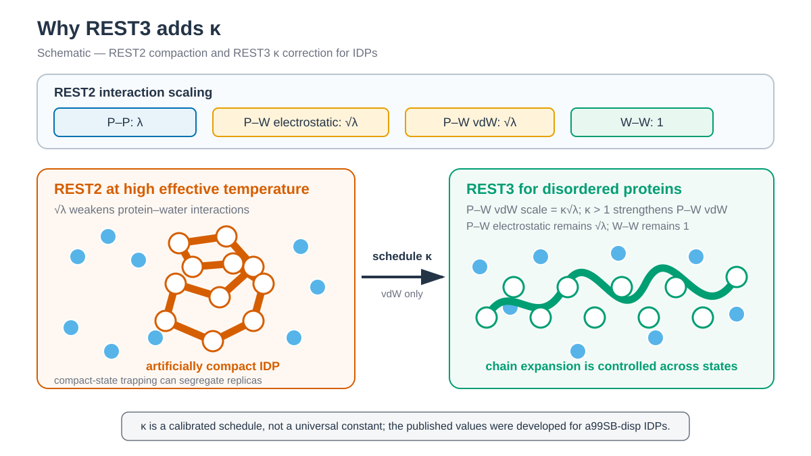

# REST3



*REST2의 `√λ` protein–water scaling은 높은 effective temperature에서 IDP를 인위적으로 compact하게 만들 수 있습니다. REST3는 protein–water vdW 항에 `κ√λ` schedule을 적용해 이 문제를 조절합니다. / REST2's `√λ` protein–water scaling can artificially compact IDPs at high effective temperature. REST3 applies a `κ√λ` schedule to the protein–water vdW term to control this artifact.*


## 한국어

Chignolin을 ff19SB/OPC로 만들고 8-replica solvent-scaled REST3를
실행합니다. Effective temperature는 geometric ladder로 300–450 K를
사용하고 physical thermostat는 300 K입니다. Equilibration은 100 ps,
production은 replica당 1 ns이며 교환은 2 ps마다 시도합니다.

REST2에서 높은 effective temperature state는 `λ=T0/Tm<1`입니다.
Protein–protein interaction은 `λ`, protein–water electrostatic과 vdW interaction은
`√λ`, water–water interaction은 1로 scaling합니다. 이 geometric `√λ` scaling은
높은 state에서 protein–water interaction을 약화합니다. Mini-protein의 reversible
folding을 촉진하려고 의도한 특성이지만, 크고 유연한 IDP에서는 chain이 temperature가
높을수록 오히려 인위적으로 collapse할 수 있습니다. Compact conformation이 높은
state에 trapping되면 낮은 state와 잘 교환되지 않아 replica가 temperature space에서
segregate되고 round trip이 줄어듭니다.

REST3는 protein–water vdW scaling을 `κ√λ`로 바꿉니다. Protein–water
electrostatic은 PME charge scaling 때문에 `√λ`로 유지하고 water–water도 1로
유지합니다. 높은 state에서 `κ>1`을 사용하면 REST2보다 protein–water vdW
interaction이 강해져 IDP chain expansion을 조절하고 artificial collapse와 exchange
bottleneck을 줄일 수 있습니다. `κ=1`이면 REST2와 같습니다. κ는 solvent
temperature가 아니며 system과 force field에 맞춰 정해야 하는 schedule입니다.

| Replica | κ |
| ---: | ---: |
| 0–3 | 1.000 |
| 4 | 1.005 |
| 5 | 1.010 |
| 6 | 1.015 |
| 7 | 1.020 |

### Script 역할

| 파일 | 역할 |
| --- | --- |
| `download.sh` | 1UAO PDB/mmCIF와 외부 parser source를 받고 checksum을 검사합니다. |
| `prepare.py` | 1UAO의 첫 NMR model을 simulation PDB로 정리합니다. |
| `convert_topology.py` | AMBER topology를 GROMACS base topology로 변환하고 protein molecule 이름을 정규화합니다. |
| `generate_states.py` | Temperature와 κ 목록에서 λ와 seed를 포함한 state table을 생성합니다. `build.sh`가 자동 호출합니다. |
| `generate_rest3.py` | 생성된 state table의 λ·κ와 외부 parser로 REST3 topology를 만듭니다. |
| `rest3_parser_adapter.py` | Parser 0.2.2 loading, 출력 정리와 solvent parameter 정밀도 보정을 담당합니다. `generate_rest3.py`가 자동으로 사용합니다. |
| `scale_cmap.py` | 외부 parser가 생략하는 ff19SB의 residue별 CMAP section을 복원하고 grid를 `lambda_pp`로 scaling합니다. |
| `verify_rest3.py` | Base identity, OPC atom type·charge·mass와 water–water/ion–water Lennard-Jones 보존을 검사합니다. |
| `validate_states.py` | State file의 각 row, λ 관계와 기준 κ를 검사합니다. |
| `net_charge.py` | hot molecule 0의 charge와 `lambda_pp`로 replica별 예상 net charge를 `work/net_charge.tsv`에 기록합니다. `build.sh`가 자동 호출합니다. |
| `grompp_utils.bash` | `run.sh`가 source하는 `run_grompp`입니다. 예상 net-charge warning 하나만 `-maxwarn 1`로 허용합니다. |
| `build.sh` | Conversion, processed topology 생성, replica topology 생성과 검사를 순서대로 호출합니다. Build의 TPR은 processed topology를 만드는 preprocessing용이며, 계산용 TPR은 `run.sh`가 만듭니다. |
| `run.sh` | 300 K pre-production과 2 ps 간격 HREX를 실행합니다. |
| `anal.py` | Exchange, occupancy와 state별 Rg/terminal distance를 계산합니다. |

### 실행

준비 사항: [family README의 준비 사항](../README.md#준비-사항)에 있는
PLUMED-patched `GROMACS 2024.3`(`gmx`, `gmx_mpi`)과 MPI launcher, AMBER 26
`tleap`, `requirements.txt`의 ParmEd·MDAnalysis·numpy와 `download.sh`가 받는
`repex-topology-parser==0.2.2` source가 필요합니다. `build.sh`는 `TLEAP`,
`GROMACS`를, `run.sh`는 `GROMACS`, `GROMACS_MPI`, `MPI_LAUNCHER`를 executable
override로 읽습니다.

```bash
python3 -m pip install -r requirements.txt
./download.sh
python3 prepare.py structure/1UAO.raw.pdb structure/chignolin.pdb
./build.sh structure/chignolin.pdb
./run.sh --cpus 48 --gpus 8
python3 anal.py
```

2026년 8월에 확인한 PyPI의 0.2.2 wheel은 parser module을 포함하지 않습니다.
`download.sh`가 공식 source archive를 내려받아 SHA-256 checksum을 검사한 뒤
`dependencies/`에 풉니다. `generate_rest3.py`가 이 위치를 자동으로 읽으므로
별도 parser 설치나 환경 변수 설정은 필요하지 않습니다. 다른 source checkout을
쓸 때만 `REPEX_TOPOLOGY_PARSER_SOURCE`를 지정합니다. Parser download가 중간에
멈추면 `.dependencies.download.pending`이 남습니다.

### 계산 resource와 길이

| 항목 | 값 |
| --- | --- |
| Replica | 8개(`inputs/temperatures.txt`와 `inputs/kappa.txt`의 값 개수) |
| `--cpus N` | Job에 할당한 총 CPU thread입니다. 8의 배수여야 하며 replica마다 `N/8` thread(`-ntomp`)를 씁니다. |
| `--gpus N` | 1–8입니다. Minimization과 equilibration은 replica를 최대 N개씩 동시에 `gmx mdrun -ntmpi 1 -gpu_id (replica index mod N)`로 실행합니다. |
| Production | `mpirun -np 8 gmx_mpi mdrun -multidir work/000 … work/007 -hrex -replex 1000`입니다. Replica마다 external-MPI rank 하나를 쓰고 `-gpu_id 0,…,N-1`의 GPU에 rank가 배치됩니다. |
| Replica당 길이 | Minimization 최대 5,000 steps, equilibration 50,000 steps × 2 fs = 100 ps, production 500,000 steps × 2 fs = 1 ns |
| 전체 길이 | Equilibration 0.8 ns, production 8 ns(8 replica 합계) |
| Exchange | 1,000 steps(2 ps)마다 시도합니다. 짝수/홀수 neighbour pair를 번갈아 시도하므로 pair당 약 250회입니다. |

`--gpus 1`로도 실행할 수 있지만 8개 replica가 GPU 하나를 공유하므로 느립니다.
Scheduler는 할당한 GPU만 `CUDA_VISIBLE_DEVICES`에 노출해야 하며 `-gpu_id`는 그
안의 logical device ID입니다.

실행 상태, 실패 후 재실행, 동시 실행 보호는 [GUIDE.md 부록](../../../GUIDE.md#4-부록-실행-상태와-복구)을
참고합니다.

### REST3 topology 생성

`generate_rest3.py`는 protein molecule index 0을 hot molecule로 지정하고
OPC oxygen type `OW`에 κ scaling을 적용합니다. OPC의 massless extra point
`EP`는 별도로 scaling하지 않습니다. 고정 κ를 재현하기 위해
각 target state를 2-state `ssrest3` 변환으로 생성합니다. `build.sh`는
replica 0 topology가 base topology와 byte 단위로 같은지 확인하고 OPC의
O/H1/H2/EP atom type·charge·mass 및 water–water/ion–water Lennard-Jones
parameter가 보존되는지 검사합니다.

Parser 0.2.2는 solvent override의 σ와 ε를 소수점 4자리로 출력합니다.
`rest3_parser_adapter.py`는 같은 mixing rule을 double precision으로 계산해 16자리로
기록합니다. 따라서 κ가 적용되는 protein–water interaction은 바뀌지만 explicit
override가 필요한 water–water와 ion–water parameter는 base topology 값을
유지합니다.

Adapter는 parser의 molecule index를 `[ moleculetype ]` definition에 맞춥니다.
같은 molecule 이름이 `[ molecules ]`의 여러 row에 나타나도 definition을 한 번만
선택하며, row 순서와 개수 및 coordinate file의 atom 순서는 바꾸지 않습니다.

ParmEd는 여러 residue로 이루어진 첫 molecule을 기본적으로 `system1`이라고
기록합니다. Parser 0.2.2는 이 이름을 `[ system ]` section으로 잘못 인식하므로
`convert_topology.py`가 첫 molecule의 definition과 reference를
`Protein_chain_A`로 바꿉니다. Atom, residue와 force-field parameter는 바꾸지
않습니다.

ff19SB의 residue-specific CMAP은 ParmEd 변환 전에 서로 다른 C-alpha
atom type으로 분리합니다. GROMACS 2024.3의 `[ cmaptypes ]` header에는
`C N XC0 C N`처럼 atom type만 기록하며, 고유한 central C-alpha type이 각
residue의 grid를 구분합니다. `repex-topology-parser` 0.2.2는 CMAP section을
생성하지 않으므로 `scale_cmap.py`가 원래 bonded type의 CMAP을 넣고 energy
grid를 `lambda_pp`로 scaling합니다. 첫 `grompp` 전에는 ParmEd가 출력한 긴
CMAP 실수도 GROMACS 2024.x가 읽을 수 있는 정밀도로 정규화합니다. REST3의
scaled nonbonded atom type은 CMAP lookup에 사용하지 않습니다.
`verify_rest3.py`는 이 값도 base topology와 비교합니다.

### Output

`run.sh`가 `Completed 1 ns REST3: work`를 출력하고 `work/.production.complete`와
모든 `work/NNN/production.gro`가 있으면 production이 끝난 것입니다. 다음 command는
`python3 anal.py`이며 마지막 줄은 `REST3 Analysis results: work`입니다.

| 파일 | 내용 |
| --- | --- |
| `work/NNN/topol.top`, `work/net_charge.tsv` | State별 REST3 topology와 예상 net charge |
| `work/NNN/production.xtc` | State NNN의 trajectory입니다. 10 ps 간격이며 시작 frame을 포함해 101 frames입니다. |
| `work/NNN/production.log` | GROMACS log와 exchange 기록 |
| `work/exchange_summary.tsv` | Neighbour state pair별 `attempts`, `accepted`, `ratio` |
| `work/replica_visits.tsv` | Walker별 `min_state`, `max_state`, `round_trips` |
| `work/state_occupancy.tsv` | Walker별 각 state 방문 횟수와 `fraction` |
| `work/structure_by_temperature.tsv` | State별 frame 수, Rg와 protein 양 끝 residue의 Cα distance |

각 `work/NNN`은 λ·κ가 고정된 state이므로 `production.xtc`에는 여러 walker가
섞여 있습니다. `anal.py`의 `replica` column은 state 000–007에서 출발한 walker
identity입니다.

`round_trips`는 처음 도달한 endpoint에서 반대 endpoint를 방문한 뒤 처음
endpoint로 돌아온 cycle 수입니다. 편도 이동과 같은 endpoint의 반복 방문은
왕복으로 세지 않습니다.

### Exchange 품질 해석

`anal.py`는 `work/000/production.log`의 `Repl ex` line을 읽습니다. 이 line은
exchange 시도 때마다 현재 replica 순서를 출력하고, 두 label 사이의 `x`가 그
state 경계의 accepted exchange입니다. Run이 끝나면 log 끝의
`Repl average probabilities`에 neighbour pair별 평균 acceptance가 나옵니다.
이 값과 `exchange_summary.tsv`의 `ratio`는 같은 경향이어야 합니다.

| 확인 | 기준 |
| --- | --- |
| `exchange_summary.tsv`의 `ratio` | 0에 가까운 pair가 없어야 합니다. κ가 1보다 커지는 state 3–7 사이 pair만 낮으면 κ 간격이나 temperature 간격을 조정합니다. |
| `replica_visits.tsv` | 각 walker의 `min_state=0`, `max_state=7`이 이상적입니다. `round_trips`가 모두 0이면 ladder 전체를 왕복하지 못한 것입니다. |
| `state_occupancy.tsv` | 한 walker가 높은 state에만 머물면 compact conformation trapping을 의심합니다. |

목표 acceptance와 round trip의 일반 기준은
[family README의 Exchange 품질 해석](../README.md#exchange-품질-해석)을
참고합니다. 모든 pair의 acceptance가 거의 0이면 PLUMED patch version을
[family README의 준비 사항](../README.md#준비-사항)과 비교합니다. 1 ns에서는
pair당 시도가 약 250회뿐이므로 ratio는 경향만 보여줍니다.

### 주요 option

| Option | 의미 |
| --- | --- |
| `lambda_pp`, `lambda_pw` | Protein–protein과 protein–water scaling factor입니다. Geometric temperature ladder에서 계산합니다. |
| `kappa` | Protein–water vdW의 `√λ` scaling에 곱하는 REST3 correction입니다. `κ=1`은 REST2이고, 이 예제에서는 높은 state에서 1.005–1.020을 사용합니다. |
| `build.sh INPUT.pdb` | 첫 argument의 PDB와 bundled temperature/κ 목록으로 `work/states.tsv`를 생성합니다. |
| `kappa_atom_names=['OW']` | OPC oxygen type만 κ scaling 대상으로 지정합니다. Water molecule 전체를 hot molecule로 지정하는 option이 아닙니다. |
| `-replex 1000` | 2 fs timestep에서 2 ps마다 Hamiltonian 교환을 시도합니다. |
| `ref-t=300`, `tcoupl=v-rescale`, `tau-t=1.0` | 모든 replica의 physical thermostat는 300 K이고 coupling time은 1.0 ps입니다. |
| `pcoupl=C-rescale`, `ref-p=1.0`, `tau-p=5.0` | Equilibration과 production을 1.0 bar NPT로 계산합니다. Coupling time은 5.0 ps입니다. |
| `nsteps`, `dt=0.002` | Minimization 최대 5,000(`emtol=1000` kJ/mol/nm), equilibration 50,000(100 ps), production 500,000(1 ns)입니다. |
| `nstxout-compressed=5000` | 5,000 steps(10 ps)마다 `production.xtc` frame을 씁니다. |
| `--cpus`, `--gpus` | 할당받은 총 CPU thread와 GPU 수입니다. 규칙은 [계산 resource와 길이](#계산-resource와-길이)에 있습니다. |

### Temperature와 κ schedule

기본 `inputs/temperatures.txt`는 Chignolin용 8-state ladder이고
`inputs/kappa.txt`는 이 예제의 κ schedule입니다. Tutorial build는 항상 이
bundled file을 읽습니다. 두 file 모두 comma, semicolon, vertical bar, space,
tab 또는 newline으로 값을 구분할 수 있고 `#` 뒤에는 comment를 쓸 수 있습니다.

아래는 구분자 형식을 보여 주는 예시이며, 실제 file의 값을 소수 셋째 자리로 줄였습니다.

```text
# temperatures.txt
300.000, 317.890, 336.847, 356.935
378.220; 400.775 | 424.675 450.000

# kappa.txt
1.000, 1.000, 1.000, 1.000
1.005; 1.010; 1.015; 1.020
```

첫 temperature는 300 K이고 이후 값은 증가해야 합니다. κ는 모두 1.0 이상이어야
하며 첫 값은 1.0이어야 합니다. Template은 첫 값을 검사하지 않습니다. 두 목록의 값 개수는 같아야 합니다. Temperature만으로
κ가 결정되지는 않습니다. `build.sh`는 λ와 deterministic seed를 계산해
`work/states.tsv`를 만들며 `run.sh`는 data row 수를 replica 수로 사용합니다.

Replica 수는 2 이상의 짝수여야 합니다. `build.sh`와 `run.sh`는 홀수 schedule을
자동 조정하지 않고 거부하며 `run.sh --dry-run`도 같은 검사를 합니다.

새 system에서는 REST2와 같이
[remd-temperature-generator](https://virtualchemistry.org/remd-temperature-generator/)에
hot solute atom 수와 water molecule 수 0을 입력한 결과를 λ ladder의 출발점으로
사용할 수 있습니다. 그러나 generator는 κ-dependent solute–water vdW scaling을
modeling하지 않습니다. Predicted exchange probability를 REST3 값으로 해석하지
말고 κ schedule을 적용한 pilot run의 adjacent acceptance와 round trip으로
state 간격을 검증합니다. 다른 system이나 schedule은
`3_Templates/3_REMD/3.3_REST3`를 사용합니다.

### 해석 범위

이 κ schedule은 a99SB-disp를 사용한 IDP 계산에서 보정된 published
schedule을 8개 state에 적용한 것입니다. ff19SB/OPC Chignolin에 검증된
parameter가 아닙니다. REST2의 높은 effective temperature에서 나타나는
compaction은 mini-protein folding을 돕기 위해 의도적으로 사용된 특성이므로,
이 예제는 Chignolin에서 REST3가 REST2보다 우수하다고 가정하지 않습니다.

### Scaled replica의 net charge

REST는 hot solute atom의 charge만 `sqrt(λ)`로 줄이고 water와 counter-ion은
cold로 둡니다. 따라서 scaled replica에는 `Q_ref + q_hot(sqrt(λ) − 1)`의 net
charge가 생깁니다. `Q_ref`는 unscaled topology의 total charge(변환 roundoff
수준)이고 `q_hot`은 parser의 hot molecule 0(protein) atom의 원래 charge
합입니다. Chignolin은 `q_hot = −2 e`이므로 replica 001(λ=0.9437)은 +0.057 e,
replica 007(λ=0.6667)은 +0.367 e입니다. PME에서 GROMACS는 균일한
neutralizing background를 더하고 Ewald net-charge warning 하나를 출력합니다.
Solute만 tempering하는 방식은
[PLUMED HREX tutorial](https://www.plumed.org/doc-v2.9/user-doc/html/hrex.html)과
[REST3 parser 예제](https://github.com/koreyr/repex_topology_parser)를
따릅니다.

`build.sh`는 `net_charge.py`로 replica별 예상 charge를 `work/net_charge.tsv`에
기록합니다. `run.sh`는 `grompp_utils.bash`의 `run_grompp`로 `grompp`를 먼저
`-maxwarn` 없이 실행합니다. 실패하면 warning이 net-charge warning 하나뿐이고
log의 `System has non-zero total charge` 값이 해당 replica 예상값 ±0.01 e일
때만 `-maxwarn 1`로 다시 실행합니다. λ=1인 replica 000은 roundoff만
허용합니다. 다른 warning이나 예상과 다른 charge는 replica, 보고된 charge,
예상 charge와 `*.grompp.log` 경로를 남기고 계산을 중단합니다. Build의
processed topology 생성 `grompp`는 warning을 허용하지 않습니다. 이 gate는 실제
GROMACS로 실행하지 않았습니다(미검증).

### 문제 해결

| Message 또는 증상 | 원인 | 조치 |
| --- | --- | --- |
| `repex-topology-parser 0.2.2 module not found. Run ./download.sh before ./build.sh.` | Parser source가 `dependencies/`에 없습니다. | `./download.sh`를 다시 실행합니다. `.dependencies.download.pending`이 남았으면 GUIDE 부록의 download 항목을 따릅니다. |
| `--cpus must be a positive multiple of 8.`, `--gpus must be between 1 and 8.` | Resource 값이 규칙에 맞지 않습니다. | `--cpus 48 --gpus 8`처럼 CPU는 8의 배수, GPU는 1–8로 지정합니다. |
| `Build did not complete: work/build.done is missing.` | `build.sh`가 topology 생성이나 `REST3 topology-preservation check`에서 멈췄습니다. | `build.sh` error를 확인하고 `mv work work.old` 후 다시 build합니다. |
| `GROMACS does not recognize -hrex`, `GROMACS is not patched with PLUMED`, `... needs PLUMED 2.10.2 or later` | `gmx_mpi`가 PLUMED 2.10.2 이상의 GROMACS 2024 patch build가 아닙니다. | [준비 사항](../README.md#준비-사항)대로 다시 build하거나 `GROMACS_MPI`로 올바른 executable을 지정합니다. `-hrex`만 지우고 실행하면 acceptance가 틀립니다. |
| `Production tpr generation failed: work/NNN/production.grompp.log` | 예상 net-charge warning 외의 `grompp` warning이나 다른 charge가 나왔습니다. | 출력된 log 마지막 부분과 `work/net_charge.tsv`를 비교합니다. |
| `REST3 production failed; replica logs: ...` | MPI rank 수, GPU 배치 또는 GROMACS runtime error입니다. | 출력된 각 replica `production.log`를 확인합니다. Partial output 정리는 [GUIDE.md 부록](../../../GUIDE.md#4-부록-실행-상태와-복구)을 따릅니다. |

## English

This example runs eight-state solvent-scaled REST3 for ff19SB/OPC Chignolin.
It uses a geometric 300–450 K effective-temperature ladder, a fixed kappa
schedule (1.000 for replicas 0–3, then 1.005, 1.010, 1.015 and 1.020) and a 300 K physical thermostat. Equilibration is 100 ps,
production is one 1 ns segment per replica, and exchanges are attempted every
2 ps.

At REST2 state `m`, `lambda=T0/Tm` is below one: protein–protein interactions
are scaled by `lambda`, protein–water electrostatic and vdW interactions by
`sqrt(lambda)`, and water–water interactions remain unscaled. This geometric
protein–water scaling weakens protein–water interactions at high effective
temperature. It was useful for promoting reversible folding of mini-proteins,
but large flexible IDPs can instead collapse artificially. Compact
conformations may then remain trapped at high states, segregating replicas and
reducing temperature round trips.

REST3 replaces only the protein–water vdW factor with `kappa*sqrt(lambda)`.
Protein–water electrostatics remain at `sqrt(lambda)` because of PME charge
scaling, and water–water interactions remain at one. Using `kappa>1` at high
states modestly strengthens protein–water vdW interactions, controls IDP chain
expansion, and can remove the compaction-driven exchange bottleneck. `kappa=1`
recovers REST2. Kappa is a system- and force-field-dependent schedule, not a
solvent temperature or universal value.

### Script roles

| File | Role |
| --- | --- |
| `download.sh` | Downloads the 1UAO PDB/mmCIF and the external parser source, and checks checksums. |
| `prepare.py` | Cleans the first 1UAO NMR model into a simulation PDB. |
| `convert_topology.py` | Converts the AMBER topology into the GROMACS base topology and normalizes the protein molecule name. |
| `generate_states.py` | Builds the state table with lambdas and seeds from the temperature and kappa lists. Called by `build.sh`. |
| `generate_rest3.py` | Builds the REST3 topologies from the state table's lambda/kappa values with the external parser. |
| `rest3_parser_adapter.py` | Handles parser 0.2.2 loading, output cleanup and solvent-parameter precision. Used by `generate_rest3.py`. |
| `scale_cmap.py` | Restores the residue-specific ff19SB CMAP section omitted by the parser and scales its grids by `lambda_pp`. |
| `verify_rest3.py` | Checks base identity, OPC atom types, charges and masses, and preservation of water–water/ion–water Lennard-Jones terms. |
| `validate_states.py` | Checks each state-file row, the lambda relations and the reference kappa. |
| `net_charge.py` | Writes each replica's expected net charge from hot molecule 0 and `lambda_pp` to `work/net_charge.tsv`. Called by `build.sh`. |
| `grompp_utils.bash` | Provides `run_grompp`, sourced by `run.sh`. Allows only the expected net-charge warning through `-maxwarn 1`. |
| `build.sh` | Runs conversion, processed-topology generation, replica-topology generation and checks in order. Its only TPR is the preprocessing file for the processed topology; `run.sh` creates the run-stage TPRs. |
| `run.sh` | Runs 300 K pre-production and HREX with exchanges every 2 ps. |
| `anal.py` | Computes exchange, occupancy, and Rg/terminal distance per state. |

### Run

Prerequisites: the PLUMED-patched GROMACS 2024.3 (`gmx`, `gmx_mpi`) and MPI
launcher described in the [family README prerequisites](../README.md#prerequisites),
AMBER 26 `tleap`, ParmEd, MDAnalysis and numpy from `requirements.txt`, and the
`repex-topology-parser==0.2.2` source fetched by `download.sh`. `build.sh` reads
`TLEAP` and `GROMACS`, and `run.sh` reads `GROMACS`, `GROMACS_MPI` and
`MPI_LAUNCHER` as executable overrides.

```bash
python3 -m pip install -r requirements.txt
./download.sh
python3 prepare.py structure/1UAO.raw.pdb structure/chignolin.pdb
./build.sh structure/chignolin.pdb
./run.sh --cpus 48 --gpus 8
python3 anal.py
```

The PyPI 0.2.2 wheel inspected in August 2026 does not contain the parser
module. `download.sh` downloads the official 0.2.2 source archive, verifies its
SHA-256 checksum, and extracts it under `dependencies/`. No separate parser
installation or environment variable is required. Set
`REPEX_TOPOLOGY_PARSER_SOURCE` only to use another source checkout. An
interrupted parser download leaves `.dependencies.download.pending`.

### Resources and length

| Item | Value |
| --- | --- |
| Replicas | 8 (the value count in `inputs/temperatures.txt` and `inputs/kappa.txt`) |
| `--cpus N` | Total CPU threads of the job. Must be a multiple of 8; each replica gets `N/8` threads (`-ntomp`). |
| `--gpus N` | 1–8. Minimization and equilibration run up to N replicas at once with `gmx mdrun -ntmpi 1 -gpu_id (replica index mod N)`. |
| Production | `mpirun -np 8 gmx_mpi mdrun -multidir work/000 … work/007 -hrex -replex 1000`: one external-MPI rank per replica, mapped onto `-gpu_id 0,…,N-1`. |
| Length per replica | Minimization up to 5,000 steps, equilibration 50,000 steps × 2 fs = 100 ps, production 500,000 steps × 2 fs = 1 ns |
| Total length | 0.8 ns equilibration and 8 ns production over 8 replicas |
| Exchange | Attempted every 1,000 steps (2 ps). Even and odd neighbour pairs alternate, so each pair gets about 250 attempts. |

`--gpus 1` works, but all eight replicas then share one GPU and run slowly. The
scheduler must expose only the allocated devices through
`CUDA_VISIBLE_DEVICES`; `-gpu_id` values are logical IDs within that set.

See [GUIDE.md appendix](../../../GUIDE.md#4-appendix-run-state-and-recovery) for run state, reruns after failure and
concurrent-run protection.

### REST3 topology generation

`generate_rest3.py` makes protein molecule index 0 the hot molecule and applies
kappa scaling to the OPC oxygen type `OW`. The massless OPC extra point `EP` is
not scaled separately. Each target state is generated as a two-state `ssrest3`
transformation to reproduce a fixed kappa. `build.sh` verifies that the
replica 0 topology is byte-identical to the base topology and that OPC
O/H1/H2/EP atom types, charges and masses, and water–water/ion–water
Lennard-Jones parameters are preserved.

Parser 0.2.2 writes solvent nonbonded overrides with only four decimal places.
`rest3_parser_adapter.py` replaces that writer with the same mixing rule
evaluated in double precision and records 16 digits. This keeps explicit
water–water and ion–water overrides equal to the base topology while retaining
the intended kappa-scaled protein–water interaction.

The adapter also matches parser molecule indices to `[ moleculetype ]`
definitions. Repeated names in `[ molecules ]` select the same definition
without changing row order, molecule counts or the atom order in the coordinate
file.

ParmEd names the first multi-residue molecule `system1`, which parser 0.2.2
mistakes for the `[ system ]` section. `convert_topology.py` renames that
molecule definition and reference to `Protein_chain_A` without changing any
atoms, residues or force-field parameters.

The residue-specific ff19SB CMAPs are split into distinct C-alpha atom types
before ParmEd conversion. GROMACS 2024.3 `[ cmaptypes ]` headers use atom types
such as `C N XC0 C N`; each unique central C-alpha type selects its residue's
grid. Parser 0.2.2 omits the CMAP section, so `scale_cmap.py` inserts the CMAP
for the original bonded types and scales its grids by `lambda_pp`. Before the
first `grompp`, it also normalizes long ParmEd-formatted CMAP numbers to a
precision accepted by GROMACS 2024.x. REST3's scaled nonbonded atom types are
not used for CMAP lookup. `verify_rest3.py` compares these values with the base
topology as well.

### Outputs

Production is complete when `run.sh` prints `Completed 1 ns REST3: work` and
`work/.production.complete` and every `work/NNN/production.gro` exist. The next
command is `python3 anal.py`; its last line is `REST3 Analysis results: work`.

| File | Content |
| --- | --- |
| `work/NNN/topol.top`, `work/net_charge.tsv` | REST3 topology per state and expected net charges |
| `work/NNN/production.xtc` | Trajectory of state NNN: 101 frames every 10 ps, including the first frame |
| `work/NNN/production.log` | GROMACS log with exchange records |
| `work/exchange_summary.tsv` | `attempts`, `accepted` and `ratio` per neighbour state pair |
| `work/replica_visits.tsv` | `min_state`, `max_state` and `round_trips` per walker |
| `work/state_occupancy.tsv` | Visit count and `fraction` of each state per walker |
| `work/structure_by_temperature.tsv` | Frame count, Rg and the Cα distance between the first and last protein residues per state |

Each `work/NNN` is a fixed lambda/kappa state, so each `production.xtc` mixes
several walkers. The `replica` column in the `anal.py` tables is the walker
that started in state 000–007.

`round_trips` counts complete cycles from the first endpoint reached, through
the opposite endpoint, and back to the starting endpoint. One-way movement and
repeated visits to the same endpoint do not count.

### Reading exchange quality

`anal.py` reads the `Repl ex` lines in `work/000/production.log`. Each line
prints the current replica order at an exchange attempt, and an `x` between two
labels marks an accepted exchange across that state boundary. At the end of the
run the log reports `Repl average probabilities` per neighbour pair; it should
follow the same trend as `ratio` in `exchange_summary.tsv`.

| Check | Expectation |
| --- | --- |
| `ratio` in `exchange_summary.tsv` | No pair near zero. If only the pairs between states 3 and 7, where kappa rises above one, are low, adjust the kappa or temperature spacing. |
| `replica_visits.tsv` | Ideally every walker reaches `min_state=0` and `max_state=7`. `round_trips` all zero means no walker crossed the whole ladder and back. |
| `state_occupancy.tsv` | A walker confined to high states suggests trapping in compact conformations. |

See [Reading exchange quality in the family README](../README.md#reading-exchange-quality)
for target acceptance and round-trip guidance. If every pair is near zero,
compare the PLUMED patch version with the
[family README prerequisites](../README.md#prerequisites). One nanosecond gives
only about 250 attempts per pair, so the ratios show trends only.

### Key options

| Option | Meaning |
| --- | --- |
| `lambda_pp`, `lambda_pw` | Protein–protein and protein–water scaling factors, computed from the geometric temperature ladder. |
| `kappa` | REST3 correction multiplying the `sqrt(lambda)` protein–water vdW scaling. `kappa=1` is REST2; this example uses 1.005–1.020 at high states. |
| `build.sh INPUT.pdb` | Writes `work/states.tsv` from the PDB in the first argument and the bundled temperature/kappa lists. |
| `kappa_atom_names=['OW']` | Restricts kappa scaling to the OPC oxygen type. It does not make the whole water molecule hot. |
| `-replex 1000` | Attempts Hamiltonian exchanges every 2 ps with a 2 fs timestep. |
| `ref-t=300`, `tcoupl=v-rescale`, `tau-t=1.0` | Physical thermostat of 300 K for every replica with a 1.0 ps coupling time. |
| `pcoupl=C-rescale`, `ref-p=1.0`, `tau-p=5.0` | Equilibration and production run at 1.0 bar NPT with a 5.0 ps coupling time. |
| `nsteps`, `dt=0.002` | Minimization up to 5,000 (`emtol=1000` kJ/mol/nm), equilibration 50,000 (100 ps), production 500,000 (1 ns). |
| `nstxout-compressed=5000` | Writes a `production.xtc` frame every 5,000 steps (10 ps). |
| `--cpus`, `--gpus` | Total allocated CPU threads and GPUs; see [Resources and length](#resources-and-length). |

### Temperature and kappa schedule

The bundled `inputs/temperatures.txt` contains an eight-state Chignolin ladder,
and `inputs/kappa.txt` contains this example's kappa schedule. The tutorial
build always reads these bundled files. Values in either file may be separated
by commas, semicolons, vertical bars, spaces, tabs or newlines; text after `#`
is ignored.

The example below shows the separator format; the temperatures are the bundled
values rounded to three decimals.

```text
# temperatures.txt
300.000, 317.890, 336.847, 356.935
378.220; 400.775 | 424.675 450.000

# kappa.txt
1.000, 1.000, 1.000, 1.000
1.005; 1.010; 1.015; 1.020
```

The first temperature must be 300 K and subsequent temperatures must increase.
Every kappa must be at least 1.0 and the first must be exactly 1.0 (the template
does not check the first value). Both lists must contain
the same number of values. Temperature determines the lambdas but not kappa.
`build.sh` assigns deterministic seeds and writes `work/states.tsv`; `run.sh`
uses its row count as the replica count.

The replica count must be even and at least two. `build.sh` and `run.sh` reject
odd schedules without adjusting them, and `run.sh --dry-run` applies the same
check.

For a new system, a water-zero
[remd-temperature-generator](https://virtualchemistry.org/remd-temperature-generator/)
run using the hot-solute atom count can provide an initial REST2-like lambda
ladder. The predictor does not model REST3's kappa-dependent solute–water vdW
scaling, so do not interpret its predicted probability as a REST3 acceptance
rate; validate and refine the states with a REST3 pilot run. Use
`3_Templates/3_REMD/3.3_REST3` for another system or schedule.

### Scope of interpretation

The published kappa schedule was calibrated for a99SB-disp IDPs and is applied
here to eight states; it is not validated for ff19SB/OPC Chignolin. REST2
compaction at high effective temperature was designed to aid mini-protein
folding, so this example does not assume that REST3 is superior for Chignolin.

### Net charge of scaled replicas

REST scales only hot solute charges by `sqrt(lambda)`; water and counter-ions
stay cold. A scaled replica therefore carries a net charge of
`Q_ref + q_hot(sqrt(lambda) - 1)`, where `Q_ref` is the total charge of the
unscaled topology (conversion roundoff) and `q_hot` is the unscaled charge of
the atoms of parser hot molecule 0 (the protein). Chignolin has
`q_hot = -2 e`, giving +0.057 e for replica 001 (lambda=0.9437) and +0.367 e
for replica 007 (lambda=0.6667). With PME, GROMACS adds a uniform neutralizing
background and prints one Ewald net-charge warning. Tempering only the solute
follows the
[PLUMED HREX tutorial](https://www.plumed.org/doc-v2.9/user-doc/html/hrex.html)
and the [REST3 parser examples](https://github.com/koreyr/repex_topology_parser).

`build.sh` writes each replica's expected charge to `work/net_charge.tsv` with
`net_charge.py`. `run.sh` calls `run_grompp` from `grompp_utils.bash`, which
first runs `grompp` without `-maxwarn`. It retries with `-maxwarn 1` only when
the single warning is the net-charge warning and the reported `System has
non-zero total charge` is within 0.01 e of that replica's expected value.
Replica 000 (lambda=1) accepts only conversion roundoff. Any other warning or
charge stops the run and reports the replica, reported charge, expected charge
and `*.grompp.log` path. The build-stage `grompp` call that writes the
processed topology accepts no warning. This gate has not been run with real
GROMACS (unverified).

### Troubleshooting

| Message or symptom | Cause | Action |
| --- | --- | --- |
| `repex-topology-parser 0.2.2 module not found. Run ./download.sh before ./build.sh.` | The parser source is missing from `dependencies/`. | Rerun `./download.sh`. If `.dependencies.download.pending` remains, follow the download section of the GUIDE appendix. |
| `--cpus must be a positive multiple of 8.`, `--gpus must be between 1 and 8.` | Resource values break the rules. | Use, for example, `--cpus 48 --gpus 8`: CPUs a multiple of 8, GPUs 1–8. |
| `Build did not complete: work/build.done is missing.` | `build.sh` stopped during topology generation or the `REST3 topology-preservation check`. | Read the `build.sh` error, then `mv work work.old` and rebuild. |
| `GROMACS does not recognize -hrex`, `GROMACS is not patched with PLUMED`, `... needs PLUMED 2.10.2 or later` | `gmx_mpi` is not a GROMACS 2024 build patched with PLUMED 2.10.2 or later. | Rebuild as in the [prerequisites](../README.md#prerequisites) or point `GROMACS_MPI` to the right executable. Removing `-hrex` gives wrong acceptance. |
| `Production tpr generation failed: work/NNN/production.grompp.log` | `grompp` reported a warning other than the expected net-charge warning, or a different charge. | Compare the log tail with `work/net_charge.tsv`. |
| `REST3 production failed; replica logs: ...` | MPI rank count, GPU mapping or a GROMACS runtime error. | Read each listed replica `production.log`. Clean up partial output as in the [GUIDE.md appendix](../../../GUIDE.md#4-appendix-run-state-and-recovery). |

## References / 참고 자료

- [REST3 원 논문 / Original REST3 paper](https://pmc.ncbi.nlm.nih.gov/articles/PMC10795075/)
- [repex-topology-parser](https://github.com/koreyr/repex_topology_parser)
