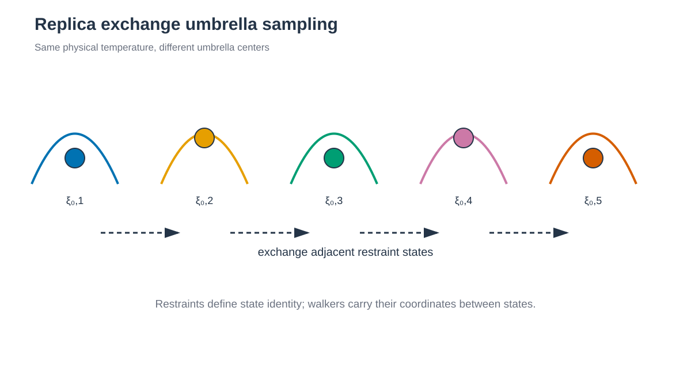

# Replica Exchange Umbrella Sampling



*CV 위의 각 umbrella center가 하나의 Hamiltonian state를 정의합니다. Accepted exchange는 state 정의를 유지한 채 인접 state의 configuration을 교환합니다. / Each umbrella center on the CV defines a Hamiltonian state. An accepted exchange swaps configurations between neighboring states without changing the state definitions.*


## 한국어

Chignolin의 residue 1과 10 Cα distance를 CV로 사용하는 REUS 예제입니다.
6–24 Å 양 끝을 포함하는 20개 window를 같은 온도에서 교환합니다.
`rk2=rk3=1.0 kcal mol⁻¹ Å⁻²`이며, heating 200 ps, equilibration 100 ps,
production은 window당 1 ns입니다. 교환은 1 ps마다 시도합니다.

REUS는 umbrella restraint가 다른 Hamiltonian 사이에서 configuration을
교환합니다. 일반 US가 각 window 안에서만 움직이는 것과 달리, accepted
exchange를 통해 한 walker가 여러 CV 영역을 방문할 수 있습니다. Restraint를
제거한 PMF 계산에는 각 frame이 어느 window state에서 생성됐는지 추적해야 합니다.

Reaction coordinate 위에서 선택한 각 point `ξᵢ`는 단순한 sampling 위치가
아니라 restraint center와 force constant로 정의된 umbrella state입니다. 각
replica는 한 state의 Hamiltonian으로 MD를 진행합니다. Exchange가 accept되면
인접 state에 배정된 configuration이 서로 바뀌지만 `ξᵢ`와 force constant는
그 state에 그대로 남습니다. 이 과정을 반복하면 같은 walker가 state ladder를
따라 이동하며 서로 떨어진 CV 영역을 방문합니다. 인접 window의 분포가 겹치지
않으면 exchange와 PMF 연결이 모두 나빠집니다.

### Script 역할

| 파일 | 역할 |
| --- | --- |
| `download.sh` | 1UAO PDB/mmCIF를 받고 checksum을 기록합니다. |
| `prepare.py` | 1UAO의 첫 NMR model을 simulation PDB로 정리합니다. |
| `make_restraints.py` | Topology에서 terminal Cα index를 찾아 20개 `distance.RST`를 만듭니다. |
| `build.sh` | 공통 topology와 `states.tsv`를 replica directory에 배치합니다. |
| `run.sh` | Window별 pre-production과 `pmemd.cuda.MPI -rem 3` exchange를 실행합니다. |
| `anal.py` | Exchange, window 방문, occupancy와 sampled distance 범위를 요약합니다. |

### 실행

Engine과 MPI 준비는 [family README의 준비 사항](../README.md#준비-사항)을
따릅니다. Python package는 `requirements.txt`의 ParmEd(`make_restraints.py`)와
NumPy(`anal.py`)입니다.

```bash
python3 -m pip install -r requirements.txt
./download.sh
python3 prepare.py structure/1UAO.raw.pdb structure/chignolin.pdb
./build.sh structure/chignolin.pdb
./run.sh
python3 anal.py
```

기본 engine은 단일-window stage에 `pmemd.cuda`, replica exchange에
`pmemd.cuda.MPI -rem 3`입니다. `AMBER_ENGINE`,
`AMBER_MPI_ENGINE`과 `MPI_LAUNCHER`로 executable을 지정합니다.

`run.sh`는 minimization, heating과 equilibration을 각 replica directory에서
실행합니다. `DISANG=distance.RST`와 `DUMPAVE=restraint.<stage>.dat`도 그
directory에서 읽고 저장합니다. Production groupfile은 tutorial directory에서
사용하는 `work/<replica>/...` 경로를 유지합니다.

실행 상태, 실패 후 재실행, 동시 실행 보호는 [GUIDE.md 부록](../../../GUIDE.md#4-부록-실행-상태와-복구)을
참고합니다.

### 계산 resource와 길이

| Stage | 실행 방식 | Window당 길이 | 20 window 합계 |
| --- | --- | --- | --- |
| minimization | `pmemd.cuda`, window를 하나씩 순서대로 | 5,000 cycles | — |
| heating 20 → 300 K (NVT) | `pmemd.cuda`, 순서대로 | 100,000 steps = 200 ps | 4 ns |
| equilibration (NPT) | `pmemd.cuda`, 순서대로 | 50,000 steps = 100 ps | 2 ns |
| production (NPT, `-rem 3`) | `mpirun -np 20 pmemd.cuda.MPI -ng 20` | 500 steps × 1,000 exchanges = 1 ns | 20 ns |

Window restraint는 minimization부터 모든 stage에 걸립니다. Pre-production은
GPU 하나로 window를 차례로 계산합니다. Production은 window당 MPI rank 하나,
즉 20 rank가 동시에 필요합니다. `run.sh`는 rank를 GPU에 배정하지 않으므로
scheduler, MPI launcher 설정 또는 `CUDA_VISIBLE_DEVICES`가 GPU 배치를 정합니다.
GPU 하나로도 test할 수 있지만 20 rank가 같은 GPU를 나눠 쓰므로 느립니다.

### Output

- `work/NNN/production.nc`
- `work/exchange_summary.tsv`, `replica_visits.tsv`,
  `window_occupancy.tsv`
- `work/restraint_sampling.tsv`

정상 종료하면 `run.sh`가 `Completed 1 ns REUS: work`를 출력하고
`work/.production.complete`를 만듭니다. AMBER H-REMD는 configuration을
교환하므로 `work/NNN/`의 output은 window `NNN` Hamiltonian에서 얻은 sample입니다.
Window마다 `production.nc`에는 100 frame(500,000 steps ÷ `ntwx=5000`),
`restraint.production.dat`에는 1 ps 간격의 distance 약 1,000개가 있습니다.
`python3 anal.py`는 마지막에 `REUS Analysis results: work`를 출력합니다.

`round_trips`는 처음 도달한 endpoint에서 반대 endpoint를 방문한 뒤 처음
endpoint로 돌아온 cycle 수입니다. 편도 이동과 같은 endpoint의 반복 방문은
왕복으로 세지 않습니다.

`anal.py`는 AMBER H-REMD의 `# exchange N` block을 읽습니다. 1-based replica
번호와 `Success`의 `T/F`를 해석하고, 서로를 기록한 두 partner row를 pair당 한
번 처리합니다. `state_a=... state_b=... accepted=...` 형식은 0-based index를
사용하며 한 line이 한 exchange event입니다.

Window overlap과 PMF는
[umbrella-sampling analysis](../../../2_Analysis/7_Enhanced_Sampling/README.md)에서
계산합니다.

### Exchange 품질 해석

일반 기준은 [family README](../README.md#exchange-품질-해석)에 있습니다. 이
예제에서는 다음 file을 봅니다.

| File | Column | 확인할 내용 |
| --- | --- | --- |
| `exchange_summary.tsv` | `state_a`, `state_b`, `attempts`, `accepted`, `ratio` | 실제로 시도한 0-based window pair별 acceptance입니다. 인접 pair는 각각 약 500회 시도합니다. 0에 가까운 인접 pair가 없어야 합니다. |
| `replica_visits.tsv` | `replica`, `min_state`, `max_state`, `round_trips` | Configuration(walker)별 최저·최고 window와 왕복 횟수입니다. `replica`는 walker가 처음 시작한 window 번호입니다. |
| `window_occupancy.tsv` | `replica`, `state`, `window_center_A`, `visits`, `fraction` | Walker가 각 window에 머문 exchange 기록의 비율입니다. |
| `restraint_sampling.tsv` | `state`, `window_center_A`, `samples`, `distance_mean_A`, `distance_std_A`, `distance_min_A`, `distance_max_A` | Window별 실제 distance 분포(Å)입니다. Window overlap을 봅니다. |

`exchange_summary.tsv`에는 `0`–`19` pair도 나옵니다. AMBER H-REMD의 기본값
`gremd_acyc=0`이 첫 replica와 마지막 replica의 교환도 시도하기 때문입니다(Amber
26 manual p. 575). 6 Å와 24 Å window는 겹치지 않으므로 이 pair의 acceptance는
0에 가깝고, ladder 문제로 보지 않습니다.

Window overlap은 `restraint_sampling.tsv`에서 인접 window의 `distance_max_A`와
다음 window의 `distance_min_A`가 겹치는지로 먼저 확인합니다.
`distance_std_A`는 예측값 약 0.55 Å와 비교합니다. `distance_mean_A`가 center에서
크게 벗어나 분포가 끊긴 구간은 window를 추가하거나 force constant를 조정할
곳입니다. Histogram과 PMF는 analysis tutorial에서 계산합니다.

`work/exchange.log`의 column은 `Rep#`, `Neibr#`, `Temp0`, `PotE(x_1)`,
`PotE(x_2)`, `left_fe`, `right_fe`, `Success`, `Success rate (i,i+1)`입니다.
`Success`가 `T`면 accept, `F`면 reject이며 energy unit은 kcal/mol입니다.

### 문제 해결

| Message 또는 증상 | 원인 | 조치 |
| --- | --- | --- |
| `ParmEd is required: ...` | `make_restraints.py`가 사용할 ParmEd가 없습니다. | `python3 -m pip install -r requirements.txt`를 실행합니다. |
| `Replica exchange requires at least two and an even number of windows`(build) 또는 `... states`(run) | `inputs/states.tsv`의 window 수가 홀수입니다. | Window를 하나 더하거나 빼서 짝수로 맞춥니다. |
| `Executable not found: pmemd.cuda.MPI` | AMBER environment가 load되지 않았거나 MPI build가 없습니다. | AMBER의 `amber.sh`를 source하거나 `AMBER_MPI_ENGINE`, `MPI_LAUNCHER`를 지정합니다. |
| `REUS production failed: work/mpirun.production.log, work/exchange.log` | 20 rank를 띄우지 못했거나 일부 window가 중단되었습니다. | 출력된 `Missing/Unfinished window output`과 `mpirun.production.log`를 보고 할당한 rank·GPU 수를 맞춥니다. |
| `Exchange analysis: incomplete exchange block in work/exchange.log` | Production이 중간에 끊겨 마지막 block이 불완전합니다. | Production을 끝까지 다시 실행한 뒤 `anal.py`를 실행합니다. |
| 인접 pair의 `ratio`가 0에 가까움 | 그 구간의 window 분포가 겹치지 않습니다. | Window 사이에 center를 추가하거나 `RESTRAINT_FORCE_KCAL_MOL_A2`를 낮춥니다. |

그 밖의 partial output과 lock 처리는 GUIDE 부록을 따릅니다.

### 주요 option

| Option | 의미 |
| --- | --- |
| `-rem 3` | AMBER Hamiltonian REMD mode로 window restraint state를 교환합니다. |
| `iat`, `r2=r3` | Terminal Cα atom pair와 window center를 정의합니다. |
| `rk2=rk3=1.0` | 각 harmonic window의 force constant(kcal mol⁻¹ Å⁻²)입니다. `make_restraints.py`의 `RESTRAINT_FORCE_KCAL_MOL_A2`에서 바꿉니다. |
| `r1=0`, `r4=99` | Restraint가 선형으로 바뀌는 경계입니다. 표본 범위 전체에서 harmonic으로 유지되어 WHAM의 bias 식과 맞습니다. |
| `nmropt=1`, `DISANG` | AMBER NMR-style restraint input을 활성화합니다. |
| `nstlim=500`, `numexchg=1000` | AMBER REMD 의미에 따라 500 steps마다 1,000회 교환하여 총 1 ns를 계산합니다. |
| `DUMPFREQ=500`, `DUMPAVE` | Production에서 2 fs timestep 기준 1 ps마다 restraint coordinate를 기록합니다. Equilibration은 `DUMPFREQ=5000`(10 ps)입니다. |
| `dt=0.002` | Timestep 2 fs입니다. `ntc=2`, `ntf=2`로 hydrogen bond length를 고정합니다. |
| `temp0=300.0`, `ntt=3`, `gamma_ln=1.0` | 모든 window가 300 K Langevin thermostat(collision frequency 1.0 ps⁻¹)를 사용합니다. |
| `ntb=2`, `ntp=1`, `barostat=2`, `pres0=1.0` | Equilibration과 production을 Monte Carlo barostat, 1 bar NPT로 계산합니다. |
| `ntwx=5000` | 10 ps마다 frame을 기록합니다. Production은 window당 100 frame입니다. |
| `ig=@SEED@` | `states.tsv`의 window seed로 치환됩니다. Langevin restart마다 다른 `ig`를 쓰도록 heating은 seed, equilibration은 seed+1,000,000, production은 seed+3,000,000을 사용합니다. |

### Window와 restraint

기본 center는 6–24 Å 양 끝을 포함하는 20개이며 spacing은
`18/19 ≈ 0.947368 Å`입니다. State table과 restraint center는 소수점 8자리로
기록합니다. Replica 수는 2 이상의 짝수여야 하며 `build.sh`와 `run.sh`는 홀수
schedule을 자동 조정하지 않고 거부합니다. `run.sh --dry-run`도 같은 검사를
합니다.

`make_restraints.py`는 ff19SB/OPC topology에서 `:1@CA`와
`:10@CA`의 atom index를 찾습니다. 각 window의 `distance.RST`에 실제
index와 restraint center를 기록하므로 다른 system에 적용할 때 selection과
window 범위를 먼저 바꿉니다.

AMBER restraint energy는 `rk(r − r₀)²`입니다. 300 K에서 window 분포 폭은 약
0.55 Å이고, 0.95 Å 간격에서 예상되는 인접 window 교환 확률은 약 0.22입니다.
이 값은 분포를 Gaussian으로 가정한 예측이며 실제 run으로 확인하지
않았습니다(미검증). 이전 값 `rk=10`은 분포 폭 약 0.17 Å로 인접 window가 거의
겹치지 않았습니다.

## English

This REUS example exchanges 20 windows along the Chignolin residue 1–10 Cα
distance at one temperature. Centers span 6–24 Å including both ends, with
`rk2=rk3=1.0 kcal mol⁻¹ Å⁻²`. Heating is 200 ps, equilibration is 100 ps,
production is 1 ns per window, and exchanges are attempted every 1 ps.

REUS exchanges configurations among Hamiltonians with different umbrella
centers. Unlike ordinary US, where each window stays in its own region,
accepted swaps let a walker visit multiple CV regions. PMF analysis without the
restraints must retain the window state associated with each sampled frame.

Each selected point `ξᵢ` on the reaction coordinate is an umbrella state defined
by its restraint center and force constant, rather than just a sampling
location. A replica propagates under one state Hamiltonian. When a neighboring
exchange is accepted, the configurations assigned to the two states are
swapped, while the centers and force constants remain attached to their states.
Repeated swaps let a walker diffuse across the state ladder. Poor overlap
between neighboring window distributions reduces both exchange acceptance and
the connectivity of the reconstructed PMF.

### Script roles

| File | Role |
| --- | --- |
| `download.sh` | Downloads the 1UAO PDB/mmCIF and records checksums. |
| `prepare.py` | Cleans the first 1UAO NMR model into a simulation PDB. |
| `make_restraints.py` | Finds the terminal Cα indices in the topology and writes 20 `distance.RST` files. |
| `build.sh` | Places the shared topology and `states.tsv` into the replica directories. |
| `run.sh` | Runs per-window pre-production and `pmemd.cuda.MPI -rem 3` exchange. |
| `anal.py` | Summarizes exchange, window visits, occupancy and sampled distance ranges. |

### Run

Follow the [family README prerequisites](../README.md#prerequisites) for the
engine and MPI. Python packages in `requirements.txt` are ParmEd
(`make_restraints.py`) and NumPy (`anal.py`).

```bash
python3 -m pip install -r requirements.txt
./download.sh
python3 prepare.py structure/1UAO.raw.pdb structure/chignolin.pdb
./build.sh structure/chignolin.pdb
./run.sh
python3 anal.py
```

The default engines are `pmemd.cuda` for single-window stages and
`pmemd.cuda.MPI -rem 3` for exchange. `AMBER_ENGINE`, `AMBER_MPI_ENGINE` and
`MPI_LAUNCHER` set the executables.

`run.sh` executes minimization, heating and equilibration inside each replica
directory. It reads `DISANG=distance.RST` and writes
`DUMPAVE=restraint.<stage>.dat` there. The production groupfile keeps its
`work/<replica>/...` paths relative to the tutorial directory.

See [GUIDE.md appendix](../../../GUIDE.md#4-appendix-run-state-and-recovery) for run state, reruns after failure and
concurrent-run protection.

### Resources and length

| Stage | How it runs | Per window | 20-window total |
| --- | --- | --- | --- |
| minimization | `pmemd.cuda`, one window after another | 5,000 cycles | — |
| heating 20 → 300 K (NVT) | `pmemd.cuda`, sequential | 100,000 steps = 200 ps | 4 ns |
| equilibration (NPT) | `pmemd.cuda`, sequential | 50,000 steps = 100 ps | 2 ns |
| production (NPT, `-rem 3`) | `mpirun -np 20 pmemd.cuda.MPI -ng 20` | 500 steps × 1,000 exchanges = 1 ns | 20 ns |

The window restraint is active from minimization onward. Pre-production runs
the windows one at a time on one GPU. Production needs one MPI rank per window,
20 ranks at once. `run.sh` does not assign ranks to GPUs; the scheduler, MPI
launcher settings or `CUDA_VISIBLE_DEVICES` decide the placement. A single GPU
works for testing, but all 20 ranks then share it and the run is slow.

### Outputs

- `work/NNN/production.nc`
- `work/exchange_summary.tsv`, `replica_visits.tsv`,
  `window_occupancy.tsv`
- `work/restraint_sampling.tsv`

On success `run.sh` prints `Completed 1 ns REUS: work` and creates
`work/.production.complete`. AMBER H-REMD swaps configurations, so the outputs
in `work/NNN/` are samples from the window `NNN` Hamiltonian. Each window's
`production.nc` holds 100 frames (500,000 steps ÷ `ntwx=5000`), and
`restraint.production.dat` holds about 1,000 distances at 1 ps intervals.
`python3 anal.py` ends with `REUS Analysis results: work`.

`round_trips` counts complete cycles from the first endpoint reached, through
the opposite endpoint, and back to the starting endpoint. One-way movement and
repeated visits to the same endpoint do not count.

`anal.py` reads AMBER H-REMD `# exchange N` blocks, converts 1-based replica
indices and `T/F` success values, and counts the two reciprocal partner rows
once per pair. The explicit `state_a=... state_b=... accepted=...` format uses
0-based indices and one exchange event per line.

Use the [umbrella-sampling analysis](../../../2_Analysis/7_Enhanced_Sampling/README.md)
for window overlap and PMF calculation.

### Reading exchange quality

General criteria are in the [family README](../README.md#reading-exchange-quality).
This example writes:

| File | Columns | What to check |
| --- | --- | --- |
| `exchange_summary.tsv` | `state_a`, `state_b`, `attempts`, `accepted`, `ratio` | Acceptance of each attempted 0-based window pair. Each neighboring pair gets about 500 attempts. No neighboring pair should be near zero. |
| `replica_visits.tsv` | `replica`, `min_state`, `max_state`, `round_trips` | Lowest and highest window and round trips per configuration (walker). `replica` is the window where the walker started. |
| `window_occupancy.tsv` | `replica`, `state`, `window_center_A`, `visits`, `fraction` | Fraction of exchange records a walker spent in each window. |
| `restraint_sampling.tsv` | `state`, `window_center_A`, `samples`, `distance_mean_A`, `distance_std_A`, `distance_min_A`, `distance_max_A` | Sampled distance distribution (Å) per window, used for window overlap. |

`exchange_summary.tsv` also lists the `0`–`19` pair. AMBER H-REMD's default
`gremd_acyc=0` also attempts exchanges between the first and last replicas
(Amber 26 manual p. 575). The 6 Å and 24 Å windows do not overlap, so this
pair's near-zero acceptance is expected and does not indicate a ladder problem.

Check window overlap first in `restraint_sampling.tsv`: each window's
`distance_max_A` should overlap the next window's `distance_min_A`. Compare
`distance_std_A` with the predicted 0.55 Å. Where `distance_mean_A` drifts far
from the center and the distributions break, add windows or adjust the force
constant. Histograms and the PMF are computed in the analysis tutorial.

`work/exchange.log` columns are `Rep#`, `Neibr#`, `Temp0`, `PotE(x_1)`,
`PotE(x_2)`, `left_fe`, `right_fe`, `Success` and `Success rate (i,i+1)`.
`Success` is `T` for accepted and `F` for rejected swaps; energies are in
kcal/mol.

### Troubleshooting

| Message or symptom | Cause | Action |
| --- | --- | --- |
| `ParmEd is required: ...` | ParmEd for `make_restraints.py` is missing. | Run `python3 -m pip install -r requirements.txt`. |
| `Replica exchange requires at least two and an even number of windows` (build) or `... states` (run) | `inputs/states.tsv` has an odd window count. | Add or remove one window. |
| `Executable not found: pmemd.cuda.MPI` | AMBER is not loaded or has no MPI build. | Source AMBER's `amber.sh` or set `AMBER_MPI_ENGINE` and `MPI_LAUNCHER`. |
| `REUS production failed: work/mpirun.production.log, work/exchange.log` | The 20 ranks did not start, or some windows stopped. | Read the printed `Missing/Unfinished window output` lines and `mpirun.production.log`, then match the allocated ranks and GPUs. |
| `Exchange analysis: incomplete exchange block in work/exchange.log` | Production stopped early and left a truncated block. | Finish production, then run `anal.py`. |
| Neighboring-pair `ratio` near zero | The window distributions there do not overlap. | Insert centers between those windows or lower `RESTRAINT_FORCE_KCAL_MOL_A2`. |

Other partial-output and lock cases follow the GUIDE appendix.

### Key options

| Option | Meaning |
| --- | --- |
| `-rem 3` | Exchanges window restraint states in AMBER Hamiltonian REMD mode. |
| `iat`, `r2=r3` | Define the terminal Cα atom pair and the window center. |
| `rk2=rk3=1.0` | Force constant of each harmonic window (kcal mol⁻¹ Å⁻²). Change it with `RESTRAINT_FORCE_KCAL_MOL_A2` in `make_restraints.py`. |
| `r1=0`, `r4=99` | Bounds where the restraint turns linear. The sampled range stays harmonic, as the WHAM bias assumes. |
| `nmropt=1`, `DISANG` | Activate the AMBER NMR-style restraint input. |
| `nstlim=500`, `numexchg=1000` | In AMBER REMD, 1,000 exchange attempts every 500 steps give 1 ns. |
| `DUMPFREQ=500`, `DUMPAVE` | Record the restraint coordinate every 1 ps in production with a 2 fs timestep; equilibration uses `DUMPFREQ=5000` (10 ps). |
| `dt=0.002` | 2 fs timestep; `ntc=2`, `ntf=2` constrain bonds to hydrogen. |
| `temp0=300.0`, `ntt=3`, `gamma_ln=1.0` | Every window uses a 300 K Langevin thermostat with a 1.0 ps⁻¹ collision frequency. |
| `ntb=2`, `ntp=1`, `barostat=2`, `pres0=1.0` | Equilibration and production run NPT at 1 bar with the Monte Carlo barostat. |
| `ntwx=5000` | Write a frame every 10 ps; production gives 100 frames per window. |
| `ig=@SEED@` | Replaced by the window seed from `states.tsv`. Heating uses the seed, equilibration adds 1,000,000 and production adds 3,000,000, so each Langevin restart gets a different `ig`. |

### Windows and restraints

The default has 20 centers including both 6 and 24 Å, spaced by
`18/19 ≈ 0.947368 Å`. State tables and restraint centers use eight decimal
places. The replica count must be even and at least two; `build.sh` and
`run.sh` reject odd schedules without adjusting them, and `run.sh --dry-run`
applies the same check.

`make_restraints.py` resolves the `:1@CA` and `:10@CA` atom indices from the
ff19SB/OPC topology and writes the actual indices and center into each window's
`distance.RST`. Change the selection and window range first when applying it to
another system.

AMBER restraint energy is `rk(r − r₀)²`. At 300 K each window is about 0.55 Å
wide, and the predicted neighbor exchange acceptance at 0.95 Å spacing is about
0.22. This is a Gaussian estimate, not a measured rate (unverified). The
previous `rk=10` gave about 0.17 Å windows with almost no neighbor overlap.
