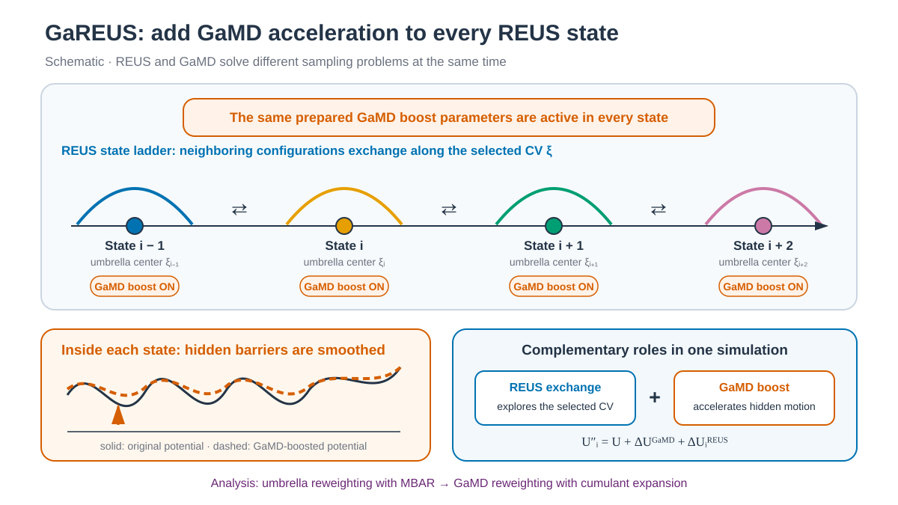

# Gaussian accelerated REUS



*REUS는 선택한 CV의 umbrella state를 연결하고, 모든 state에 공통으로 적용한 GaMD boost는 CV에 드러나지 않는 barrier를 낮춥니다. / REUS connects umbrella states along the selected CV, while a GaMD boost shared by all states lowers barriers hidden from that CV.*


## 한국어

REUS의 terminal Cα distance CV와 20개 window에 dual-boost GaMD를 결합합니다.
Window는 6–25 Å, 1 Å 간격이고 production은 window당 1 ns NVT이며 교환은
1 ps마다 시도합니다.

GaREUS는 CV 방향의 umbrella/replica exchange와 CV에 포함되지 않은 자유도의
GaMD acceleration을 동시에 사용합니다. 두 bias가 함께 작동하므로 window
overlap뿐 아니라 exchange mixing, GaMD boost distribution과 reweighting 조건을
각각 확인해야 합니다.

Umbrella state `i`에서 사용하는 potential은 다음처럼 볼 수 있습니다.

```text
U″ᵢ(x) = U(x) + ΔU_GaMD(U(x)) + ΔUᵢ_REUS(ξ(x))
```

`ΔUᵢ_REUS`는 terminal Cα distance `ξ`의 center를 정하고, replica exchange가
configuration을 인접 center 사이에서 이동시킵니다. `ΔU_GaMD`는 낮은 potential
energy 영역을 harmonic boost로 올려 energy landscape를 완만하게 만듭니다.
따라서 선택한 CV만으로 구분되지 않는 dihedral motion과 hidden barrier의
sampling을 촉진합니다. GaMD는 umbrella state ladder를 대신하지 않으며, 두
항이 같은 configuration에 동시에 적용됩니다.

이 예제에서는 15 Å reference window에서 준비한 같은 GaMD parameter를 모든
state에 사용합니다. Analysis에서는 먼저 MBAR로 umbrella bias를 제거하고,
이어서 2차 cumulant expansion으로 GaMD boost를 reweight합니다.

### Script 역할

| 파일 | 역할 |
| --- | --- |
| `download.sh` | 1UAO PDB/mmCIF를 받고 checksum을 기록합니다. |
| `prepare.py` | 1UAO의 첫 NMR model을 simulation PDB로 정리합니다. |
| `make_restraints.py` | Terminal Cα index와 20개 window restraint를 생성합니다. |
| `build.sh` | 공통 topology, `work/shared` stage input, state table, restraint와 replica별 seed를 배치합니다. |
| `run.sh` | 공통 NPT pre-production, window별 NVT equilibration, GaMD parameter preparation과 GaREUS exchange를 실행합니다. |
| `anal.py` | Exchange/occupancy, restraint sampling과 GaMD boost 범위를 계산합니다. |

### 실행

Engine과 MPI 준비는 [family README의 준비 사항](../README.md#준비-사항)을
따릅니다. Python package는 `requirements.txt`의 ParmEd(`make_restraints.py`)와
NumPy(`anal.py`)입니다.

```bash
python3 -m pip install -r requirements.txt
./download.sh
python3 prepare.py structure/1UAO.raw.pdb structure/chignolin.pdb
./build.sh structure/chignolin.pdb
./run.sh --allow-unverified
python3 anal.py
```

`gamd-restart.dat`은 filename이 고정되어 있고 multipmemd는 replica output에
suffix를 붙입니다. Amber 26 GPU에서 replica별 state read/write가 분리되는지
확인하기 전에는 실제 실행에 `./run.sh --allow-unverified`가 필요합니다.

단일-window stage는 `pmemd.cuda`, GaREUS는 `pmemd.cuda.MPI -rem 3`를 기본으로
사용합니다. `AMBER_ENGINE`, `AMBER_MPI_ENGINE`과 `MPI_LAUNCHER`로 executable을
바꿀 수 있습니다.

실행 상태, 실패 후 재실행, 동시 실행 보호는 [GUIDE.md 부록](../../../GUIDE.md#4-부록-실행-상태와-복구)을
참고합니다.

### 계산 단계

Production은 NVT라서 모든 window의 부피가 같아야 합니다. AMBER manual(REMD 절)은
NVT replica exchange 전에 원래 system을 constant pressure로 먼저 안정화하라고
권합니다. 그래서 pre-production은 두 부분으로 나뉩니다.

| 순서 | Stage | 위치 | Ensemble | 길이 |
| --- | --- | --- | --- | --- |
| 1 | minimization | `work/shared` | 고정 box | 5,000 cycles |
| 2 | heating 20 → 300 K | `work/shared` | NVT | 100,000 steps (200 ps) |
| 3 | equilibration | `work/shared` | NPT | 25,000 steps (50 ps) |
| 4 | window equilibration | `work/NNN` | NVT, window restraint | 25,000 steps (50 ps) |

1–3은 window restraint 없이 한 번만 실행하고 `inputs/shared/*.in`을 사용합니다.
4는 모든 window가 `work/shared/equilibrate.rst7`의 box와 velocity에서 시작해
그 부피를 유지합니다. 한 window가 거치는 equilibration은 NPT 25,000 + NVT
25,000 = 50,000 steps입니다.

GaMD parameter는 15 Å reference window `009`에서 4 ns NVT로 한 번 준비합니다.
`igamd=3`, `sigma0P=sigma0D=6.0`을 사용합니다. 준비가 끝나면 reference
window의 GaMD state를 `prepared.gamd.rst`로 보존하고 같은 `gamd-restart.dat`를
모든 window에 복사합니다. 각 window는 자기 `equilibrate.rst7`을
`production_start.rst7`로 사용합니다. Production은 이 state를
`irest_gamd=1`로 이어받아 1 ns NVT GaREUS를 실행합니다. 계속 갱신되는
`gamd-restart.dat`가 아니라 `prepared.gamd.rst`가 production의 고정 input입니다.

각 window는 고유한 positive seed를 사용합니다. Langevin restart마다 다른 `ig`를
쓰도록 window equilibration은 seed+1,000,000, GaMD preparation은
seed+2,000,000, production은 seed+3,000,000을 사용합니다. 공통 heating은
600001, 공통 NPT equilibration은 1600001입니다(`build.sh`의 `shared_seed`).

### 계산 resource와 길이

| Stage | 실행 방식 | 실행 횟수 | 합계 |
| --- | --- | --- | --- |
| 공통 minimization, heating, NPT equilibration | `pmemd.cuda`, `work/shared` | 1회 | 200 ps + 50 ps |
| window NVT equilibration | `pmemd.cuda`, window를 하나씩 순서대로 | 20회 × 50 ps | 1 ns |
| GaMD parameter preparation | `pmemd.cuda`, window `009` | 1회 × 2,000,000 steps | 4 ns |
| GaREUS production (`-rem 3`) | `mpirun -np 20 pmemd.cuda.MPI -ng 20` | window당 500 steps × 1,000 exchanges | 20 ns |

Production 전 stage는 GPU 하나로 차례로 계산합니다. Production은 window당 MPI
rank 하나, 즉 20 rank가 동시에 필요합니다. `run.sh`는 rank를 GPU에 배정하지
않으므로 scheduler, MPI launcher 설정 또는 `CUDA_VISIBLE_DEVICES`가 GPU 배치를
정합니다. GPU 하나로도 test할 수 있지만 20 rank가 같은 GPU를 나눠 쓰므로
느립니다.

### Output

- `work/NNN/production.nc`
- `work/NNN/gamd.production.log`
- `work/009/gamd.prepare.log` (reference window만)
- `work/exchange_summary.tsv`, `replica_visits.tsv`,
  `window_occupancy.tsv`
- `work/restraint_sampling.tsv`, `boost_potential.tsv`

정상 종료하면 `run.sh`가 `Completed 1 ns GaREUS: work`를 출력하고
`work/.production.complete`를 만듭니다. `work/NNN/`의 output은 window `NNN`
Hamiltonian에서 얻은 sample입니다. Window마다 `production.nc`에는 100
frame(500,000 steps ÷ `ntwx=5000`), `restraint.production.dat`에는 10 ps 간격의
distance 약 100개가 있습니다. `python3 anal.py`는 마지막에
`GaREUS Analysis results: work`를 출력합니다.

`boost_potential.tsv`는 AMBER GaMD header의 `Boost-Energy-Potential`과
`Boost-Energy-Dihedral`을 합한 total boost 범위(kcal/mol)를 기록합니다.
Header의 이름으로 column을 찾고, 누락·변경된 header 또는 nonfinite boost는
거부합니다.

`round_trips`는 처음 도달한 endpoint에서 반대 endpoint를 방문한 뒤 처음
endpoint로 돌아온 cycle 수입니다. 편도 이동과 같은 endpoint의 반복 방문은
왕복으로 세지 않습니다.

`anal.py`는 AMBER H-REMD의 `# exchange N` block을 읽습니다. 1-based replica
번호와 `Success`의 `T/F`를 해석하고, 서로를 기록한 두 partner row를 pair당 한
번 처리합니다. `state_a=... state_b=... accepted=...` 형식은 0-based index를
사용하며 한 line이 한 exchange event입니다.

PMF는 [GaREUS reweighting tutorial](../../../2_Analysis/7_Enhanced_Sampling/7.3_GaREUS_Reweighting/README.md)에서
MBAR와 2차 cumulant expansion으로 계산합니다.

### Exchange 품질 해석

일반 기준은 [family README](../README.md#exchange-품질-해석)에 있습니다.
`exchange_summary.tsv`, `replica_visits.tsv`, `window_occupancy.tsv`와
`restraint_sampling.tsv`의 column과 읽는 법은 [REUS README](../3.4_REUS/README.md#exchange-품질-해석)와
같습니다. GaREUS에서 다른 점은 다음과 같습니다.

| 항목 | 확인할 내용 |
| --- | --- |
| `0`–`19` pair | AMBER H-REMD 기본값 `gremd_acyc=0`이 양 끝 교환도 시도합니다. 6 Å와 25 Å window라 acceptance가 0에 가까운 것이 정상입니다. |
| Window overlap | Window 간격이 1 Å이고 예측 폭은 약 0.55 Å입니다. `restraint_sampling.tsv`에서 인접 window의 `distance_max_A`와 `distance_min_A`가 겹쳐야 합니다. Production sample은 window당 약 100개입니다. |
| `boost_potential.tsv` | `state`, `window_center_A`, `samples`, `boost_min_kcal_mol`, `boost_max_kcal_mol`입니다. 모든 window가 같은 GaMD parameter를 쓰므로 window 사이 boost 범위가 크게 다르면 그 window의 potential energy 분포가 reference window `009`와 다르다는 뜻입니다. |

Boost 분포의 anharmonicity와 reweighting 조건은
[GaREUS reweighting tutorial](../../../2_Analysis/7_Enhanced_Sampling/7.3_GaREUS_Reweighting/README.md)에서
확인합니다.

### 문제 해결

| Message 또는 증상 | 원인 | 조치 |
| --- | --- | --- |
| `Per-replica GaMD state handling with Amber 26 multipmemd is unverified; see README.md before opting in.` | `--allow-unverified` 없이 실행했습니다(exit 2). | 위 실행 절의 제한을 읽고 `./run.sh --allow-unverified`로 실행합니다. |
| `ParmEd is required: ...` | `make_restraints.py`가 사용할 ParmEd가 없습니다. | `python3 -m pip install -r requirements.txt`를 실행합니다. |
| `Replica exchange requires at least two and an even number of windows` | `inputs/states.tsv`의 window 수가 홀수입니다. | Window를 하나 더하거나 빼서 짝수로 맞춥니다. |
| `GaMD parameter preparation failed: work/009/gamd_prepare.out` | 4 ns GaMD preparation이 중단되었습니다. | `work/009/gamd_prepare.out`과 `engine.gamd_prepare.log`의 마지막 error를 확인합니다. |
| `GaREUS production failed: work/mpirun.production.log, work/exchange.log` | 20 rank를 띄우지 못했거나 일부 window가 중단되었습니다. | 출력된 `Missing/Unfinished window output`과 `mpirun.production.log`를 보고 할당한 rank·GPU 수를 맞춥니다. |
| `Boost analysis: dual-boost header missing in ...` | `gamd.production.log` header에 `Boost-Energy-Potential`, `Boost-Energy-Dihedral`이 없습니다. | 사용한 AMBER build의 `-gamd` log 형식과 `igamd=3` 설정을 확인합니다. |

그 밖의 partial output과 lock 처리는 GUIDE 부록을 따릅니다.

### 주요 option

| Option | 의미 |
| --- | --- |
| `igamd=3`, `iE=1` | Total potential과 dihedral potential에 dual boost를 적용하고 lower-bound threshold를 사용합니다. |
| `sigma0P=sigma0D=6.0` | 두 boost의 target standard deviation 상한(kcal/mol)입니다. |
| `irest_gamd=0/1` | Preparation에서 GaMD statistics를 만들고 production에서 해당 state를 이어받습니다. |
| `ntcmdprep=250000`, `ntcmd=1000000` | Preparation의 처음 2 ns(1,000,000 steps)는 conventional MD입니다. 처음 0.5 ns 뒤부터 potential statistics를 모읍니다. |
| `ntebprep=250000`, `nteb=1000000` | 이어지는 2 ns는 boost를 적용한 GaMD equilibration입니다. 처음 0.5 ns 동안은 statistics를 갱신하지 않습니다. `*prep`은 전체 구간에 포함되므로 더하지 않으며 `ntcmd + nteb = nstlim = 2,000,000`입니다(Amber 26 manual p. 526). |
| `ntave=50000` | Potential 평균·표준편차를 계산하는 구간 100 ps(steps)입니다. 위 네 값은 이 값의 배수여야 합니다. |
| `dt=0.002`, `temp0=300.0`, `gamma_ln=1.0` | 2 fs timestep, 300 K Langevin thermostat(collision frequency 1.0 ps⁻¹)입니다. |
| `ntwx=5000`, `DUMPFREQ` | 10 ps마다 frame을 기록합니다. Restraint coordinate는 preparation에서 1 ps(`500`), production에서 10 ps(`5000`)마다 기록합니다. |
| `ntb=1` | Volume을 고정한 NVT ensemble에서 GaREUS production을 실행합니다. |
| `-rem 3`, `nstlim=500`, `numexchg=1000` | Umbrella Hamiltonian을 500 steps, 즉 1 ps마다 교환하고 총 1 ns를 계산합니다. |
| `-gamd` | GaREUS runner가 window별 boost 기록을 별도 log에 저장할 때 사용합니다. AMBER version별 option 이름을 실제 engine help와 대조합니다. |
| `--allow-unverified` | Amber 26 multipmemd의 replica별 GaMD state 처리를 검증하기 전 실제 실행을 opt-in합니다. |

### Window와 restraint

Window force constant는 `rk2=rk3=1.0 kcal mol⁻¹ Å⁻²`이고 `r1=0`, `r4=99`로
표본 범위 전체가 harmonic입니다. 300 K window 폭은 약 0.55 Å, 예상 인접 교환
확률은 약 0.2입니다(Gaussian 예측, 미검증). 이 값은 `make_restraints.py`와
analysis `prepare.py`의 `RESTRAINT_FORCE_KCAL_MOL_A2`가 같아야 합니다.

Replica 수는 2 이상의 짝수여야 합니다. `build.sh`와 `run.sh`는 홀수 schedule을
자동 조정하지 않고 거부하며 `run.sh --dry-run`도 같은 검사를 합니다.

## English

This example combines dual-boost GaMD with the REUS terminal-Cα distance CV and
20 windows from 6 to 25 Å at 1 Å spacing. Production is 1 ns of NVT per window,
with exchanges attempted every 1 ps.

GaREUS combines umbrella/replica exchange along the selected CV with GaMD
acceleration of degrees of freedom outside the CV. Because both biases act
together, window overlap, exchange mixing, boost distributions and reweighting
quality each require separate checks.

The potential in umbrella state `i` is:

```text
U″ᵢ(x) = U(x) + ΔU_GaMD(U(x)) + ΔUᵢ_REUS(ξ(x))
```

The REUS term defines a terminal-Cα distance center, and replica exchange moves
configurations between neighboring centers. The GaMD term raises low-potential
regions with a harmonic boost and smooths energetic barriers, improving sampling
of dihedral motion and other hidden barriers not resolved by the selected CV.
GaMD does not replace the umbrella state ladder; both bias terms act on the same
configuration.

This example distributes the same GaMD parameters prepared at the 15 Å
reference window to every state. Analysis first removes the umbrella bias with
MBAR and then reweights the GaMD boost with a second-order cumulant expansion.

### Script roles

| File | Role |
| --- | --- |
| `download.sh` | Downloads the 1UAO PDB/mmCIF and records checksums. |
| `prepare.py` | Cleans the first 1UAO NMR model into a simulation PDB. |
| `make_restraints.py` | Writes the terminal Cα indices and 20 window restraints. |
| `build.sh` | Places the shared topology, `work/shared` stage inputs, state table, restraints and per-replica seeds. |
| `run.sh` | Runs shared NPT pre-production, per-window NVT equilibration, GaMD parameter preparation and GaREUS exchange. |
| `anal.py` | Computes exchange/occupancy, restraint sampling and GaMD boost ranges. |

### Run

Follow the [family README prerequisites](../README.md#prerequisites) for the
engine and MPI. Python packages in `requirements.txt` are ParmEd
(`make_restraints.py`) and NumPy (`anal.py`).

```bash
python3 -m pip install -r requirements.txt
./download.sh
python3 prepare.py structure/1UAO.raw.pdb structure/chignolin.pdb
./build.sh structure/chignolin.pdb
./run.sh --allow-unverified
python3 anal.py
```

`gamd-restart.dat` has a fixed filename, and multipmemd appends suffixes to
replica outputs. Actual execution requires `./run.sh --allow-unverified` until
separate per-replica state reads and writes are confirmed with Amber 26 GPU
multipmemd.

The run uses `pmemd.cuda` for single-window stages and `pmemd.cuda.MPI -rem 3`
for GaREUS. `AMBER_ENGINE`, `AMBER_MPI_ENGINE` and `MPI_LAUNCHER` override the
executables.

See [GUIDE.md appendix](../../../GUIDE.md#4-appendix-run-state-and-recovery) for run state, reruns after failure and
concurrent-run protection.

### Stages

Production runs at constant volume, so every window must share one box. The
AMBER manual (REMD section) asks for a constant-pressure run of the original
system before NVT replica exchange. Pre-production is therefore split:

| Order | Stage | Location | Ensemble | Length |
| --- | --- | --- | --- | --- |
| 1 | minimization | `work/shared` | fixed box | 5,000 cycles |
| 2 | heating 20 → 300 K | `work/shared` | NVT | 100,000 steps (200 ps) |
| 3 | equilibration | `work/shared` | NPT | 25,000 steps (50 ps) |
| 4 | window equilibration | `work/NNN` | NVT, window restraint | 25,000 steps (50 ps) |

Stages 1–3 run once without window restraints from `inputs/shared/*.in`. Every
window starts stage 4 from the box and velocities in `work/shared/equilibrate.rst7`
and keeps that volume. Each window therefore sees 25,000 NPT + 25,000 NVT =
50,000 equilibration steps.

GaMD parameters are prepared once in a 4 ns NVT run at the 15 Å reference
window `009`, with `igamd=3` and `sigma0P=sigma0D=6.0`. The prepared GaMD state
is kept as `prepared.gamd.rst` in the reference window, and the same
`gamd-restart.dat` is copied to every window. Each window starts production from
its own `equilibrate.rst7`, copied to `production_start.rst7`. Production continues that
state with `irest_gamd=1` for a 1 ns NVT GaREUS run. Production's fixed input is
`prepared.gamd.rst`, not the evolving `gamd-restart.dat`.

Each window has a unique positive seed. Langevin dynamics needs a different
`ig` on each restart, so window equilibration adds 1,000,000 to the window seed,
GaMD preparation adds 2,000,000, and production adds 3,000,000. Shared heating
uses 600001 and shared NPT equilibration 1600001 (`shared_seed` in `build.sh`).

### Resources and length

| Stage | How it runs | Runs | Total |
| --- | --- | --- | --- |
| shared minimization, heating, NPT equilibration | `pmemd.cuda`, `work/shared` | once | 200 ps + 50 ps |
| window NVT equilibration | `pmemd.cuda`, one window after another | 20 × 50 ps | 1 ns |
| GaMD parameter preparation | `pmemd.cuda`, window `009` | once, 2,000,000 steps | 4 ns |
| GaREUS production (`-rem 3`) | `mpirun -np 20 pmemd.cuda.MPI -ng 20` | 500 steps × 1,000 exchanges per window | 20 ns |

Stages before production run one at a time on one GPU. Production needs one MPI
rank per window, 20 ranks at once. `run.sh` does not assign ranks to GPUs; the
scheduler, MPI launcher settings or `CUDA_VISIBLE_DEVICES` decide the
placement. A single GPU works for testing, but all 20 ranks then share it and
the run is slow.

### Outputs

- `work/NNN/production.nc`
- `work/NNN/gamd.production.log`
- `work/009/gamd.prepare.log` (reference window only)
- `work/exchange_summary.tsv`, `replica_visits.tsv`,
  `window_occupancy.tsv`
- `work/restraint_sampling.tsv`, `boost_potential.tsv`

On success `run.sh` prints `Completed 1 ns GaREUS: work` and creates
`work/.production.complete`. The outputs in `work/NNN/` are samples from the
window `NNN` Hamiltonian. Each window's `production.nc` holds 100 frames
(500,000 steps ÷ `ntwx=5000`), and `restraint.production.dat` holds about 100
distances at 10 ps intervals. `python3 anal.py` ends with
`GaREUS Analysis results: work`.

`boost_potential.tsv` reports total boost ranges in kcal/mol as the sum of
`Boost-Energy-Potential` and `Boost-Energy-Dihedral` from the AMBER GaMD header.
Columns are located by header name; missing or changed headers and nonfinite
boosts are rejected.

`round_trips` counts complete cycles from the first endpoint reached, through
the opposite endpoint, and back to the starting endpoint. One-way movement and
repeated visits to the same endpoint do not count.

`anal.py` reads AMBER H-REMD `# exchange N` blocks, converts 1-based replica
indices and `T/F` success values, and counts the two reciprocal partner rows
once per pair. The explicit `state_a=... state_b=... accepted=...` format uses
0-based indices and one exchange event per line.

The separate [GaREUS reweighting tutorial](../../../2_Analysis/7_Enhanced_Sampling/7.3_GaREUS_Reweighting/README.md)
calculates the PMF with MBAR followed by second-order cumulant expansion.

### Reading exchange quality

General criteria are in the [family README](../README.md#reading-exchange-quality).
The columns of `exchange_summary.tsv`, `replica_visits.tsv`,
`window_occupancy.tsv` and `restraint_sampling.tsv` are read as in the
[REUS README](../3.4_REUS/README.md#reading-exchange-quality). GaREUS differs
as follows.

| Item | What to check |
| --- | --- |
| `0`–`19` pair | AMBER H-REMD's default `gremd_acyc=0` also attempts end-to-end swaps. Between the 6 Å and 25 Å windows, near-zero acceptance is expected. |
| Window overlap | Windows are 1 Å apart with a predicted width of about 0.55 Å. In `restraint_sampling.tsv`, each window's `distance_max_A` should overlap the next window's `distance_min_A`. Production gives about 100 samples per window. |
| `boost_potential.tsv` | Columns `state`, `window_center_A`, `samples`, `boost_min_kcal_mol`, `boost_max_kcal_mol`. All windows share one set of GaMD parameters, so a window with a very different boost range has a potential-energy distribution unlike reference window `009`. |

Check boost anharmonicity and reweighting conditions in the
[GaREUS reweighting tutorial](../../../2_Analysis/7_Enhanced_Sampling/7.3_GaREUS_Reweighting/README.md).

### Troubleshooting

| Message or symptom | Cause | Action |
| --- | --- | --- |
| `Per-replica GaMD state handling with Amber 26 multipmemd is unverified; see README.md before opting in.` | Run without `--allow-unverified` (exit 2). | Read the limits in the Run section and use `./run.sh --allow-unverified`. |
| `ParmEd is required: ...` | ParmEd for `make_restraints.py` is missing. | Run `python3 -m pip install -r requirements.txt`. |
| `Replica exchange requires at least two and an even number of windows` | `inputs/states.tsv` has an odd window count. | Add or remove one window. |
| `GaMD parameter preparation failed: work/009/gamd_prepare.out` | The 4 ns GaMD preparation stopped. | Read the last error in `work/009/gamd_prepare.out` and `engine.gamd_prepare.log`. |
| `GaREUS production failed: work/mpirun.production.log, work/exchange.log` | The 20 ranks did not start, or some windows stopped. | Read the printed `Missing/Unfinished window output` lines and `mpirun.production.log`, then match the allocated ranks and GPUs. |
| `Boost analysis: dual-boost header missing in ...` | The `gamd.production.log` header lacks `Boost-Energy-Potential` and `Boost-Energy-Dihedral`. | Check the `-gamd` log format of the AMBER build and the `igamd=3` setting. |

Other partial-output and lock cases follow the GUIDE appendix.

### Key options

| Option | Meaning |
| --- | --- |
| `igamd=3`, `iE=1` | Dual boost on the total and dihedral potentials with the lower-bound threshold. |
| `sigma0P=sigma0D=6.0` | Upper limits (kcal/mol) on the target standard deviations of the two boosts. |
| `irest_gamd=0/1` | Preparation builds GaMD statistics; production continues that state. |
| `ntcmdprep=250000`, `ntcmd=1000000` | The first 2 ns (1,000,000 steps) of preparation are conventional MD; potential statistics are collected after the first 0.5 ns. |
| `ntebprep=250000`, `nteb=1000000` | The next 2 ns are boosted GaMD equilibration; statistics are not updated during its first 0.5 ns. The `*prep` steps lie inside the full intervals, so do not add them: `ntcmd + nteb = nstlim = 2,000,000` (Amber 26 manual p. 526). |
| `ntave=50000` | 100 ps window (in steps) for potential averages and standard deviations. The four values above must be multiples of it. |
| `dt=0.002`, `temp0=300.0`, `gamma_ln=1.0` | 2 fs timestep and a 300 K Langevin thermostat with a 1.0 ps⁻¹ collision frequency. |
| `ntwx=5000`, `DUMPFREQ` | Write a frame every 10 ps. The restraint coordinate is recorded every 1 ps (`500`) in preparation and every 10 ps (`5000`) in production. |
| `ntb=1` | Runs GaREUS production at constant volume (NVT). |
| `-rem 3`, `nstlim=500`, `numexchg=1000` | Exchange umbrella Hamiltonians every 500 steps (1 ps) for a 1 ns run. |
| `-gamd` | Used by the GaREUS runner to write per-window boost logs. Confirm the accepted option name against the target AMBER build's help. |
| `--allow-unverified` | Opts in to actual execution before per-replica GaMD state handling in Amber 26 multipmemd is verified. |

### Windows and restraints

The window force constant is `rk2=rk3=1.0 kcal mol⁻¹ Å⁻²`, and `r1=0`, `r4=99`
keep the sampled range harmonic. Windows are about 0.55 Å wide at 300 K, with a
predicted neighbor acceptance of about 0.2 (Gaussian estimate, unverified).
`RESTRAINT_FORCE_KCAL_MOL_A2` must match in `make_restraints.py` and the
analysis `prepare.py`.

The replica count must be even and at least two. `build.sh` and `run.sh` reject
odd schedules without adjusting them, and `run.sh --dry-run` applies the same
check.
