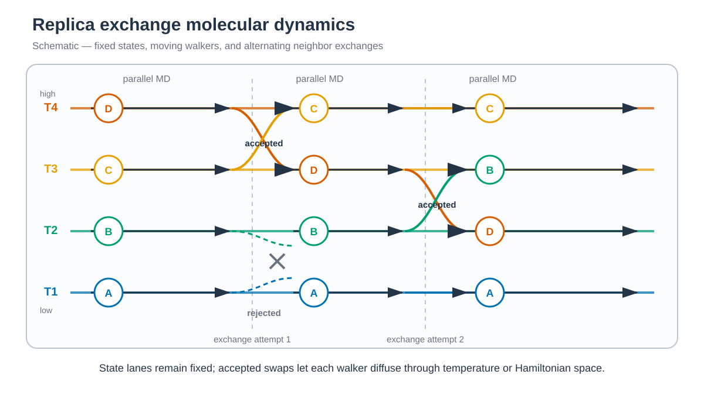

# Replica-exchange simulations / Replica exchange 시뮬레이션



*각 가로 lane은 고정된 temperature/state이고 원은 walker identity입니다. 가로 화살표는 병렬 MD, 교차 화살표는 accepted exchange, X 표시는 rejected exchange를 나타냅니다. / Each horizontal lane is a fixed temperature/state and each circle is a walker identity. Horizontal arrows show parallel MD, crossed arrows show accepted exchanges, and X marks a rejected exchange. Figure concept adapted from [Zhang et al.](https://pmc.ncbi.nlm.nih.gov/articles/PMC6484850/).*


## 한국어

Replica exchange는 서로 다른 thermodynamic state 또는 Hamiltonian을 병렬로
계산하고 주기적으로 state 교환을 시도합니다. Metropolis criterion을 만족하는
교환은 각 replica가 barrier를 우회하도록 돕지만, replica 수·state 간격·교환
빈도와 round trip을 함께 점검해야 합니다.

다섯 예제 모두 Chignolin(PDB 1UAO)을 ff19SB/OPC로 만들며 다른 tutorial의
output을 사용하지 않습니다. Production은 replica당 1 ns를 한 번 실행합니다.

| 순서 | Method | Replica/state | Engine |
| ---: | --- | ---: | --- |
| 3.1 | [T-REMD](3.1_REMD/README.md) | OPC 기준 18 temperatures | `pmemd.cuda.MPI -rem 1` |
| 3.2 | [REST2](3.2_REST2/README.md) | 기본 8 effective temperatures | GROMACS/PLUMED HREX |
| 3.3 | [REST3](3.3_REST3/README.md) | 기본 8 λ/κ states | GROMACS/PLUMED HREX |
| 3.4 | [REUS](3.4_REUS/README.md) | 20 distance windows | `pmemd.cuda.MPI -rem 3` |
| 3.5 | [GaREUS](3.5_GaREUS/README.md) | 20 distance windows | `pmemd.cuda.MPI -rem 3` |

다섯 method 모두 최소 2개·짝수 replica만 지원합니다. 일반 US의 독립 window에는
이 제한을 적용하지 않습니다.

### 준비 사항

모든 예제는 CUDA GPU용 engine을 사용합니다. Python package는 각 leaf의
`requirements.txt`로 설치합니다(T-REMD는 표준 library만 사용).

| Method | 필요한 executable | Executable override |
| --- | --- | --- |
| T-REMD, REUS, GaREUS | AMBER 26 `tleap`, `pmemd.cuda`, `pmemd.cuda.MPI`, MPI launcher | `TLEAP`, `AMBER_ENGINE`, `AMBER_MPI_ENGINE`, `MPI_LAUNCHER` |
| REST2, REST3 | AMBER 26 `tleap`, GROMACS `gmx`, PLUMED-patched `gmx_mpi`, MPI launcher. REST2 `build.sh`는 PLUMED CLI `plumed`도 확인합니다. | `TLEAP`, `GROMACS`, `GROMACS_MPI`, `MPI_LAUNCHER`, REST2의 `PLUMED` |

REST2/REST3의 `gmx`는 `grompp`와 replica별 pre-production에, `gmx_mpi`는 HREX
production에 사용합니다. PLUMED version 검사는 `gmx_mpi`에만 적용됩니다.

#### REST2/REST3 GROMACS build

REST2와 REST3는 PLUMED 2.10.2 이상으로 patch한 `GROMACS 2024.3`
external-MPI build가 필요합니다. 서로 다른 scaled topology를 `-hrex`로 교차
평가하는 경로는 PLUMED의 GROMACS 2024 patch에만 있습니다. GROMACS 2025/2026
patch와 built-in PLUMED interface에는 이 경로가 없습니다. PLUMED 2.10.0과
2.10.1의 GROMACS 2024 patch는 swapped coordinate의 energy를 잘못 계산해
exchange가 거의 accept되지 않습니다. 이 문제는 2.10.2에서 수정되었습니다
([PLUMED issue #1326](https://github.com/plumed/plumed2/issues/1326)).

GROMACS source root에서 PLUMED patch를 적용한 뒤 external MPI로 build합니다.
`-DGMX_GPU=CUDA`는 GPU build에만 붙입니다.

```bash
plumed patch -p -e gromacs-2024.3
mkdir build
cd build
cmake .. -DGMX_MPI=ON -DGMX_THREAD_MPI=OFF -DGMX_GPU=CUDA
make
make install
```

`GMX_MPI=ON` build는 `gmx_mpi`라는 이름으로 설치됩니다. GROMACS 기본값인
thread-MPI는 multi-simulation을 지원하지 않으므로 `-multidir` HREX에는 external
MPI가 필요합니다(GROMACS 2026.3 manual 2.2.2와 p. 20).

REST2와 REST3 `run.sh`는 `gmx_mpi --version`에 들어 있는 `plumed_X.Y.Z`를
읽고 2.10.2보다 낮으면 계산 전에 중단합니다. GROMACS 2024.6처럼 다른 2024
bugfix release에 2024.3 patch를 적용하는 조합과, 2.10.2 build의 실제
GPU/external-MPI HREX 실행은 미검증입니다.

### 실행

각 폴더에서 다음 순서로 실행합니다.

```bash
./download.sh
python3 prepare.py structure/1UAO.raw.pdb structure/chignolin.pdb
./build.sh structure/chignolin.pdb
./run.sh
python3 anal.py
```

| Method | `run.sh` 실행 방식 |
| --- | --- |
| T-REMD, REUS | `./run.sh`; state 수만큼 MPI rank를 사용합니다. |
| REST2, REST3 | `./run.sh --cpus N --gpus N`; replica별 preproduction은 GPU별로 병렬 실행하며 각 process를 `-ntmpi 1`로 제한하고, production은 replica당 external-MPI rank 하나를 사용합니다. |
| GaREUS | 검증 범위를 읽고 `./run.sh --allow-unverified`로 실행합니다. State 수만큼 MPI rank를 사용합니다. |

T-REMD는 18개, REUS와 GaREUS는 20개 MPI rank를 띄웁니다. Open MPI는 CPU core보다
많은 rank를 거부하고 `There are not enough slots available`로 멈춥니다. Core가 더
적은 단일 node에서는 실행 전에 oversubscription을 허용합니다. Open MPI 4는
`export OMPI_MCA_rmaps_base_oversubscribe=1`, Open MPI 5는
`export PRTE_MCA_rmaps_default_mapping_policy=:oversubscribe`를 씁니다.

공통으로 `download.sh`는 source structure를 받고, `prepare.py`는 첫 NMR model을
정리합니다. `build.sh`는 topology와 replica별 input을 만들며, `run.sh`는
pre-production과 replica exchange를 실행합니다. `anal.py`는 exchange log에서
acceptance, state 방문, occupancy와 round trip을 계산합니다. REST2/REST3에는
scaled topology를 만드는 추가 helper가 있습니다.

Production이 완료된 `work`에서 `run.sh`를 다시 실행하면 engine을 호출하지
않습니다. `Skipping completed production`과 `Next: python3 anal.py`를 출력하고
0으로 종료합니다.

T-REMD, REUS, GaREUS의 단일-replica AMBER stage는 engine stdout/stderr를
`<stage>.out` 옆의 `engine.<stage>.log`에 시도마다 header를 붙여 이어서
기록합니다. REST2/REST3 pre-production은 `<stage>.grompp.log`와
`<stage>.mdrun.log`에 기록합니다. Stage가 실패하면 `run.sh`가 이 log의 경로와
마지막 20줄을 출력합니다.

실행 상태, 실패 후 재실행, 동시 실행 보호는 [GUIDE.md 부록](../../GUIDE.md#4-부록-실행-상태와-복구)을
참고합니다. REUS/GaREUS PMF처럼 더 긴 후처리는
[analysis tutorial](../../2_Analysis/7_Enhanced_Sampling/README.md)에서
다룹니다.

### State schedule

REST2와 REST3의 `inputs/temperatures.txt`에는 Chignolin용 기본 ladder가 들어
있으며 `build.sh`가 lambda와 seed를 포함한 `work/states.tsv`를 생성합니다.
REST3는 temperature와 별도로 `inputs/kappa.txt`도 읽습니다. T-REMD, REUS와
GaREUS는 `inputs/states.tsv`를 사용합니다. State 수가 replica 수가 됩니다. 다른
system과 schedule은 `3_Templates/3_REMD/`에서 구성합니다.

새 system의 T-REMD temperature ladder는
[remd-temperature-generator](https://virtualchemistry.org/remd-temperature-generator/)로
설계합니다. REST2는 hot solute atom 수를 protein atom 수로 넣고 water
molecule 수를 0으로 둔 결과를 initial effective-temperature ladder로
사용합니다. 두 경우 모두 production 전 짧은 pilot run에서 adjacent acceptance와
round trip을 확인합니다. REST3의 κ-dependent solute–water scaling은 generator에
포함되지 않으므로 REST2 ladder를 출발점으로만 사용하고 별도로 검증합니다.

### Exchange 품질 해석

각 `anal.py`는 exchange log에서 neighbour pair acceptance, walker별 state
방문·round trip과 state occupancy를 계산합니다. File 이름과 column은 leaf
README에 있습니다.

| 지표 | 확인할 점 | 문제가 보이면 |
| --- | --- | --- |
| Neighbour acceptance | 0에 가까운 인접 pair가 없고, pair 사이 값이 크게 치우치지 않아야 합니다. | 낮은 pair 구간에 state를 추가하거나 간격을 좁힙니다. |
| Walker 방문과 round trip | 각 walker가 ladder 양 끝 state를 모두 방문하고 한 번 이상 왕복해야 합니다. | Acceptance가 고른데 왕복이 없으면 계산 길이를 늘리거나 state 수를 다시 봅니다. |
| State occupancy | 한 walker가 ladder 일부에만 머물지 않아야 합니다. | 한 pair의 bottleneck이나 서로 분리된 conformational state를 의심합니다. |

Acceptance는 높을수록 좋은 값이 아닙니다. 간격을 좁히면 acceptance는 오르지만
replica가 늘어나고 ladder를 건너는 시간도 길어집니다.
[Rathore et al. (2005)](https://doi.org/10.1063/1.1831273)는 T-REMD에서
인접 acceptance 약 20%가 효율적인 replica 배치라고 보고했습니다. 3.1 T-REMD
ladder는 [Patriksson & van der Spoel (2008)](https://doi.org/10.1039/b716554d)
temperature predictor에 목표 확률 0.20을 넣어 만들었습니다. REST와 REUS에서는
이 값을 출발 기준으로만 사용합니다.

REUS/GaREUS에서는 이웃 window의 reaction-coordinate 분포가 겹쳐야 exchange가
accept되고 PMF도 이어집니다. Acceptance와 window별 distance 분포의 overlap을
함께 봅니다.

## English

Replica exchange propagates parallel thermodynamic states or Hamiltonians and
periodically proposes state swaps using a Metropolis criterion. Accepted swaps
help each replica bypass barriers, but useful mixing depends on the replica
count, state spacing, exchange frequency and round trips, not on exchange
attempts alone.

All five examples independently build ff19SB/OPC Chignolin (PDB 1UAO) without
using outputs from other tutorials. Production is one 1 ns run per replica.

| Order | Method | Replicas/states | Engine |
| ---: | --- | ---: | --- |
| 3.1 | [T-REMD](3.1_REMD/README.md) | 18 temperatures for OPC | `pmemd.cuda.MPI -rem 1` |
| 3.2 | [REST2](3.2_REST2/README.md) | 8 effective temperatures by default | GROMACS/PLUMED HREX |
| 3.3 | [REST3](3.3_REST3/README.md) | 8 λ/κ states by default | GROMACS/PLUMED HREX |
| 3.4 | [REUS](3.4_REUS/README.md) | 20 distance windows | `pmemd.cuda.MPI -rem 3` |
| 3.5 | [GaREUS](3.5_GaREUS/README.md) | 20 distance windows | `pmemd.cuda.MPI -rem 3` |

All five methods support only even replica counts of at least two. Independent
windows in ordinary US are outside this restriction.

### Prerequisites

All examples use CUDA GPU engines. Install Python packages from each leaf's
`requirements.txt`; T-REMD needs only the standard library.

| Method | Required executables | Executable overrides |
| --- | --- | --- |
| T-REMD, REUS, GaREUS | AMBER 26 `tleap`, `pmemd.cuda`, `pmemd.cuda.MPI`, MPI launcher | `TLEAP`, `AMBER_ENGINE`, `AMBER_MPI_ENGINE`, `MPI_LAUNCHER` |
| REST2, REST3 | AMBER 26 `tleap`, GROMACS `gmx`, PLUMED-patched `gmx_mpi`, MPI launcher. REST2 `build.sh` also checks the PLUMED CLI `plumed`. | `TLEAP`, `GROMACS`, `GROMACS_MPI`, `MPI_LAUNCHER`, `PLUMED` for REST2 |

In REST2/REST3, `gmx` runs `grompp` and per-replica pre-production, and
`gmx_mpi` runs HREX production. Only `gmx_mpi` is checked for the PLUMED
version.

#### REST2/REST3 GROMACS build

REST2 and REST3 require an external-MPI build of GROMACS 2024.3 patched with
PLUMED 2.10.2 or later. Only the PLUMED patch for GROMACS 2024 provides the
`-hrex` path that cross-evaluates differently scaled topologies; the GROMACS
2025/2026 patches and the built-in PLUMED interface do not. The GROMACS 2024
patch in PLUMED 2.10.0 and 2.10.1 computes a wrong swapped-coordinate energy,
so exchanges are almost never accepted; PLUMED 2.10.2 fixes this
([PLUMED issue #1326](https://github.com/plumed/plumed2/issues/1326)).

From the GROMACS source root, apply the PLUMED patch and build with external
MPI. Add `-DGMX_GPU=CUDA` only for a GPU build.

```bash
plumed patch -p -e gromacs-2024.3
mkdir build
cd build
cmake .. -DGMX_MPI=ON -DGMX_THREAD_MPI=OFF -DGMX_GPU=CUDA
make
make install
```

A `GMX_MPI=ON` build installs binaries named `gmx_mpi`. The default thread-MPI
build does not support multi-simulation runs, so `-multidir` HREX needs external
MPI (GROMACS 2026.3 manual, section 2.2.2 and p. 20).

Both REST runners read `plumed_X.Y.Z` from `gmx_mpi --version` and stop before
the simulation if it is older than 2.10.2. Applying the 2024.3 patch to another
2024 bugfix release such as 2024.6, and an actual GPU/external-MPI HREX run
with a 2.10.2 build, are unverified.

### Run

Run these steps in each folder.

```bash
./download.sh
python3 prepare.py structure/1UAO.raw.pdb structure/chignolin.pdb
./build.sh structure/chignolin.pdb
./run.sh
python3 anal.py
```

| Method | How to run `run.sh` |
| --- | --- |
| T-REMD, REUS | `./run.sh`; one MPI rank per state. |
| REST2, REST3 | `./run.sh --cpus N --gpus N`; per-replica preproduction runs concurrently across GPUs with `-ntmpi 1` per process, and production uses one external-MPI rank per replica. |
| GaREUS | Read its validation limits and run `./run.sh --allow-unverified`. One MPI rank per state. |

T-REMD starts 18 MPI ranks and REUS/GaREUS start 20. Open MPI refuses more
ranks than CPU cores and stops with `There are not enough slots available`. On
a single node with fewer cores, allow oversubscription before running:
`export OMPI_MCA_rmaps_base_oversubscribe=1` for Open MPI 4 or
`export PRTE_MCA_rmaps_default_mapping_policy=:oversubscribe` for Open MPI 5.

In every folder, `download.sh` fetches the source structure, `prepare.py` cleans
the first NMR model, `build.sh` creates the topology and per-replica inputs,
`run.sh` performs pre-production and exchange, and `anal.py` computes
acceptance, state visits, occupancy and round trips from the exchange log.
REST2/REST3 add topology-scaling helpers documented in their own READMEs.

Rerunning `run.sh` in a `work` with completed production calls no engine. It
prints `Skipping completed production` and `Next: python3 anal.py` and exits 0.

Single-replica AMBER stages in T-REMD, REUS and GaREUS append engine
stdout/stderr to `engine.<stage>.log` beside `<stage>.out`, with a header line
per attempt. REST2/REST3 pre-production writes `<stage>.grompp.log` and
`<stage>.mdrun.log`. When a stage fails, `run.sh` prints the log path and its
last 20 lines.

See [GUIDE.md appendix](../../GUIDE.md#4-appendix-run-state-and-recovery) for run state, reruns after failure and
concurrent-run protection. Longer post-processing such as the REUS/GaREUS PMF
is covered in the [analysis tutorial](../../2_Analysis/7_Enhanced_Sampling/README.md).

### State schedule

REST2 and REST3 store their precomputed Chignolin ladders in
`inputs/temperatures.txt`; each `build.sh` generates `work/states.tsv` with
lambdas and seeds. REST3 also reads a separate `inputs/kappa.txt`. T-REMD, REUS
and GaREUS use `inputs/states.tsv`. The state count sets the replica count.
Configure a different system or schedule under `3_Templates/3_REMD/`.

Use the [remd-temperature-generator](https://virtualchemistry.org/remd-temperature-generator/)
for a new system's T-REMD ladder. For REST2, enter the hot-solute atom count as
the protein atom count and set the water-molecule count to zero; treat the
result as an initial effective-temperature ladder. In both cases, verify
adjacent acceptance and round trips in a short pilot run before production.
REST3 adds κ-dependent solute–water scaling that the generator does not model,
so the REST2 ladder is only a starting point for REST3 validation.

### Reading exchange quality

Each `anal.py` computes neighbour-pair acceptance, per-walker state visits and
round trips, and state occupancy from the exchange log. Leaf READMEs list the
files and columns.

| Metric | What to check | If it fails |
| --- | --- | --- |
| Neighbour acceptance | No adjacent pair near zero and no large imbalance between pairs. | Add a state or narrow the spacing around the low pair. |
| Walker visits and round trips | Every walker reaches both ladder ends and completes at least one round trip. | If acceptance is even but no walker returns, run longer or revisit the state count. |
| State occupancy | No walker stays confined to part of the ladder. | Suspect a single-pair bottleneck or disconnected conformational states. |

Higher acceptance is not automatically better: narrower spacing raises
acceptance but adds replicas and lengthens ladder crossings.
[Rathore et al. (2005)](https://doi.org/10.1063/1.1831273) reported that about
20% neighbour acceptance gives an efficient T-REMD replica allocation. The 3.1
T-REMD ladder was generated with the
[Patriksson & van der Spoel (2008)](https://doi.org/10.1039/b716554d)
temperature predictor at a target probability of 0.20. Treat this value only as
a starting point for REST and REUS.

In REUS/GaREUS, exchanges are accepted and the PMF connects only when
neighbouring windows have overlapping reaction-coordinate distributions. Check
the per-window distance distributions alongside acceptance.
