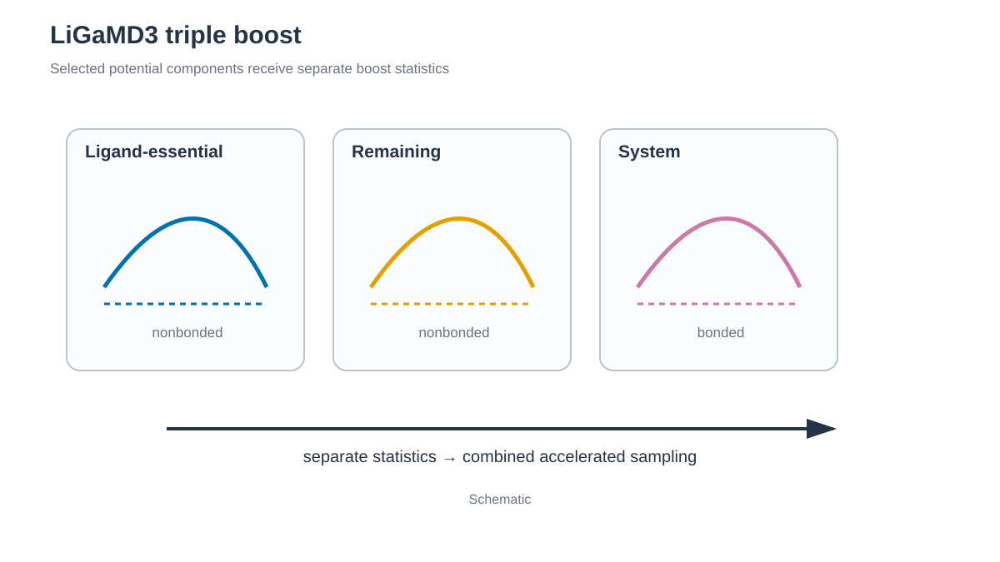

# Trypsin–benzamidine LiGaMD3



*첫 boost는 ligand dissociation, 두 번째는 rebinding, 세 번째는 receptor와 ligand의 conformational change를 촉진합니다. / The first boost promotes ligand dissociation, the second facilitates rebinding, and the third promotes receptor and ligand conformational changes.*


## 한국어

PDB 3PTB의 trypsin–benzamidine complex를 ff19SB/GAFF2/OPC로 build하고
LiGaMD3 triple boost를 적용합니다. BEN에는 AM1-BCC charge를 사용합니다.

LiGaMD3는 ligand essential nonbonded interaction, 나머지 nonbonded interaction과
system bonded potential을 세 component로 나누어 가속합니다. Ligand의
binding/unbinding barrier뿐 아니라 receptor와 ligand의 flexibility를 함께
sampling하려는 구성입니다. Triple boost를 정확히 분리하려면 ligand mask와
receptor atom range가 최종 topology와 일치해야 합니다.

Potential energy는 다음 세 component로 나뉩니다.

```text
V_L = V_LL,nonbonded + V_PL,nonbonded
V_D = V_system,nonbonded - V_L
V_B = V_system,bond + V_system,angle + V_system,dihedral
ΔV_total = ΔV_L + ΔV_D + ΔV_B
```

`V_L`은 BEN 내부의 self nonbonded와 BEN–trypsin nonbonded interaction을
포함합니다. 이 항을 boost하면 binding pocket에서 ligand를 붙잡는 electrostatic과
van der Waals barrier가 완만해져 dissociation sampling이 촉진됩니다. `V_D`는
protein–protein, protein–environment, ligand–environment와
environment–environment를 포함하는 나머지 nonbonded potential이며 ligand의
diffusion과 rebinding을 돕습니다. `V_B`는 전체 system의 bond, angle과 dihedral
potential로 receptor와 ligand의 internal conformational change를 가속합니다.
세 boost는 각자 potential statistics와 threshold를 사용한 뒤 합산됩니다.

### Script 역할

| 파일 | 역할 |
| --- | --- |
| `download.sh` | 3PTB PDB/mmCIF와 BEN ideal SDF를 저장합니다. |
| `prepare.py` | Protein/BEN/Ca2+, 6개 disulfide와 Asp189 metadata를 준비합니다. |
| `protonate_benzamidine.py` | RCSB neutral SDF를 BEN(+1)로 바꾸는 내부 helper입니다. |
| `build.sh` | BEN GAFF2/AM1-BCC parameter, solvated topology와 generated GaMD input을 만듭니다. |
| `render_inputs.py` | Final topology에서 BEN 앞 receptor atom 범위를 찾아 template marker를 치환합니다. |
| `run.sh` | Conventional stage, triple-boost preparation과 production을 실행합니다. |
| `anal.py` | `gamd.log`의 두 boost-energy column과 그 합의 통계를 저장합니다. |

~~~bash
cd 1_Simulation/4_GaMD/4.2_LiGaMD3
./download.sh
python3 prepare.py structure/3PTB.raw.pdb structure/complex.pdb
./build.sh structure/complex.pdb structure/BEN_ideal.sdf
./run.sh --allow-unverified
python3 anal.py
~~~

`build.sh`는 최종 topology에서 BEN 앞의 receptor atom 범위를 계산하고
`work/inputs/`에 `bgpro2atm`과 `edpro2atm`이 채워진 input을 생성합니다.
기본 charge가 +1이면 RCSB neutral SDF의 imine N에 H 하나와 formal charge를
추가한 뒤 GAFF2/AM1-BCC를 적용합니다.

Amber 26의 LiGaMD3 `gamd.log`는 세 물리적 boost를 각각 별도 column으로
기록하지 않습니다. 기존 형식의 `Boost-Energy-Potential`과
`Boost-Energy-Dihedral` 두 aggregate column을 기록합니다. `anal.py`는 두 값을
읽어 각각의 통계와 합계인 frame별 total boost `ΔV`를 저장합니다. TSV의
`logged_potential_column`과 `logged_dihedral_column`은 이 두 log column을
가리키며 `ΔV_L`, `ΔV_D`, `ΔV_B`를 각각 분리한 값이 아닙니다. 기본
production log의 103줄은 header 3줄과 GaMD record 100개입니다.

필요한 program과 stage별 계산량은 [GaMD README](../README.md#필요한-program)에
정리되어 있습니다.

### 성공 확인

| Command | 마지막 출력 | 확인할 파일 |
| --- | --- | --- |
| `./build.sh` | `LiGaMD3 topology, restart, and generated inputs: work` | `work/inputs/gamd_prepare.in`의 `bgpro2atm`/`edpro2atm`(직전 `LiGaMD3 receptor atoms: 1-N` 출력과 같은 값) |
| `./run.sh --allow-unverified` | `1 ns LiGaMD3 production completed: work/production.nc` | `work/gamd_prepare.gamd.rst`, `work/production.gamd.log` |
| `python3 anal.py` | `LiGaMD3 boost diagnostics: work/boost_summary.tsv` | `work/boost_summary.tsv`, `work/boost_frames.tsv` |

두 logged column이 세 boost를 어떻게 나누어 담는지는 확인하지 않았습니다(미검증).
따라서 column별 `std`를 `sigma0P/D/B`와 일대일로 비교하지 않고, `total` 행의
anharmonicity와 effective sample size로 reweighting 가능성을 판단합니다. 해석
기준은 [GaMD README](../README.md#결과-해석)에 있습니다. 다음 단계는 PMF
reweighting입니다.

~~~bash
cd ../../../2_Analysis/7_Enhanced_Sampling/7.2_GaMD_Reweighting
./run.sh ligamd3 ../../../1_Simulation/4_GaMD/4.2_LiGaMD3/work
~~~

### 주요 option

| Option | 의미 |
| --- | --- |
| `igamd=28` | LiGaMD3 triple-boost mode를 선택합니다. |
| `iEP=2`, `iED=iEB=1` | Amber 26 예제처럼 첫 boost는 upper-bound threshold, 나머지 두 boost는 lower-bound threshold를 사용합니다. |
| `sigma0P`, `sigma0D`, `sigma0B=6.0` | 세 boost component의 target standard deviation 상한(kcal/mol)입니다. |
| `timask1=':BEN'`, `scmask1=':BEN'` | Selective interaction의 ligand를 BEN residue로 지정합니다. |
| `bgpro2atm`, `edpro2atm` | Final topology에서 계산한 receptor atom 범위입니다. 직접 고정하지 않고 generated input을 확인합니다. |
| `ntave=50000` | Triple-boost statistics averaging interval이며 2 fs 기준 100 ps입니다. |
| `ntcmd*`, `nteb*` | Initial conventional statistics와 GaMD equilibration schedule입니다. `*prep`과 전체 step 값을 독립 구간처럼 더하지 않습니다. |
| BEN net charge `+1` | AM1-BCC parameterization에 사용하는 고정 charge입니다. |
| `--allow-unverified` | Amber26 GPU 검증 전 실제 실행을 의도적으로 opt-in합니다. |
| `ntr=1`, `-ref minimize.rst7` | Heating restraint의 reference로 minimization restart를 사용합니다. |
| Heating seed `42001` | 이 고정 example의 initial velocity seed입니다. |

Amber 26 manual은 LiGaMD3를 serial GPU `pmemd.cuda` 전용으로 설명합니다.
`AMBER_ENGINE`을 `pmemd`, `sander` 또는 MPI executable로 바꾸면 `run.sh`가
계산 전에 중단합니다. System별 production 설정은
`3_Templates/4_GaMD/4.2_LiGaMD3`에서 구성합니다.

Amber26의 LiGaMD3 동작은 아직 실제 GPU에서 검증하지 않았습니다(미검증).
`--allow-unverified`는 이 상태를 확인하기 위한 opt-in이며 호환성을 보장하지
않습니다. GaMD parameter와 state, 기록된 total boost, `gamd-restart.dat`, DV/DL
output과 짧은 continuation을 확인하기 전에는 결과를 해석하지 않습니다.

### Production 재실행

Production은 시작할 때 `work/.production.started`를 남깁니다. Production이 실패한
뒤 다시 실행하면 남은 output과 engine이 바꾼 `work/gamd-restart.dat`을
preparation state로 덮어쓰지 않고 중단합니다. Error에 나온 파일을 `work` 밖으로
옮긴 뒤 다시 실행합니다. Preparation state는 `work/gamd_prepare.gamd.rst`에
남아 있으므로 production은 이 state에서 다시 시작합니다.

~~~bash
mkdir -p work.failed
mv work/production.* work/.production.started work/gamd-restart.dat work.failed/
./run.sh --allow-unverified
~~~

완료된 production은 다시 실행하지 않습니다. Engine을 실행하지 않고
`Skipping completed production`과 다음 command `python3 anal.py`를 출력한 뒤
정상 종료합니다. 그 밖의 실행 상태, 실패 후 재실행, 동시 실행 보호는 [GUIDE.md 부록](../../../GUIDE.md#4-부록-실행-상태와-복구)을 참고합니다.

### 문제 해결

| Message | 원인과 조치 |
| --- | --- |
| `Usage: ./run.sh --allow-unverified` | 실제 engine 실행에 opt-in argument가 없습니다. 위 미검증 설명을 읽은 뒤 `--allow-unverified`를 붙입니다. |
| `Error: Amber 26 LiGaMD3 supports only the serial GPU pmemd.cuda engine: ...` | `AMBER_ENGINE`이 `pmemd.cuda`가 아닙니다. Serial GPU executable로 바꿉니다. |
| `Error: Executable not found: antechamber` | AmberTools 26 environment를 activate하거나 `ANTECHAMBER`, `PARMCHK2`, `TLEAP`에 경로를 지정합니다. |
| `Error: antechamber failed: work/antechamber.log` | AM1-BCC charge 계산이 실패했습니다. Log를 확인하고 `structure/BEN_ideal.sdf`가 `download.sh` output인지 확인합니다. |
| `Expected exactly one BEN residue, ...` 또는 `Receptor residue count before BEN differs from the preparation metadata.` | `render_inputs.py`가 receptor atom 범위를 정하지 못했습니다. `prepare.py`부터 다시 실행해 PDB와 `system_metadata.tsv`를 맞춥니다. |
| `work/production.gamd.log: malformed GaMD record at line N: ...` | Log가 중간에 끊겼거나 형식이 다릅니다. Production 완료 여부와 Amber version을 확인합니다. |

1 ns는 binding thermodynamics나 kinetics 계산 길이가 아닙니다.

## English

PDB 3PTB is built with ff19SB, GAFF2/AM1-BCC, and OPC, and the LiGaMD3 triple
boost is applied. BEN uses AM1-BCC charges.

LiGaMD3 accelerates three components separately: ligand-essential nonbonded
interactions, remaining nonbonded interactions, and the system bonded potential.
It targets both ligand binding/unbinding barriers and receptor and ligand
flexibility. A clean separation requires the ligand mask and receptor atom range
to match the final topology.

The potential energy is partitioned as follows.

```text
V_L = V_LL,nonbonded + V_PL,nonbonded
V_D = V_system,nonbonded - V_L
V_B = V_system,bond + V_system,angle + V_system,dihedral
ΔV_total = ΔV_L + ΔV_D + ΔV_B
```

`V_L` contains BEN self-nonbonded and BEN–trypsin nonbonded interactions.
Boosting it flattens the electrostatic and van der Waals barriers that hold the
ligand in the pocket and promotes dissociation. `V_D` is the remaining
nonbonded potential (protein–protein, protein–environment, ligand–environment
and environment–environment) and facilitates diffusion and rebinding. `V_B`
contains all-system bond, angle and dihedral terms and accelerates internal
conformational changes of receptor and ligand. Each boost uses its own
potential statistics and threshold before the three are summed.

### Script roles

| File | Role |
| --- | --- |
| `download.sh` | Saves 3PTB PDB/mmCIF and the BEN ideal SDF. |
| `prepare.py` | Prepares protein/BEN/Ca2+, six disulfides and Asp189 metadata. |
| `protonate_benzamidine.py` | Internal helper that converts the neutral RCSB SDF to BEN(+1). |
| `build.sh` | Creates BEN GAFF2/AM1-BCC parameters, the solvated topology and generated GaMD inputs. |
| `render_inputs.py` | Finds the receptor atom range before BEN in the final topology and fills the template markers. |
| `run.sh` | Runs the conventional stages, triple-boost preparation and production. |
| `anal.py` | Saves statistics of the two boost-energy columns in `gamd.log` and their sum. |

~~~bash
cd 1_Simulation/4_GaMD/4.2_LiGaMD3
./download.sh
python3 prepare.py structure/3PTB.raw.pdb structure/complex.pdb
./build.sh structure/complex.pdb structure/BEN_ideal.sdf
./run.sh --allow-unverified
python3 anal.py
~~~

`build.sh` resolves the receptor atom range before BEN from the final topology
and writes inputs with `bgpro2atm` and `edpro2atm` filled in under
`work/inputs/`. The default +1 ligand path first adds one imine-N hydrogen and a
formal charge to the neutral RCSB SDF, then applies GAFF2/AM1-BCC.

Amber 26 does not write the three physical LiGaMD3 boosts as separate columns
in `gamd.log`. It retains the legacy aggregate `Boost-Energy-Potential` and
`Boost-Energy-Dihedral` columns. `anal.py` reports both logged values and their
sum as the per-frame total boost `ΔV`. The TSV labels `logged_potential_column`
and `logged_dihedral_column` name these log columns; they are not separate
`ΔV_L`, `ΔV_D`, or `ΔV_B` values. The default 103-line production log
contains three header lines and 100 records.

Required programs and per-stage computation are listed in the
[GaMD README](../README.md#required-programs).

### Success check

| Command | Last line | Files to check |
| --- | --- | --- |
| `./build.sh` | `LiGaMD3 topology, restart, and generated inputs: work` | `bgpro2atm`/`edpro2atm` in `work/inputs/gamd_prepare.in` (same as the preceding `LiGaMD3 receptor atoms: 1-N` line) |
| `./run.sh --allow-unverified` | `1 ns LiGaMD3 production completed: work/production.nc` | `work/gamd_prepare.gamd.rst`, `work/production.gamd.log` |
| `python3 anal.py` | `LiGaMD3 boost diagnostics: work/boost_summary.tsv` | `work/boost_summary.tsv`, `work/boost_frames.tsv` |

How the two logged columns divide the three boosts has not been checked
(unverified). Do not compare the per-column `std` one-to-one with
`sigma0P/D/B`; judge reweighting from the anharmonicity and effective sample
size of the `total` row, as described in the
[GaMD README](../README.md#interpreting-the-results). The next step is PMF
reweighting.

~~~bash
cd ../../../2_Analysis/7_Enhanced_Sampling/7.2_GaMD_Reweighting
./run.sh ligamd3 ../../../1_Simulation/4_GaMD/4.2_LiGaMD3/work
~~~

### Key options

| Option | Meaning |
| --- | --- |
| `igamd=28` | Selects the LiGaMD3 triple-boost mode. |
| `iEP=2`, `iED=iEB=1` | Following the Amber 26 example, the first boost uses the upper-bound threshold and the other two use lower-bound thresholds. |
| `sigma0P`, `sigma0D`, `sigma0B=6.0` | Upper limits (kcal/mol) on the target standard deviation of the three boost components. |
| `timask1=':BEN'`, `scmask1=':BEN'` | Selects the BEN residue as the ligand for selective interactions. |
| `bgpro2atm`, `edpro2atm` | Receptor atom range computed from the final topology. Check the generated input instead of fixing it by hand. |
| `ntave=50000` | Triple-boost statistics averaging interval, 100 ps at 2 fs. |
| `ntcmd*`, `nteb*` | Initial conventional-statistics and GaMD-equilibration schedules. The `*prep` and total step values overlap and are not summed. |
| BEN net charge `+1` | Fixed charge used for AM1-BCC parameterization. |
| `--allow-unverified` | Deliberate opt-in to actual execution before Amber26 GPU validation. |
| `ntr=1`, `-ref minimize.rst7` | Uses the minimization restart as the heating restraint reference. |
| Heating seed `42001` | Initial velocity seed of this fixed example. |

Amber 26 documents LiGaMD3 only for serial GPU `pmemd.cuda`; `run.sh` stops
before computing if `AMBER_ENGINE` is set to `pmemd`, `sander` or an MPI
executable. Use `3_Templates/4_GaMD/4.2_LiGaMD3` for system-specific production
settings.

Amber26 LiGaMD3 behavior has not been validated on an actual GPU (unverified).
`--allow-unverified` is an opt-in for checking this and does not guarantee
compatibility. Do not interpret results until a short run confirms the GaMD
parameters and state, the logged total boost, `gamd-restart.dat`, DV/DL output
and continuation behavior.

### Rerunning production

Production leaves an attempt record, `work/.production.started`. After a failed
production, a rerun stops instead of overwriting the leftover output or the
engine-modified `work/gamd-restart.dat` with the prepared state. Move the files
named in the error out of `work` and rerun. The prepared state remains in
`work/gamd_prepare.gamd.rst`, so production restarts from it.

~~~bash
mkdir -p work.failed
mv work/production.* work/.production.started work/gamd-restart.dat work.failed/
./run.sh --allow-unverified
~~~

A completed production is not rerun: `run.sh` skips the engine, prints
`Skipping completed production` and the next command, `python3 anal.py`, and
exits 0. See [GUIDE.md appendix](../../../GUIDE.md#4-appendix-run-state-and-recovery) for
other run state, reruns after failure and concurrent-run protection.

### Troubleshooting

| Message | Cause and fix |
| --- | --- |
| `Usage: ./run.sh --allow-unverified` | The opt-in argument for engine runs is missing. Read the unverified note above, then add `--allow-unverified`. |
| `Error: Amber 26 LiGaMD3 supports only the serial GPU pmemd.cuda engine: ...` | `AMBER_ENGINE` is not `pmemd.cuda`. Use the serial GPU executable. |
| `Error: Executable not found: antechamber` | Activate the AmberTools 26 environment or set `ANTECHAMBER`, `PARMCHK2` or `TLEAP`. |
| `Error: antechamber failed: work/antechamber.log` | The AM1-BCC charge calculation failed. Read the log and check that `structure/BEN_ideal.sdf` is the `download.sh` output. |
| `Expected exactly one BEN residue, ...` or `Receptor residue count before BEN differs from the preparation metadata.` | `render_inputs.py` could not set the receptor atom range. Rerun from `prepare.py` so the PDB and `system_metadata.tsv` match. |
| `work/production.gamd.log: malformed GaMD record at line N: ...` | The log is truncated or has a different format. Check that production finished and which Amber version wrote it. |

The 1 ns example is not a binding thermodynamics or kinetics calculation.

## References / 참고 자료

- [RCSB PDB 3PTB](https://www.rcsb.org/structure/3PTB)
- [LiGaMD3](https://doi.org/10.1021/acs.jctc.4c00502)
