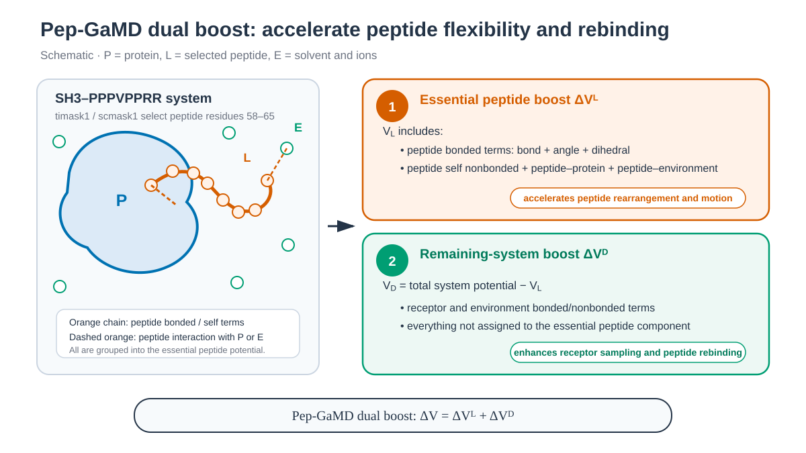

# SH3–peptide Pep-GaMD



*첫 boost는 peptide의 internal rearrangement와 receptor/environment interaction을 가속하고, 두 번째 boost는 나머지 system의 sampling과 peptide rebinding을 돕습니다. / The first boost accelerates peptide rearrangement and its interactions with the receptor and environment; the second enhances the remaining system and peptide rebinding.*


## 한국어

PDB 1CKB의 C-crk N-terminal SH3 domain과 resolved SOS peptide PPPVPPRR를
ff19SB/OPC로 build합니다. PDB entity에는 peptide 10 residues가 기록되어
있지만 coordinate가 존재하는 8 residues만 사용합니다.

Pep-GaMD는 peptide essential potential과 나머지 system potential을 분리해
dual boost를 적용합니다. Flexible peptide의 내부 rearrangement와 receptor에서의
이동을 가속하는 것이 목적입니다. Peptide selection이 receptor residue를 포함하면
다른 Hamiltonian이 되므로 sequence와 generated mask를 build 단계에서 검사합니다.

이 예제의 `igamd=15`는 다음 energy partition을 사용합니다.

```text
V_L = peptide bonded + peptide self nonbonded
      + peptide-protein nonbonded + peptide-environment nonbonded
V_D = V_system,total - V_L
ΔV_total = ΔV_L + ΔV_D
```

`V_L`에는 peptide의 bond, angle과 dihedral뿐 아니라 peptide 내부 nonbonded와
protein·solvent와의 nonbonded interaction도 포함됩니다. 따라서 flexible peptide의
internal rearrangement와 binding/unbinding motion을 함께 가속합니다. `V_D`는
essential peptide component를 제외한 receptor와 environment potential입니다.
두 번째 boost는 receptor conformational sampling과 peptide rebinding을 돕습니다.
`timask1`과 `scmask1`은 단순한 analysis selection이 아니라 이 두 potential의
경계를 정하므로 generated `:58-65` mask를 확인합니다.

### Script 역할

| 파일 | 역할 |
| --- | --- |
| `download.sh` | 1CKB PDB/mmCIF와 checksum을 저장합니다. |
| `prepare.py` | Chain A receptor와 resolved chain B PPPVPPRR를 정리하고 residue metadata를 만듭니다. |
| `build.sh` | ff19SB/OPC topology를 만들고 peptide mask renderer를 호출합니다. |
| `render_inputs.py` | Metadata의 residue 58–65를 `timask1`/`scmask1`에 기록합니다. |
| `run.sh` | Conventional stage, Pep-GaMD preparation과 production을 실행합니다. |
| `anal.py` | 두 boost component와 total boost의 통계를 저장합니다. |

~~~bash
cd 1_Simulation/4_GaMD/4.3_Pep-GaMD
./download.sh
python3 prepare.py structure/1CKB.raw.pdb structure/sh3-peptide.pdb
./build.sh structure/sh3-peptide.pdb
./run.sh
python3 anal.py
~~~

`prepare.py`는 chain A 57 residues와 chain B의 PPPVPPRR sequence를 검사합니다.
`build.sh`는 생성된 residue 범위로 `timask1`과 `scmask1`을 채웁니다.

필요한 program과 stage별 계산량은 [GaMD README](../README.md#필요한-program)에
정리되어 있습니다.

### 성공 확인

| Command | 마지막 출력 | 확인할 파일 |
| --- | --- | --- |
| `./build.sh` | `Pep-GaMD topology, restart, and generated inputs: work` | `work/inputs/gamd_prepare.in`의 `timask1='...'`(직전 `Pep-GaMD peptide mask: ...` 출력과 같은 값) |
| `./run.sh` | `1 ns Pep-GaMD production completed: work/production.nc` | `work/gamd_prepare.gamd.rst`, `work/production.gamd.log`(header 뒤 100 records) |
| `python3 anal.py` | `Pep-GaMD boost diagnostics: work/boost_summary.tsv` | `work/boost_summary.tsv`, `work/boost_frames.tsv` |

`boost_1`과 `boost_2`는 `gamd.log`의 `Boost-Energy-Potential`과
`Boost-Energy-Dihedral` column입니다. `igamd=15`에서 두 column이 peptide와 나머지
system boost에 각각 대응하는지는 manual에서 확인하지 않았습니다(미검증).
Reweighting에는 합계인 `total`을 사용합니다. 해석 기준은 [GaMD README](../README.md#결과-해석)에 있습니다. 다음 단계는 PMF
reweighting입니다.

~~~bash
cd ../../../2_Analysis/7_Enhanced_Sampling/7.2_GaMD_Reweighting
./run.sh pepgamd ../../../1_Simulation/4_GaMD/4.3_Pep-GaMD/work
~~~

### 주요 option

| Option | 의미 |
| --- | --- |
| `igamd=15` | Peptide-selective dual-boost mode를 선택합니다. |
| `iEP=1`, `iED=1` | Peptide essential potential과 나머지 potential에 lower-bound threshold를 사용합니다. |
| `timask1`, `scmask1=':58-65'` | Prepared topology의 resolved PPPVPPRR peptide를 선택합니다. Generated input에서 확인합니다. |
| `sigma0P=sigma0D=6.0` | 두 boost component의 target standard deviation 상한(kcal/mol)입니다. |
| `ntcmd*`, `nteb*`, `ntave=50000` | Initial conventional statistics와 GaMD equilibration schedule, 100 ps averaging interval을 정의합니다. `*prep`과 전체 step 값을 독립 구간처럼 더하지 않습니다. |
| Heating seed `43001` | 이 고정 example의 initial velocity seed입니다. |
| `ntr=1`, `-ref minimize.rst7` | Heating restraint의 reference로 minimization restart를 사용합니다. |

Amber 26 manual은 Pep-GaMD를 serial GPU `pmemd.cuda` 전용으로 설명합니다.
`AMBER_ENGINE`을 CPU 또는 MPI executable로 바꾸면 `run.sh`가 계산 전에
중단합니다. System별 설정과 independent run은 `3_Templates/4_GaMD/4.3_Pep-GaMD`에서
구성합니다.

### Production 재실행

Production은 시작할 때 `work/.production.started`를 남깁니다. Production이 실패한
뒤 다시 실행하면 남은 output과 engine이 바꾼 `work/gamd-restart.dat`을
preparation state로 덮어쓰지 않고 중단합니다. Error에 나온 파일을 `work` 밖으로
옮긴 뒤 다시 실행합니다. Preparation state는 `work/gamd_prepare.gamd.rst`에
남아 있으므로 production은 이 state에서 다시 시작합니다.

~~~bash
mkdir -p work.failed
mv work/production.* work/.production.started work/gamd-restart.dat work.failed/
./run.sh
~~~

완료된 production은 다시 실행하지 않습니다. Engine을 실행하지 않고
`Skipping completed production`과 다음 command `python3 anal.py`를 출력한 뒤
정상 종료합니다. 그 밖의 실행 상태, 실패 후 재실행, 동시 실행 보호는 [GUIDE.md 부록](../../../GUIDE.md#4-부록-실행-상태와-복구)을 참고합니다.

### 문제 해결

| Message | 원인과 조치 |
| --- | --- |
| `1CKB chain A must contain 57 resolved residues: N` 또는 `Resolved 1CKB peptide differs from PPPVPPRR: ...` | `prepare.py` input이 `download.sh`가 받은 `structure/1CKB.raw.pdb`가 아닙니다. 다시 다운로드합니다. |
| `Error: Executable not found: tleap` | AmberTools 26 environment를 activate하거나 `TLEAP`에 경로를 지정합니다. |
| `Error: Pep-GaMD input generation failed: ...` | 앞줄의 `Pep-GaMD peptide metadata does not match the 8-residue PPPVPPRR peptide.`를 확인하고 `prepare.py`부터 다시 실행합니다. |
| `Error: Amber 26 Pep-GaMD supports only the serial GPU pmemd.cuda engine: ...` | `AMBER_ENGINE`을 serial `pmemd.cuda`로 바꿉니다. |
| `Error: Run build.sh first: work/inputs/gamd_prepare.in` | Build가 generated input까지 만들지 못했습니다. Build error를 해결하고 `mv work work.old` 뒤 `./build.sh`를 다시 실행합니다. |
| `work/production.gamd.log: 100 GaMD records is required: N` | Production이 끝나지 않았거나 `ntwx`/`nstlim`을 바꿨습니다. |

1 ns에서 peptide dissociation·rebinding, binding free energy 또는 kinetics가
수렴할 것으로 기대하지 않습니다.

## English

PDB 1CKB supplies the C-crk N-terminal SH3 domain and the resolved SOS peptide
PPPVPPRR, built with ff19SB/OPC. The PDB entity contains ten peptide residues,
but only the eight residues with coordinates are used.

Pep-GaMD separates peptide-essential and remaining-system potentials and applies
a dual boost to accelerate internal rearrangement of the flexible peptide and its
motion on the receptor. A peptide selection that includes receptor residues
defines a different Hamiltonian, so the build checks the sequence and the
generated mask.

For `igamd=15`, this example uses the following energy partition.

```text
V_L = peptide bonded + peptide self nonbonded
      + peptide-protein nonbonded + peptide-environment nonbonded
V_D = V_system,total - V_L
ΔV_total = ΔV_L + ΔV_D
```

`V_L` contains peptide bond, angle and dihedral terms, peptide self-nonbonded
energy, and peptide interactions with the protein and solvent. The first boost
therefore accelerates both internal peptide rearrangement and binding/unbinding
motion. `V_D` is the receptor and environment potential without the essential
peptide component; the second boost enhances receptor conformational sampling
and peptide rebinding. Because `timask1` and `scmask1` define this energy
boundary rather than an analysis-only selection, check the generated `:58-65`
mask.

### Script roles

| File | Role |
| --- | --- |
| `download.sh` | Saves 1CKB PDB/mmCIF and checksums. |
| `prepare.py` | Prepares chain A receptor and resolved chain B PPPVPPRR and writes residue metadata. |
| `build.sh` | Creates the ff19SB/OPC topology and calls the peptide mask renderer. |
| `render_inputs.py` | Writes residues 58–65 from the metadata into `timask1`/`scmask1`. |
| `run.sh` | Runs the conventional stages, Pep-GaMD preparation and production. |
| `anal.py` | Saves statistics of both boost components and the total boost. |

~~~bash
cd 1_Simulation/4_GaMD/4.3_Pep-GaMD
./download.sh
python3 prepare.py structure/1CKB.raw.pdb structure/sh3-peptide.pdb
./build.sh structure/sh3-peptide.pdb
./run.sh
python3 anal.py
~~~

`prepare.py` checks the 57 chain A residues and the chain B PPPVPPRR sequence.
`build.sh` fills `timask1` and `scmask1` with the generated residue range.

Required programs and per-stage computation are listed in the
[GaMD README](../README.md#required-programs).

### Success check

| Command | Last line | Files to check |
| --- | --- | --- |
| `./build.sh` | `Pep-GaMD topology, restart, and generated inputs: work` | `timask1='...'` in `work/inputs/gamd_prepare.in` (same as the preceding `Pep-GaMD peptide mask: ...` line) |
| `./run.sh` | `1 ns Pep-GaMD production completed: work/production.nc` | `work/gamd_prepare.gamd.rst`, `work/production.gamd.log` (100 records after the header) |
| `python3 anal.py` | `Pep-GaMD boost diagnostics: work/boost_summary.tsv` | `work/boost_summary.tsv`, `work/boost_frames.tsv` |

`boost_1` and `boost_2` are the `Boost-Energy-Potential` and
`Boost-Energy-Dihedral` columns of `gamd.log`. Whether they correspond to the
peptide and remaining-system boosts for `igamd=15` has not been checked in the
manual (unverified). Reweighting uses their sum, `total`. See the
[GaMD README](../README.md#interpreting-the-results) for interpretation. The
next step is PMF reweighting.

~~~bash
cd ../../../2_Analysis/7_Enhanced_Sampling/7.2_GaMD_Reweighting
./run.sh pepgamd ../../../1_Simulation/4_GaMD/4.3_Pep-GaMD/work
~~~

### Key options

| Option | Meaning |
| --- | --- |
| `igamd=15` | Selects the peptide-selective dual-boost mode. |
| `iEP=1`, `iED=1` | Uses lower-bound thresholds for the peptide-essential and remaining potentials. |
| `timask1`, `scmask1=':58-65'` | Selects the resolved PPPVPPRR peptide in the prepared topology. Check it in the generated input. |
| `sigma0P=sigma0D=6.0` | Upper limits (kcal/mol) on the target standard deviation of the two boost components. |
| `ntcmd*`, `nteb*`, `ntave=50000` | Define the initial conventional-statistics and GaMD-equilibration schedules and a 100 ps averaging interval. The `*prep` and total step values overlap and are not summed. |
| Heating seed `43001` | Initial velocity seed of this fixed example. |
| `ntr=1`, `-ref minimize.rst7` | Uses the minimization restart as the heating restraint reference. |

Amber 26 documents Pep-GaMD only for serial GPU `pmemd.cuda`; `run.sh` stops
before computing if `AMBER_ENGINE` is set to a CPU or MPI executable. Use
`3_Templates/4_GaMD/4.3_Pep-GaMD` for system-specific settings and independent
runs.

### Rerunning production

Production leaves an attempt record, `work/.production.started`. After a failed
production, a rerun stops instead of overwriting the leftover output or the
engine-modified `work/gamd-restart.dat` with the prepared state. Move the files
named in the error out of `work` and rerun. The prepared state remains in
`work/gamd_prepare.gamd.rst`, so production restarts from it.

~~~bash
mkdir -p work.failed
mv work/production.* work/.production.started work/gamd-restart.dat work.failed/
./run.sh
~~~

A completed production is not rerun: `run.sh` skips the engine, prints
`Skipping completed production` and the next command, `python3 anal.py`, and
exits 0. See [GUIDE.md appendix](../../../GUIDE.md#4-appendix-run-state-and-recovery) for
other run state, reruns after failure and concurrent-run protection.

### Troubleshooting

| Message | Cause and fix |
| --- | --- |
| `1CKB chain A must contain 57 resolved residues: N` or `Resolved 1CKB peptide differs from PPPVPPRR: ...` | The `prepare.py` input is not the `structure/1CKB.raw.pdb` from `download.sh`. Download it again. |
| `Error: Executable not found: tleap` | Activate the AmberTools 26 environment or set `TLEAP`. |
| `Error: Pep-GaMD input generation failed: ...` | Check the preceding `Pep-GaMD peptide metadata does not match the 8-residue PPPVPPRR peptide.` line and rerun from `prepare.py`. |
| `Error: Amber 26 Pep-GaMD supports only the serial GPU pmemd.cuda engine: ...` | Set `AMBER_ENGINE` to serial `pmemd.cuda`. |
| `Error: Run build.sh first: work/inputs/gamd_prepare.in` | The build did not reach the generated inputs. Fix the build error, run `mv work work.old` and rerun `./build.sh`. |
| `work/production.gamd.log: 100 GaMD records is required: N` | Production did not finish, or `ntwx`/`nstlim` was changed. |

The 1 ns example demonstrates preparation, restart and reweighting data flow; it
cannot establish peptide dissociation/rebinding, binding thermodynamics or
kinetics.

## References / 참고 자료

- [RCSB PDB 1CKB](https://www.rcsb.org/structure/1CKB)
- [Pep-GaMD](https://pmc.ncbi.nlm.nih.gov/articles/PMC7575327/)
