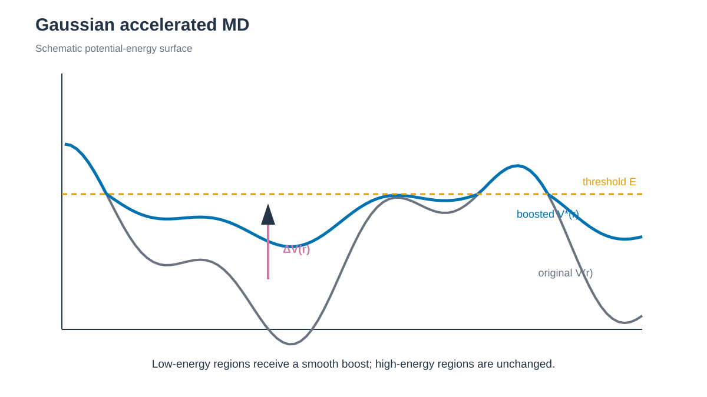

# Gaussian accelerated MD / Gaussian 가속 MD

*Threshold 아래의 low-energy region에 smooth boost를 더해 barrier crossing을 촉진합니다. / A smooth boost is added below the threshold to facilitate barrier crossing.*

## 한국어

GaMD는 potential energy가 threshold보다 낮을 때 smooth harmonic boost를 더해
energy barrier를 낮춥니다. 특정 CV를 미리 정하지 않는 대신 boost distribution이
Gaussian에 가까워야 낮은 차수의 cumulant expansion으로 원래 ensemble을 reweight할
수 있습니다. `sigma0`를 크게 하면 acceleration은 커질 수
있지만 reweighting variance도 증가합니다.

| Tutorial | Boost | System |
| --- | --- | --- |
| [4.1 GaMD](4.1_GaMD/README.md) | Total potential과 dihedral dual boost | Chignolin |
| [4.2 LiGaMD3](4.2_LiGaMD3/README.md) | Ligand essential, 나머지 nonbonded, bonded triple boost | Trypsin–benzamidine |
| [4.3 Pep-GaMD](4.3_Pep-GaMD/README.md) | Peptide와 나머지 system dual boost | SH3–peptide |

세 예제는 독립적으로 build합니다. 4 ns 동안 boost 통계를 준비한 뒤 1 ns
production을 실행합니다. Production은 parameter preparation에서 만든 GaMD state를
이어받습니다.

세 폴더는 같은 역할 이름을 사용합니다. `download.sh`와 `prepare.py`가 source
structure를 정리하고, `build.sh`가 force field와 system별 generated input을
만듭니다. `run.sh`는 conventional preparation, GaMD parameter preparation과
고정된 production을 실행합니다. `anal.py`는 GaMD log의 component별 범위,
평균, 표준편차, anharmonicity와 frame 수를 진단합니다.

### 필요한 program

| Program | 사용하는 script |
| --- | --- |
| Amber 26 `pmemd.cuda` (serial GPU) | 세 `run.sh`. 4.2와 4.3은 다른 executable이면 계산 전에 중단합니다. |
| AmberTools 26 `tleap` | 세 `build.sh` |
| AmberTools 26 `antechamber`, `parmchk2`, ParmEd | 4.2 `build.sh`와 `render_inputs.py` |
| `curl`, Python 3 standard library | `download.sh`, `prepare.py`, `anal.py` |

### 계산량

세 tutorial의 stage 길이는 같습니다. 모든 MD stage는 `dt=0.002` ps(2 fs)입니다.

| Stage | Input | 길이 | 조건 |
| --- | --- | --- | --- |
| Minimization | `minimize.in` | 5,000 cycles (처음 2,500 steepest descent) | Restraint 없음 |
| Heating | `heat.in` | 100,000 steps = 200 ps | NVT, 20→300 K, non-solvent restraint 5 kcal/mol/Ų |
| Equilibration | `equilibrate.in` | 50,000 steps = 100 ps | NPT, 1 bar |
| GaMD parameter preparation | `gamd_prepare.in` | 2,000,000 steps = 4 ns | NVT. `ntcmd` 2 ns conventional MD 뒤 `nteb` 2 ns boost equilibration |
| Production | `production.in` | 500,000 steps = 1 ns | NVT, boost parameter 고정, 10 ps 간격 100 frames |

한 tutorial은 GPU 하나에서 `pmemd.cuda`를 다섯 번 순서대로 실행하며 MD 길이는
모두 5.3 ns입니다. 각 stage는 앞 stage의 restart에서 시작합니다.

### 결과 해석

`python3 anal.py`는 `work/production.gamd.log`를 읽어 `work/boost_summary.tsv`와
frame별 `work/boost_frames.tsv`를 씁니다. Component별 행과 합계인 `total` 행이
있습니다. Boost 단위는 kcal/mol입니다.

| Column | 확인할 내용 |
| --- | --- |
| `frames` | 100이어야 합니다. 다르면 `anal.py`가 중단합니다. |
| `mean_kcal_mol`, `std_kcal_mol` | Boost 크기와 폭입니다. `std`를 `sigma0*` 상한 6 kcal/mol과 비교합니다. |
| `anharmonicity` | Boost distribution의 Gaussian 엔트로피와 histogram 엔트로피 차이 γ입니다(Miao et al. 2014). Gaussian이면 0이고 클수록 2차 cumulant expansion의 오차가 커집니다. |
| `effective_sample_size` | `exp(βΔV)` weight(300 K)의 effective sample size입니다. 100보다 훨씬 작으면 소수 frame이 reweighting을 좌우합니다. |

Reweighting 전에 `total` 행의 anharmonicity를 확인합니다. 2차 cumulant
expansion은 boost distribution이 Gaussian에 가까울 때만 정확합니다(Amber 26
manual 26.3). 100 frames의 histogram 추정은 거칩니다. Anharmonicity가 크면
PMF를 정량값으로 쓰지 않고 production을 늘리거나 template에서 `sigma0*`를
낮춥니다. PMF 계산은
[7.2 GaMD reweighting](../../2_Analysis/7_Enhanced_Sampling/7.2_GaMD_Reweighting/README.md)에서
이어서 실행합니다.

실행 상태, 실패 후 재실행, 동시 실행 보호는 [GUIDE.md 부록](../../GUIDE.md#4-부록-실행-상태와-복구)을 참고합니다.

## English

GaMD adds a smooth harmonic boost when the potential energy is below a
threshold, lowering energy barriers without choosing a CV. Cumulant reweighting
instead relies on an approximately Gaussian boost distribution; increasing `sigma0` can improve acceleration while
increasing the reweighting variance.

| Tutorial | Boost | System |
| --- | --- | --- |
| [4.1 GaMD](4.1_GaMD/README.md) | Total-potential and dihedral dual boost | Chignolin |
| [4.2 LiGaMD3](4.2_LiGaMD3/README.md) | Ligand-essential, remaining nonbonded and bonded triple boost | Trypsin–benzamidine |
| [4.3 Pep-GaMD](4.3_Pep-GaMD/README.md) | Peptide and remaining-system dual boost | SH3–peptide |

The three examples are built independently. Each prepares boost statistics for
4 ns and runs one 1 ns production calculation, which continues from the saved
GaMD preparation state.

Each folder uses the same role names. `download.sh` and `prepare.py` prepare
the source structure, `build.sh` creates the force-field system and generated
inputs, and `run.sh` runs conventional preparation, GaMD parameter preparation
and the fixed production. `anal.py` reports component-wise boost ranges, means,
standard deviations, anharmonicity and frame counts from the GaMD log.

### Required programs

| Program | Used by |
| --- | --- |
| Amber 26 `pmemd.cuda` (serial GPU) | All three `run.sh`. 4.2 and 4.3 stop before computing with any other executable. |
| AmberTools 26 `tleap` | All three `build.sh` |
| AmberTools 26 `antechamber`, `parmchk2`, ParmEd | 4.2 `build.sh` and `render_inputs.py` |
| `curl`, Python 3 standard library | `download.sh`, `prepare.py`, `anal.py` |

### Expected computation

All three tutorials use the same stage lengths. Every MD stage uses
`dt=0.002` ps (2 fs).

| Stage | Input | Length | Conditions |
| --- | --- | --- | --- |
| Minimization | `minimize.in` | 5,000 cycles (first 2,500 steepest descent) | No restraint |
| Heating | `heat.in` | 100,000 steps = 200 ps | NVT, 20→300 K, 5 kcal/mol/Ų non-solvent restraint |
| Equilibration | `equilibrate.in` | 50,000 steps = 100 ps | NPT, 1 bar |
| GaMD parameter preparation | `gamd_prepare.in` | 2,000,000 steps = 4 ns | NVT; 2 ns of `ntcmd` conventional MD, then 2 ns of `nteb` boost equilibration |
| Production | `production.in` | 500,000 steps = 1 ns | NVT, fixed boost parameters, 100 frames at 10 ps |

Each tutorial runs `pmemd.cuda` five times in sequence on one GPU, 5.3 ns of
MD in total. Each stage starts from the previous stage's restart.

### Interpreting the results

`python3 anal.py` reads `work/production.gamd.log` and writes
`work/boost_summary.tsv` and the per-frame `work/boost_frames.tsv`, with one
row per component and a `total` row. Boosts are in kcal/mol.

| Column | What to check |
| --- | --- |
| `frames` | Must be 100; otherwise `anal.py` stops. |
| `mean_kcal_mol`, `std_kcal_mol` | Boost size and width. Compare `std` with the 6 kcal/mol `sigma0*` limit. |
| `anharmonicity` | γ, the difference between the Gaussian and histogram entropies of the boost distribution (Miao et al. 2014). It is 0 for a Gaussian; larger values mean larger second-order cumulant errors. |
| `effective_sample_size` | Effective sample size of the `exp(βΔV)` weights at 300 K. Values far below 100 mean that a few frames dominate reweighting. |

Check the anharmonicity of the `total` row before reweighting. The second-order
cumulant expansion is accurate only for a near-Gaussian boost distribution
(Amber 26 manual 26.3), and a 100-frame histogram gives only a rough estimate.
If the anharmonicity is large, do not use the PMF quantitatively; extend
production or lower `sigma0*` in the template. Compute the PMF next in
[7.2 GaMD reweighting](../../2_Analysis/7_Enhanced_Sampling/7.2_GaMD_Reweighting/README.md).

See [GUIDE.md appendix](../../GUIDE.md#4-appendix-run-state-and-recovery) for run state, reruns after failure and concurrent-run protection.

## References / 참고 자료

- Miao Y. et al. Improved reweighting of accelerated molecular dynamics
  simulations for free energy calculation. *J. Chem. Theory Comput.* 2014, 10,
  2677–2689. [doi:10.1021/ct500090q](https://doi.org/10.1021/ct500090q)
- Amber 26 Reference Manual, section 26.3 Gaussian Accelerated Molecular Dynamics
