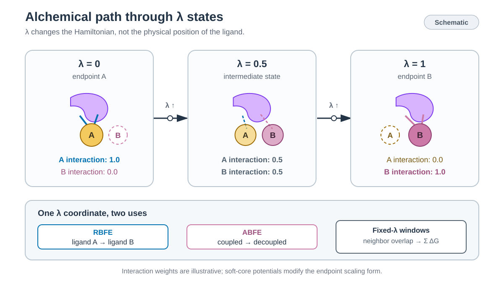

# Free-energy perturbation



*각 lambda window에서 서로 다른 Hamiltonian을 sampling하고 인접 state의 free-energy 차이를 합산합니다. / Each lambda window samples a different Hamiltonian, and adjacent-state free-energy differences are accumulated.*


## 한국어

Alchemical calculation은 실제 결합·해리 경로 대신 lambda에 따라 Hamiltonian의
interaction을 단계적으로 바꿉니다. Lambda는 simulation time이나 ligand의 물리적
이동 거리가 아니라 두 endpoint 사이의 alchemical state를 나타냅니다.
인접한 lambda state가 비슷한 configuration을 sampling해야 state 사이의
free-energy 차이를 계산할 수 있습니다.

| Tutorial | 계산 | System |
| --- | --- | --- |
| [5.1 RBFE](5.1_RBFE/) | 두 ligand의 상대 결합 자유에너지 | T4 lysozyme L99A, benzene → toluene |
| [5.2 ABFE](5.2_ABFE/) | 한 ligand의 표준 결합 자유에너지 | T4 lysozyme L99A/M102Q–JZ4, PDB 3HTB |

두 예제 모두 AMBER가 각 configuration을 모든 lambda state에서 다시 평가하도록
`ifmbar=1`을 사용합니다. `anal.py`는 AmberTools 26 FE-ToolKit의
`edgembar-amber2dats.py`로 자료를 변환하고 `edgembar --mode=AUTO`로 Gibbs
free energy와 bootstrap uncertainty를 계산합니다. 전체 cross-state matrix가 있으면
MBAR와 state overlap을 계산하고, 인접 state energy만 있으면 BAR를 사용합니다.
Window당 1 ns는 실행 가능한 tutorial 기본값이며 수렴된 연구 결과를 보장하지
않습니다.

### 필요한 program

| Program | 사용하는 script | 역할 |
| --- | --- | --- |
| Amber 26 `pmemd.cuda` | `run.sh` | ACES26 soft-core(`aces26=1`) input을 실행합니다. `run.sh`는 다른 engine을 거부합니다. |
| AmberTools 26 `antechamber`, `parmchk2`, `tleap` | `build.sh` | GAFF2/AM1-BCC ligand parameter와 topology를 만듭니다. |
| ParmEd Python module | `build.sh`, `generate_inputs.py` | Common core, restraint atom 번호와 window input을 만듭니다. |
| FE-ToolKit `edgembar-amber2dats.py`, `edgembar` | `anal.py` | AmberTools 26에 포함됩니다. Energy 추출, MBAR/BAR와 bootstrap을 계산합니다. |

`anal.py`는 pymbar나 alchemlyb를 사용하지 않습니다.

```bash
conda activate ambertools26
command -v edgembar-amber2dats.py
command -v edgembar
```

### 계산량

모든 window는 같은 네 stage를 실행합니다. MD stage는 `dt=0.002` ps(2 fs)입니다.

| Stage | 길이 | 조건 |
| --- | --- | --- |
| Minimization | 5,000 cycles | RBFE는 전부 steepest descent(`ntmin=2`), ABFE는 처음 2,500 cycles steepest descent |
| Heating | 100,000 steps = 200 ps | NVT, 0→300 K |
| Equilibration | 50,000 steps = 100 ps | NPT, 1 bar |
| Production | 500,000 steps = 1 ns | NPT, `ifmbar=1`, 10 ps마다 frame 저장(window당 100 frames) |

| Tutorial | Window | `pmemd.cuda` 실행 | MD 합계 | Production 합계 |
| --- | --- | --- | --- | --- |
| RBFE | 22 (complex 11, solvent 11) | 88 | 28.6 ns | 22 ns |
| ABFE | 65 (restraint 11, charge 22, LJ 32) | 260 | 84.5 ns | 65 ns |

`run.sh`는 `work/states.tsv` 순서대로 window를 하나씩 실행하므로 GPU 하나를
사용합니다. Tutorial `run.sh`에는 window 선택 option이 없습니다. Window를 나누어
동시에 실행하려면 template의 `--system`, `--stage`(ABFE만), `--windows`를 사용합니다.

### 결과 해석

값의 단위는 kcal/mol입니다. Uncertainty는 `edgembar` bootstrap 20회로 추정한
statistical uncertainty이며 force field 오차나 sampling하지 못한 configuration의
영향은 포함하지 않습니다.

| 값 | 부호 |
| --- | --- |
| RBFE `relative_binding_delta_delta_g` | `complex_delta_g - solvent_delta_g`입니다. 두 항은 λ=0(benzene)→λ=1(toluene) 방향입니다. 음수이면 toluene이 benzene보다 강하게 결합합니다. |
| ABFE `corrected_standard_binding_delta_g` | 1 M standard state의 `ΔG°bind`입니다. 음수이면 결합이 유리합니다. Stage별 값은 simulation 방향(interacting→decoupled, restrained→unrestrained)이며 cycle의 부호는 [5.2 README](5.2_ABFE/README.md)를 따릅니다. |

최종 값보다 `work/overlap_matrix.tsv`를 먼저 봅니다. 인접 state pair(sampled
λᵢ, evaluated λᵢ₊₁ 또는 λᵢ₋₁)의 overlap이 약 0.03 이상이면 흔히 쓰는 기준을
만족합니다(Klimovich, Shirts & Mobley 2015). 이보다 작은 pair가 있으면 그 λ
구간에 window를 추가합니다. Template의 explicit lambda list로 다시 build하고
production을 늘리는 것도 함께 검토합니다.

`work/mbar_diagnostics.tsv`에서 `equilibrated`가 `false`인 state는 FE-ToolKit이
production 구간을 평형으로 판정하지 못한 경우입니다. 이 state는 더 긴 window로
다시 계산합니다.

ACES26 cross-state energy와 ABFE restraint scaling은 Amber 26
`pmemd.cuda` short run으로 아직 검증하지 않았습니다(미검증). 두 tutorial의
input은 실제 GPU mdout에 모든 lambda의 `MBAR Energy analysis` block이 기록되는지
확인한 뒤 사용합니다.

실행 상태, 실패 후 재실행, 동시 실행 보호는 [GUIDE.md 부록](../../GUIDE.md#4-부록-실행-상태와-복구)을 참고합니다.

## English

Alchemical calculations scale Hamiltonian interactions across lambda states
instead of sampling a physical binding or unbinding path. Lambda is an
alchemical state coordinate, not simulation time or ligand displacement.
Neighboring lambda states must sample overlapping configurations for reliable
free-energy estimates.

| Tutorial | Calculation | System |
| --- | --- | --- |
| [5.1 RBFE](5.1_RBFE/) | Relative binding free energy of two ligands | T4 lysozyme L99A, benzene → toluene |
| [5.2 ABFE](5.2_ABFE/) | Standard binding free energy of one ligand | T4 lysozyme L99A/M102Q–JZ4, PDB 3HTB |

Both examples use AMBER `ifmbar=1` so that each configuration is re-evaluated at
every lambda state. `anal.py` converts the data with AmberTools 26 FE-ToolKit
`edgembar-amber2dats.py` and computes Gibbs free energies and bootstrap
uncertainties with `edgembar --mode=AUTO`: MBAR with state overlap for a complete
cross-state matrix, or BAR when only adjacent-state energies are available. One
nanosecond of production per window is a runnable tutorial default, not a
converged research result.

### Required programs

| Program | Used by | Role |
| --- | --- | --- |
| Amber 26 `pmemd.cuda` | `run.sh` | Runs the ACES26 soft-core (`aces26=1`) inputs; `run.sh` rejects other engines. |
| AmberTools 26 `antechamber`, `parmchk2`, `tleap` | `build.sh` | Create GAFF2/AM1-BCC ligand parameters and topologies. |
| ParmEd Python module | `build.sh`, `generate_inputs.py` | Builds the common core, restraint atom indices and window inputs. |
| FE-ToolKit `edgembar-amber2dats.py`, `edgembar` | `anal.py` | Shipped with AmberTools 26; extract energies and compute MBAR/BAR and bootstrap errors. |

`anal.py` does not use pymbar or alchemlyb.

```bash
conda activate ambertools26
command -v edgembar-amber2dats.py
command -v edgembar
```

### Expected computation

Every window runs the same four stages. MD stages use `dt=0.002` ps (2 fs).

| Stage | Length | Conditions |
| --- | --- | --- |
| Minimization | 5,000 cycles | RBFE: steepest descent throughout (`ntmin=2`); ABFE: first 2,500 cycles steepest descent |
| Heating | 100,000 steps = 200 ps | NVT, 0→300 K |
| Equilibration | 50,000 steps = 100 ps | NPT, 1 bar |
| Production | 500,000 steps = 1 ns | NPT, `ifmbar=1`, one frame every 10 ps (100 frames per window) |

| Tutorial | Windows | `pmemd.cuda` runs | Total MD | Total production |
| --- | --- | --- | --- | --- |
| RBFE | 22 (complex 11, solvent 11) | 88 | 28.6 ns | 22 ns |
| ABFE | 65 (restraint 11, charge 22, LJ 32) | 260 | 84.5 ns | 65 ns |

`run.sh` runs the windows one after another in `work/states.tsv` order, so it
uses one GPU. The tutorial `run.sh` has no window selection. To split windows
across concurrent runs, use the template options `--system`, `--stage` (ABFE only) and
`--windows`.

### Interpreting the results

Values are in kcal/mol. The uncertainty is the statistical uncertainty from 20
`edgembar` bootstrap samples; it does not include force-field error or
configurations that were never sampled.

| Value | Sign |
| --- | --- |
| RBFE `relative_binding_delta_delta_g` | `complex_delta_g - solvent_delta_g`, both for λ=0 (benzene) → λ=1 (toluene). A negative value means toluene binds more strongly than benzene. |
| ABFE `corrected_standard_binding_delta_g` | `ΔG°bind` for the 1 M standard state; negative means favorable binding. Stage values follow the simulated direction (interacting → decoupled, restrained → unrestrained); the cycle signs are given in the [5.2 README](5.2_ABFE/README.md). |

Check `work/overlap_matrix.tsv` before the final value. Neighboring-state
overlap (sampled λᵢ, evaluated λᵢ₊₁ or λᵢ₋₁) of about 0.03 or more meets a
common guideline (Klimovich, Shirts & Mobley 2015). If a pair falls below it,
add windows in that λ region by rebuilding from the template's explicit lambda
lists, and consider longer production as well.

In `work/mbar_diagnostics.tsv`, `equilibrated=false` means FE-ToolKit did not
find an equilibrated production region for that state. Rerun such states with
longer windows.

The ACES26 cross-state energies and ABFE restraint scaling have not yet been
validated with a short Amber 26 `pmemd.cuda` run (unverified). Confirm that the
GPU mdout contains the `MBAR Energy analysis` block for every lambda before
using either tutorial's inputs.

See [GUIDE.md appendix](../../GUIDE.md#4-appendix-run-state-and-recovery) for run state, reruns after failure and concurrent-run protection.

## References / 참고 자료

- Klimovich, P. V.; Shirts, M. R.; Mobley, D. L. Guidelines for the analysis of
  free energy calculations. *J. Comput.-Aided Mol. Des.* **2015**, 29, 397–411.
  [doi:10.1007/s10822-015-9840-9](https://doi.org/10.1007/s10822-015-9840-9)
