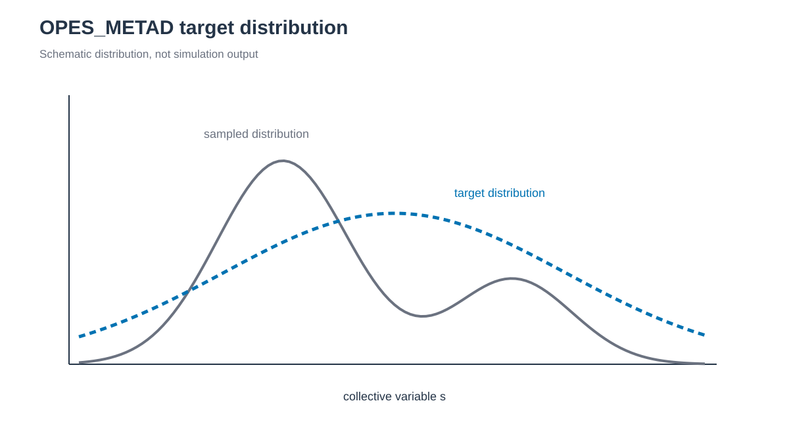

# OPES_METAD



*방문한 CV data로 `P_n(s)`를 먼저 추정한 뒤 well-tempered target에 필요한 bias를 계산합니다. / Visited CV data first estimate `P_n(s)`, from which the bias required for a well-tempered target is calculated.*

## 한국어

MetaD가 방문한 CV 위치에 bias를 직접 누적한다면, OPES_METAD는 방문 data를
reweighting하고 kernel density estimate를 사용해 unbiased probability
distribution `P_n(s)`를 먼저 추정합니다. 이어서 well-tempered target
distribution을 sampling하는 데 필요한 bias를 계산합니다. 여기서는 alanine
dipeptide의 φ와 ψ를 bias합니다.

φ는 atom 5,7,9,15(ACE C, ALA N, CA, C), ψ는 atom 7,9,15,17(ALA N, CA, C,
NME N)입니다. `check_topology.py`가 build 직후 이 번호를 확인합니다.

준비할 software와 AMBER–PLUMED 연결 방식은 [상위 README](../README.md)에 있습니다.

### Script 역할

| 파일 | 역할 |
|---|---|
| `build.sh` | Argument로 받은 capped alanine PDB의 ff19SB/OPC topology를 만들고 CV atom을 확인합니다. |
| `check_topology.py` | `build.sh`가 자동 호출하며 CV atom 번호와 이름을 검사합니다. |
| `run.sh` | preparation stage와 1 ns OPES_METAD production을 실행합니다. |
| `anal.py` | φ/ψ, bias, effective sample size와 kernel 수를 production 전체에서 요약합니다. |

### 실행

PLUMED 2.10은 `opes` module을 기본으로 build하지 않습니다. PLUMED configure에
`--enable-modules=opes`를 추가하고 실행 전에 action을 확인합니다. `run.sh`도 같은
검사를 수행합니다.

```bash
plumed manual --action OPES_METAD
```

```bash
cd 1_Simulation/6_MetaD/6.3_OPES_METAD
./build.sh structure/alanine-dipeptide.pdb
./run.sh
python3 anal.py
```

### 주요 output

| 파일 | 내용 |
|---|---|
| `work/COLVAR` | φ, ψ, `opes.bias`, `opes.rct`, `opes.neff`, `opes.nker` |
| `work/KERNELS` | Distribution estimate에 사용된 compressed kernel history |
| `work/opes.state` | 마지막 adaptive state(`STATE_WFILE`) |
| `work/analysis/production_summary.tsv` | φ/ψ와 bias 범위, 마지막 effective sample size와 kernel 수 |

각 kernel을 MetaD hill과 같은 direct bias deposit으로 해석하지 않습니다.
`opes.rct`는 c(t) 추정값이며 PLUMED 문서에 따라 reweighting에 쓰지 않습니다.
`anal.py`는 `COLVAR`의 header와 finite 값을 확인하고, 잘못된 input이면 기존
analysis 결과를 교체하지 않습니다.

### 결과 확인과 해석

`run.sh`는 `1 ns OPES_METAD production completed: .../work/production.nc`로
끝나고 `python3 anal.py`는 `OPES_METAD diagnostics results: .../work/analysis`로
끝납니다. `COLVAR`의 `opes.nker`는 kernel 수, `opes.neff`는 effective sample
size입니다.

FES는 `COLVAR`의 bias로 reweight해서 얻습니다(Invernizzi & Parrinello,
*J. Phys. Chem. Lett.* 11:2731, 2020; PLUMED `OPES_METAD` 문서). 초기 구간을 제외한
각 행에 `w = exp(opes.bias / kT)`를 주고, 300 K에서 `kT = 2.494 kJ/mol`입니다.
가중 φ/ψ histogram `P(φ, ψ)`에서 `F = −kT ln P`를 계산하고 최솟값을 0으로
옮깁니다. 이 tutorial의 `COLVAR`는 10 ps마다 한 행이라 1 ns에 약 100개
sample만 남습니다.

### 주요 option

| Keyword | 값 | Unit | 의미 |
| --- | --- | --- | --- |
| `TEMP` | 300 | K | Thermostat 온도와 같아야 합니다. |
| `PACE` | 500 | step(1 ps) | Kernel 추가와 bias update 간격 |
| `BARRIER` | 50 | kJ/mol | 넘어야 할 free-energy barrier 추정값. PLUMED가 bias factor, regularization과 kernel cutoff 기본값을 정하는 데 씁니다. |
| `SIGMA` | 0.15, 0.15 | rad | φ, ψ의 처음 kernel width. Simulation이 진행되면 PLUMED가 줄입니다. |
| `STATE_WSTRIDE` | 50000 | step(100 ps) | `opes.state` 쓰기 간격 |
| `PRINT STRIDE` | 5000 | step(10 ps) | `COLVAR` 출력 간격 |
| Production `nstlim`, `dt` | 500000, 0.002 | step, ps | 1 ns production |
| Production `ntp`, `barostat`, `pres0` | 1, 1, 1.0 | –, –, bar | Berendsen barostat를 쓰는 NPT |

`BARRIER`는 simulation 온도와 system에 맞춰 정합니다.

100 ps NPT equilibration은 `skinnb=5.0 Å`로 GPU pair-list 여유를 늘립니다.
같은 solvent box를 사용하는 WT-MetaD에서 확인한 설정이며 실제 cutoff는
`cut=10.0 Å`로 유지됩니다.

Parse-only 검사는 별도 임시 filename을 사용하므로 production의 `KERNELS`,
`opes.state`와 `COLVAR`를 생성하거나 partial production으로 판정하지 않습니다.

### 문제 해결

| Error message | 확인할 것 |
| --- | --- |
| `PLUMED OPES_METAD is unavailable` | PLUMED 2.10을 `--enable-modules=opes`로 다시 build합니다. |
| `PLUMED input check failed: .../plumed.parse.dat` | `work/plumed.parse.log` |
| `production failed. Engine output: .../production.out` | PLUMED error는 `work/engine.production.log`에 있습니다. |
| `Partial production output already exists and is retained` | Error에 출력된 `mv` command로 `KERNELS`, `opes.state`를 포함한 partial output을 옮기고 `./run.sh`를 다시 실행합니다. |

### 주의

이 example은 adaptive state와 restart를 학습하는 용도입니다. 1 ns 결과로
정량 free energy나 수렴을 판단하지 않습니다. Keyword는 PLUMED 2.10
[`OPES_METAD`](https://www.plumed.org/doc-v2.10/user-doc/html/_o_p_e_s__m_e_t_a_d.html)를
기준으로 작성했습니다.

실행 상태, 실패 후 재실행, 동시 실행 보호는 [GUIDE.md 부록](../../../GUIDE.md#4-부록-실행-상태와-복구)을
참고합니다.

## English

Unlike MetaD, which directly accumulates bias at visited CV positions,
OPES_METAD reweights the visited data and uses a kernel-density estimate of the
unbiased probability distribution `P_n(s)`. It then calculates the bias required
to sample a well-tempered target distribution. Here it biases the φ and ψ
torsions of alanine dipeptide.

φ uses atoms 5,7,9,15 (ACE C, ALA N, CA, C) and ψ uses atoms 7,9,15,17
(ALA N, CA, C, NME N); `check_topology.py` checks them right after the build.

Required software and the AMBER–PLUMED coupling are described in the
[parent README](../README.md).

### Script roles

| File | Role |
|---|---|
| `build.sh` | Builds the ff19SB/OPC topology from the capped alanine PDB given as an argument and checks the CV atoms. |
| `check_topology.py` | Called by `build.sh`; checks CV atom numbers and names. |
| `run.sh` | Runs the preparation stages and 1 ns OPES_METAD production. |
| `anal.py` | Summarizes φ/ψ, bias, effective sample size and kernel count over the whole production. |

### Run

PLUMED 2.10 does not build the `opes` module by default. Configure PLUMED with
`--enable-modules=opes` and check the action before running. `run.sh` performs
the same check.

```bash
plumed manual --action OPES_METAD
```

```bash
cd 1_Simulation/6_MetaD/6.3_OPES_METAD
./build.sh structure/alanine-dipeptide.pdb
./run.sh
python3 anal.py
```

### Main outputs

| File | Content |
|---|---|
| `work/COLVAR` | φ, ψ, `opes.bias`, `opes.rct`, `opes.neff`, `opes.nker` |
| `work/KERNELS` | Compressed kernel history used for the distribution estimate |
| `work/opes.state` | Final adaptive state (`STATE_WFILE`) |
| `work/analysis/production_summary.tsv` | φ/ψ and bias ranges, final effective sample size and kernel count |

Kernels are not direct bias deposits like MetaD hills. `opes.rct` is the c(t)
estimate; the PLUMED documentation says not to use it for reweighting.
`anal.py` checks the `COLVAR` header and finite values and leaves previous
analysis results in place on invalid input.

### Success check and interpretation

`run.sh` ends with `1 ns OPES_METAD production completed: .../work/production.nc`,
and `python3 anal.py` ends with
`OPES_METAD diagnostics results: .../work/analysis`. In `COLVAR`, `opes.nker` is
the kernel count and `opes.neff` the effective sample size.

Obtain the FES by reweighting with the bias in `COLVAR` (Invernizzi &
Parrinello, *J. Phys. Chem. Lett.* 11:2731, 2020; PLUMED `OPES_METAD`
documentation). After discarding the initial part, give each row
`w = exp(opes.bias / kT)`, with `kT = 2.494 kJ/mol` at 300 K. Compute
`F = −kT ln P` from the weighted φ/ψ histogram `P(φ, ψ)` and shift its minimum
to zero. This tutorial writes one `COLVAR` row per 10 ps, leaving only about
100 samples in 1 ns.

### Key options

| Keyword | Value | Unit | Meaning |
| --- | --- | --- | --- |
| `TEMP` | 300 | K | Must match the thermostat temperature. |
| `PACE` | 500 | step (1 ps) | Kernel deposition and bias-update interval |
| `BARRIER` | 50 | kJ/mol | Estimated free-energy barrier; PLUMED uses it to set default bias factor, regularization and kernel cutoff. |
| `SIGMA` | 0.15, 0.15 | rad | Initial φ, ψ kernel widths; PLUMED shrinks them as the run proceeds. |
| `STATE_WSTRIDE` | 50000 | step (100 ps) | `opes.state` write interval |
| `PRINT STRIDE` | 5000 | step (10 ps) | `COLVAR` interval |
| Production `nstlim`, `dt` | 500000, 0.002 | step, ps | 1 ns production |
| Production `ntp`, `barostat`, `pres0` | 1, 1, 1.0 | –, –, bar | NPT with the Berendsen barostat |

Choose `BARRIER` for the simulation temperature and system.

The 100 ps NPT equilibration uses `skinnb=5.0 Å` to enlarge the GPU pair-list
margin. The setting was checked with WT-MetaD on the same solvent box, and the
physical cutoff stays at `cut=10.0 Å`.

The parse-only check uses separate temporary filenames, so it neither creates
production `KERNELS`, `opes.state` or `COLVAR` nor counts as partial
production.

### Troubleshooting

| Error message | What to check |
| --- | --- |
| `PLUMED OPES_METAD is unavailable` | Rebuild PLUMED 2.10 with `--enable-modules=opes`. |
| `PLUMED input check failed: .../plumed.parse.dat` | `work/plumed.parse.log` |
| `production failed. Engine output: .../production.out` | PLUMED errors are in `work/engine.production.log`. |
| `Partial production output already exists and is retained` | Move the partial output, including `KERNELS` and `opes.state`, with the printed `mv` command and rerun `./run.sh`. |

### Cautions

This example teaches adaptive state and restart handling. Do not judge
quantitative free energies or convergence from the 1 ns result. Keywords follow
PLUMED 2.10
[`OPES_METAD`](https://www.plumed.org/doc-v2.10/user-doc/html/_o_p_e_s__m_e_t_a_d.html).

See [GUIDE.md appendix](../../../GUIDE.md#4-appendix-run-state-and-recovery) for run state, reruns after failure and
concurrent-run protection.
