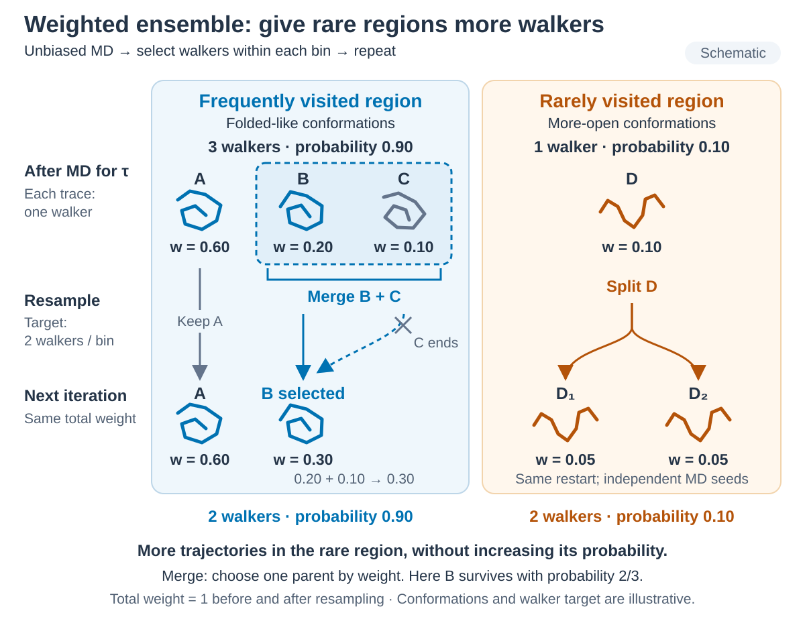

# Weighted ensemble

*Walker를 bin 안에서 split하거나 merge해도 statistical weight의 합은 보존됩니다. / Splitting or merging walkers within bins preserves total statistical weight.*

## 한국어

Weighted ensemble은 짧은 trajectory segment를 여러 개 전파한 뒤 progress
coordinate bin에서 walker를 split하거나 merge합니다. WESTPA가 walker weight와
resampling을 관리하고 MD engine은 각 segment의 dynamics만 계산합니다.

- [WESTPA + AMBER](6.1_WESTPA_AMBER/): Explicit-solvent Chignolin Cα RMSD sampling

이 예제는 WESTPA–AMBER 연결, restart 전달, weight 보존과 weighted bin
occupancy 분석을 다룹니다. Partially unfolded target은 학습용 정의이며 target
도달 횟수를 folding 또는 unfolding rate로 해석하지 않습니다.

### 준비

| 항목 | 조건 |
| --- | --- |
| WESTPA | WESTPA 2. `w_init`, `w_run`이 같은 environment의 `PATH`에 있어야 합니다. 미완료 segment 처리 설명은 WESTPA 2022.15 동작 기준입니다. |
| AMBER | AmberTools `tleap`, `cpptraj`와 `pmemd.cuda`. `TLEAP`, `CPPTRAJ`, `AMBER_ENGINE`으로 executable을 바꿀 수 있습니다. |
| Python | `anal.py`가 `h5py`로 `west.h5`를 읽습니다. |

WESTPA 설치는 저장소 [README](../../README.md)의 Conda 예시를 따릅니다.

## English

Weighted ensemble propagates many short trajectory segments and then splits or
merges walkers across progress-coordinate bins. WESTPA manages walker weights
and resampling; the MD engine computes only the dynamics of each segment.

- [WESTPA + AMBER](6.1_WESTPA_AMBER/): Explicit-solvent Chignolin Cα RMSD sampling

The example covers the WESTPA–AMBER coupling, restart handoff, weight
conservation and weighted bin-occupancy analysis. The partially unfolded target
is a teaching definition; target arrival counts are not a folding or unfolding
rate.

### Prerequisites

| Item | Requirement |
| --- | --- |
| WESTPA | WESTPA 2, with `w_init` and `w_run` on the `PATH` of the same environment. The incomplete-segment behavior described here follows WESTPA 2022.15. |
| AMBER | AmberTools `tleap` and `cpptraj`, plus `pmemd.cuda`. Override them with `TLEAP`, `CPPTRAJ` and `AMBER_ENGINE`. |
| Python | `anal.py` reads `west.h5` with `h5py`. |

Install WESTPA as in the Conda example of the repository [README](../../README.md).
