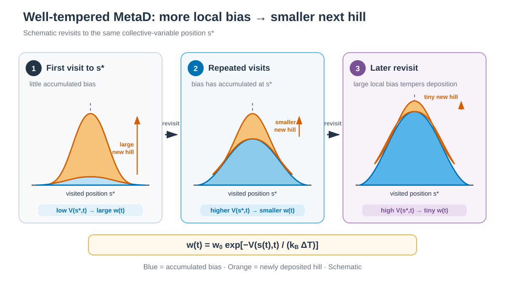

# Well-Tempered Metadynamics



*같은 CV 위치를 다시 방문하면 accumulated bias는 커지고 그 위에 추가되는 새 hill은 작아집니다. / Revisiting the same CV position increases its accumulated bias and reduces the next deposited hill.*

## 한국어

Alanine dipeptide의 φ와 ψ torsion에 well-tempered MetaD bias를 적용합니다.
방문한 위치에 Gaussian을 쌓되, 현재 위치 `s(t)`의 accumulated bias
`V(s(t),t)`가 클수록 새 hill의 height를 지수적으로 낮춥니다. 따라서 hill이
simulation time에 따라 모든 위치에서 일률적으로 작아지는 것이 아닙니다.

φ는 atom 5,7,9,15(ACE C, ALA N, CA, C), ψ는 atom 7,9,15,17(ALA N, CA, C,
NME N)입니다. `check_topology.py`가 build 직후 이 번호를 확인합니다.

준비할 software와 AMBER–PLUMED 연결 방식은 [상위 README](../README.md)에 있습니다.

### Script 역할

| 파일 | 역할 |
|---|---|
| `build.sh` | Argument로 받은 capped alanine PDB에서 ff19SB/OPC solvent box와 topology를 생성합니다. |
| `check_topology.py` | build가 끝날 때 CV atom 번호와 atom 이름을 확인합니다. |
| `run.sh` | minimization, 200 ps heating, 100 ps NPT equilibration과 1 ns production을 실행합니다. Production output은 `work/`에 저장합니다. |
| `anal.py` | φ/ψ 및 bias 범위를 기록하고 1 ns 누적 `HILLS`로 FES를 만듭니다. |

### 실행

```bash
cd 1_Simulation/7_MetaD/7.1_WT-MetaD
./build.sh structure/alanine-dipeptide.pdb
./run.sh
python3 anal.py
```

`AMBER_ENGINE`과 `PLUMED`로 executable을 지정할 수 있습니다. 고정 seed와
system별 production 설정을 바꾸려면 `3_Templates/7_MetaD/7.1_WT-MetaD`를
사용합니다.

### 주요 output

| 파일 | 내용 |
|---|---|
| `work/COLVAR` | 5000 steps(10 ps)마다 φ, ψ, `metad.bias`, `metad.rbias` |
| `work/HILLS` | 1 ps마다 추가한 Gaussian. Bias를 복원하는 기록이며 `COLVAR`를 대신하지 않습니다. |
| `work/analysis/production_summary.tsv`, `sampling_summary.tsv` | φ/ψ와 bias 범위, φ/ψ 부호가 바뀐 횟수 |
| `work/analysis/fes.dat` | `plumed sum_hills`로 만든 FES |

PLUMED가 없는 분석 환경에서는 `python3 anal.py --skip-fes`로 diagnostic TSV만
생성합니다. 이때 새 결과에는 과거 FES를 포함하지 않습니다. `anal.py`는
`COLVAR`의 header와 finite 값을 확인하고, 잘못된 input이면 기존 analysis 결과를
교체하지 않습니다.

### 결과 확인과 해석

`run.sh`는 `1 ns WT-MetaD production completed: .../work/production.nc`로 끝나고
`python3 anal.py`는 `WT-MetaD diagnostics results: .../work/analysis`로 끝납니다.
`HILLS`에는 1000개 안팎의 hill이 있어야 합니다.

Well-tempered `HILLS`에는 bias factor로 rescale한 height가 기록되므로
`sum_hills` 결과가 바로 FES 추정값입니다(PLUMED `METAD` 문서). 시간에 따른
변화를 보려면 200 hill(200 ps)마다 FES를 따로 만들고 basin 사이 free-energy
차이가 일정해지는지 비교합니다.

```bash
mkdir -p work/fes_time
plumed sum_hills --hills work/HILLS --stride 200 --mintozero --outfile work/fes_time/fes_
```

다른 observable은 `COLVAR`의 `metad.rbias`(= bias − c(t))로 reweight합니다. Frame
weight는 `w = exp(metad.rbias / kT)`이고 300 K에서 `kT = 2.494 kJ/mol`입니다
(Tiwary & Parrinello, *J. Phys. Chem. B* 119:736, 2015). 초기 구간은 제외합니다.
이 tutorial의 `COLVAR`는 10 ps마다 한 행이라 1 ns에 약 100개 sample만 남습니다.

### 주요 option

| Keyword | 값 | Unit | 의미 |
| --- | --- | --- | --- |
| `SIGMA` | 0.2, 0.2 | rad | φ, ψ Gaussian width |
| `HEIGHT` | 1.2 | kJ/mol | 처음 hill height |
| `PACE` | 500 | step(1 ps) | Hill 추가 간격 |
| `BIASFACTOR` | 10 | – | Well-tempered tempering. 같은 위치를 다시 방문할수록 hill이 작아집니다. |
| `TEMP` | 300 | K | Thermostat 온도와 같아야 합니다. |
| `GRID_MIN`, `GRID_MAX`, `GRID_BIN` | -π, π, 200 | rad, bin | Periodic torsion 전체를 덮는 bias grid |
| `CALC_RCT` | 사용 | – | c(t)를 계산해 `metad.rct`, `metad.rbias`를 출력합니다. |
| `PRINT STRIDE` | 5000 | step(10 ps) | `COLVAR` 출력 간격 |
| Production `nstlim`, `dt` | 500000, 0.002 | step, ps | 1 ns production |
| Production `temp0`, `gamma_ln` | 300, 1.0 | K, ps⁻¹ | Langevin thermostat |
| Production `ntp`, `barostat`, `pres0` | 1, 1, 1.0 | –, –, bar | Berendsen barostat를 쓰는 NPT |

LEaP가 만든 초기 solvent box는 NPT equilibration에서 수축할 수 있습니다.
`equilibrate.in.template`의 `skinnb=5.0 Å`는 실제 `cut=10 Å`를 바꾸지 않고
GPU nonbonded pair-list의 여유 폭을 늘립니다. 따라서 100 ps equilibration을
`pmemd.cuda`에서 한 번에 실행할 때 box 변화로 인한 grid-cell 중단 가능성을
낮춥니다. 더 큰 system에 이 값을 그대로 사용하지 말고
`2 × (cut + skinnb)`가 shortest box dimension보다 작은지 확인합니다.

Production 전 PLUMED parse-only 검사는 `plumed.parse.HILLS`와
`plumed.parse.COLVAR`라는 임시 filename을 사용하고 검사 후 삭제합니다.

### 문제 해결

| Error message | 확인할 것 |
| --- | --- |
| `Executable not found: pmemd.cuda` 또는 `plumed` | `AMBER_ENGINE`, `PLUMED`로 설치 경로를 지정합니다. |
| `PLUMED input check failed: .../plumed.parse.dat` | `work/plumed.parse.log`. Action이나 keyword를 모르면 PLUMED version과 build를 확인합니다. |
| `production failed. Engine output: .../production.out` | PLUMED error는 `work/engine.production.log`에 있습니다. |
| `Partial production output already exists and is retained` | Error에 출력된 `mv` command로 partial output을 옮기고 `./run.sh`를 다시 실행합니다. |
| `anal.py`의 `plumed sum_hills` 실패 | PLUMED가 없는 analysis 환경이면 `python3 anal.py --skip-fes`를 사용합니다. |

### 주의

1 ns는 workflow 학습용 길이입니다. φ/ψ 공간의 수렴이나 정량 free energy를
입증하지 않습니다. FES 비교는 sampling 진행 상황을 보는 용도이며 수렴 판정은
별도의 반복 계산과 오차 분석이 필요합니다. Keyword는 PLUMED 2.10
[`METAD`](https://www.plumed.org/doc-v2.10/user-doc/html/_m_e_t_a_d.html)를
기준으로 작성했습니다.

실행 상태, 실패 후 재실행, 동시 실행 보호는 [GUIDE.md 부록](../../../GUIDE.md#4-부록-실행-상태와-복구)을
참고합니다. Analysis 결과는 `work/analysis/`에 게시하며, 게시가 중단되면
`work/.analysis.pending`이 남습니다.

## English

This example biases the φ and ψ torsions of alanine dipeptide with
well-tempered metadynamics. Gaussians are deposited at visited positions, and
the next hill height is reduced exponentially as the accumulated bias
`V(s(t),t)` at the current position `s(t)` grows. Hill height therefore does not
decrease uniformly everywhere as a function of simulation time.

φ uses atoms 5,7,9,15 (ACE C, ALA N, CA, C) and ψ uses atoms 7,9,15,17
(ALA N, CA, C, NME N); `check_topology.py` checks them right after the build.

Required software and the AMBER–PLUMED coupling are described in the
[parent README](../README.md).

### Script roles

| File | Role |
|---|---|
| `build.sh` | Builds the ff19SB/OPC solvent box and topology from the capped alanine PDB given as an argument. |
| `check_topology.py` | Checks CV atom numbers and names at the end of the build. |
| `run.sh` | Runs minimization, 200 ps heating, 100 ps NPT equilibration and 1 ns production. Production output goes to `work/`. |
| `anal.py` | Records φ/ψ and bias ranges and builds the FES from the accumulated 1 ns `HILLS`. |

### Run

```bash
cd 1_Simulation/7_MetaD/7.1_WT-MetaD
./build.sh structure/alanine-dipeptide.pdb
./run.sh
python3 anal.py
```

`AMBER_ENGINE` and `PLUMED` select the executables. Use
`3_Templates/7_MetaD/7.1_WT-MetaD` for fixed seeds and system-specific
production settings.

### Main outputs

| File | Content |
|---|---|
| `work/COLVAR` | φ, ψ, `metad.bias` and `metad.rbias` every 5000 steps (10 ps) |
| `work/HILLS` | Gaussians deposited every 1 ps. It restores the bias and does not replace `COLVAR`. |
| `work/analysis/production_summary.tsv`, `sampling_summary.tsv` | φ/ψ and bias ranges, φ/ψ sign-change counts |
| `work/analysis/fes.dat` | FES from `plumed sum_hills` |

Without PLUMED in the analysis environment, `python3 anal.py --skip-fes` writes
only the diagnostic TSV files; the new result does not keep the old FES.
`anal.py` checks the `COLVAR` header and finite values and leaves previous
analysis results in place on invalid input.

### Success check and interpretation

`run.sh` ends with `1 ns WT-MetaD production completed: .../work/production.nc`,
and `python3 anal.py` ends with `WT-MetaD diagnostics results: .../work/analysis`.
`HILLS` should hold about 1000 hills.

Well-tempered `HILLS` stores heights rescaled by the bias factor, so the
`sum_hills` output is the FES estimate itself (PLUMED `METAD` documentation).
To follow its time evolution, write one FES per 200 hills (200 ps) and check
whether free-energy differences between basins stop changing.

```bash
mkdir -p work/fes_time
plumed sum_hills --hills work/HILLS --stride 200 --mintozero --outfile work/fes_time/fes_
```

Reweight other observables with `metad.rbias` (= bias − c(t)) from `COLVAR`. The
frame weight is `w = exp(metad.rbias / kT)`, with `kT = 2.494 kJ/mol` at 300 K
(Tiwary & Parrinello, *J. Phys. Chem. B* 119:736, 2015). Discard the initial
part. This tutorial writes one `COLVAR` row per 10 ps, leaving only about 100
samples in 1 ns.

### Key options

| Keyword | Value | Unit | Meaning |
| --- | --- | --- | --- |
| `SIGMA` | 0.2, 0.2 | rad | φ, ψ Gaussian widths |
| `HEIGHT` | 1.2 | kJ/mol | Initial hill height |
| `PACE` | 500 | step (1 ps) | Hill deposition interval |
| `BIASFACTOR` | 10 | – | Well-tempered tempering; hills shrink as a position is revisited. |
| `TEMP` | 300 | K | Must match the thermostat temperature. |
| `GRID_MIN`, `GRID_MAX`, `GRID_BIN` | -π, π, 200 | rad, bins | Bias grid covering the periodic torsions |
| `CALC_RCT` | On | – | Computes c(t) and prints `metad.rct` and `metad.rbias`. |
| `PRINT STRIDE` | 5000 | step (10 ps) | `COLVAR` interval |
| Production `nstlim`, `dt` | 500000, 0.002 | step, ps | 1 ns production |
| Production `temp0`, `gamma_ln` | 300, 1.0 | K, ps⁻¹ | Langevin thermostat |
| Production `ntp`, `barostat`, `pres0` | 1, 1, 1.0 | –, –, bar | NPT with the Berendsen barostat |

The LEaP solvent box can contract during NPT equilibration. The
`skinnb=5.0 Å` setting in `equilibrate.in.template` increases the GPU
nonbonded pair-list margin without changing the physical `cut=10 Å` cutoff.
This reduces grid-cell failures during a single 100 ps `pmemd.cuda` run.
For another system, confirm that `2 × (cut + skinnb)` remains smaller than
the shortest box dimension before reusing this value.

The PLUMED parse-only check before production writes temporary
`plumed.parse.HILLS` and `plumed.parse.COLVAR` files and removes them afterwards.

### Troubleshooting

| Error message | What to check |
| --- | --- |
| `Executable not found: pmemd.cuda` or `plumed` | Point `AMBER_ENGINE` or `PLUMED` to the installed executable. |
| `PLUMED input check failed: .../plumed.parse.dat` | `work/plumed.parse.log`. Unknown actions or keywords point to the PLUMED version or build. |
| `production failed. Engine output: .../production.out` | PLUMED errors are in `work/engine.production.log`. |
| `Partial production output already exists and is retained` | Move the partial output with the printed `mv` command and rerun `./run.sh`. |
| `plumed sum_hills` fails in `anal.py` | Without PLUMED in the analysis environment, use `python3 anal.py --skip-fes`. |

### Cautions

The 1 ns run demonstrates the workflow. It does not show convergence in φ/ψ
space or give quantitative free energies. FES comparisons track sampling
progress; judging convergence needs repeated runs and error analysis. Keywords
follow PLUMED 2.10
[`METAD`](https://www.plumed.org/doc-v2.10/user-doc/html/_m_e_t_a_d.html).

See [GUIDE.md appendix](../../../GUIDE.md#4-appendix-run-state-and-recovery) for run state, reruns after failure and
concurrent-run protection. Analysis results are published to `work/analysis/`;
an interrupted publication leaves `work/.analysis.pending`.
