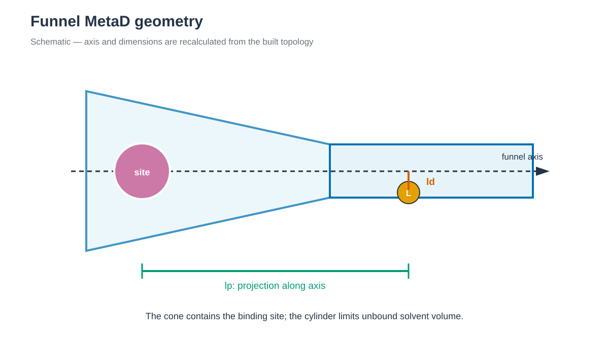

# Funnel Metadynamics / Funnel MetaD

*lp는 funnel axis 방향 이동을, ld는 axis에서 떨어진 radial distance를 나타냅니다. / lp measures motion along the funnel axis, while ld is the radial distance from it.*

## 한국어

Trypsin–benzamidine complex(PDB 3PTB)에 Funnel MetaD를 적용합니다.
Funnel-shaped restraint는 binding pocket의 넓은 cone을 solvent의 좁은
cylinder와 연결합니다. Ligand가 unbound state에서 불필요하게 넓은
solvent volume을 탐색하지 않도록 하며, `fps.lp`에 well-tempered MetaD
bias를 추가해 binding·unbinding 방향 sampling을 촉진합니다.

준비할 software와 AMBER–PLUMED 연결 방식은 [상위 README](../README.md)에 있습니다.

### Geometry

Axis는 Funnel MetaD 원 논문의 trypsin–benzamidine 정의를 3PTB에
적용합니다.

- Point A: Leu185 C, Pro225 Cα, Pro225 N의 center of mass
- Point B: Cys220 Cα, Lys224 C, Gly226 N의 center of mass
- `ZCC=1.8 nm`, `ALPHA=0.55 rad`, `RCYL=0.1 nm`
- `MINS=-0.5 nm`, `MAXS=3.7 nm`; axial wall은 -0.3, 3.5 nm

Raw 3PTB에서 A=(-2.323, 11.292, 7.015) Å, B=(-2.874, 13.242,
11.159) Å입니다. Build 후에는 tleap이 이동한 실제 coordinate에서 다시
계산합니다. Test build의 BEN COM은 `lp=1.007 nm`, `ld=0.191 nm`였고,
해당 lp의 cone radius 0.586 nm 안에 있었습니다.

### 파일 역할

| 파일 | 역할 |
| --- | --- |
| `download.sh` | 3PTB PDB/mmCIF와 BEN SDF를 받고 checksum을 기록합니다. |
| `prepare.py` | Protein, BEN, Ca2+와 disulfide bond를 정리하고 axis residue mapping을 만듭니다. |
| `protonate_benzamidine.py` | Neutral RCSB SDF를 benzamidinium(+1)으로 바꾸는 internal helper입니다. |
| `build.sh` | BEN(+1) GAFF2/AM1-BCC parameter, ff19SB/OPC topology와 funnel geometry를 만듭니다. |
| `setup_funnel.py` | Topology atom index, alignment reference, axis, ligand COM과 anchor를 계산합니다. `build.sh`가 실행합니다. |
| `run.sh` | Minimization, 200 ps heating, 100 ps equilibration과 1 ns production을 실행하고 output을 `work/`에 저장합니다. |
| `anal.py` | `lp`/`ld`, funnel boundary bias, cone–cylinder crossing과 1D FES를 요약합니다. |

### 실행

PLUMED 2.10은 `funnel` module을 기본으로 build하지 않습니다. PLUMED를 build할
때 `./configure --enable-modules=funnel`을 사용하고 다음 command로 두 action을
확인합니다. `run.sh`도 simulation stage를 시작하기 전에 같은 검사를 수행합니다.

~~~bash
plumed manual --action FUNNEL_PS
plumed manual --action FUNNEL
~~~

PLUMED를 다시 build했다면 AMBER engine이 새 PLUMED kernel을 사용하는지도
coupled run으로 확인합니다.

~~~bash
cd 1_Simulation/7_MetaD/7.2_funnel-MetaD
./download.sh
python3 prepare.py structure/3PTB.raw.pdb structure/complex.pdb
./build.sh structure/complex.pdb structure/BEN_ideal.sdf
./run.sh
python3 anal.py
~~~

### 주요 output

| 파일 | 내용 |
| --- | --- |
| `work/COLVAR` | `fps.lp`, `fps.ld`, funnel·wall·MetaD bias |
| `work/HILLS` | `fps.lp`에 추가한 Gaussian |
| `work/FUNNEL_GRID` | Production 전에 PLUMED가 `FUNNEL` restraint를 구성하며 만드는 setup grid. Production output이 아닙니다. |
| `work/analysis/production_summary.tsv`, `sampling_summary.tsv` | `lp`/`ld` 범위, bias, cone–cylinder crossing |
| `work/analysis/fes.dat` | `plumed sum_hills`로 만든 1D FES |

Cone–cylinder crossing은 production에 사용한 `work/plumed.dat`의 `ZCC` 값(nm)을
기준으로 셉니다. `python3 anal.py --skip-fes`는 FES 없이 TSV만 만들며, 새 결과에는
과거 FES를 포함하지 않습니다. `anal.py`는 `COLVAR`의 header와 finite 값을 확인하고,
잘못된 input이면 기존 analysis 결과를 교체하지 않습니다.

### 결과 확인과 해석

`run.sh`는 `1 ns Funnel MetaD production completed: .../work/production.nc`로
끝나고 `python3 anal.py`는 `Funnel MetaD diagnostics results: .../work/analysis`로
끝납니다. `sampling_summary.tsv`의 `cone_cylinder_crossings`는 `COLVAR` 행 사이에서
`lp`가 `ZCC`를 넘나든 횟수이고, 0이면 ligand가 cylinder 구간에 기록되지 않았거나
계속 그 안에 있었습니다.

`fes.dat`은 `fps.lp`에 대한 1D FES `W(lp)`입니다. Binding free energy는 다음
안내 절차로 계산합니다(Limongelli, Bonomi & Parrinello, *PNAS* 110:6358, 2013).
이 repository는 이 계산을 구현하지 않았습니다.

1. Cylinder 구간(`lp > ZCC`)에서 FES가 평평한 unbound 값 `W_ref`를 정합니다.
2. Bound site 구간에서 `I = ∫ exp(−[W(lp) − W_ref] / kT) dlp`를 적분합니다.
3. `ΔG° = −kT ln(C° · π R_cyl² · I)`를 계산합니다. `C° = 1/1660 Å⁻³ = 0.6022 nm⁻³`,
   `R_cyl = RCYL = 0.1 nm`, 300 K에서 `kT = 2.494 kJ/mol`입니다.

### 주요 option

Funnel geometry 값은 위 Geometry section에 있습니다.

| Keyword | 값 | Unit | 의미 |
| --- | --- | --- | --- |
| `FUNNEL KAPPA` | 35100 | kJ mol⁻¹ nm⁻² | Funnel 경계 restraint의 force constant |
| `NBINS`, `NBINZ` | 500, 500 | bin | `FUNNEL_GRID`의 radial, axial 해상도 |
| `LOWER_WALLS`, `UPPER_WALLS` `KAPPA`, `EXP` | 35100, 2 | kJ mol⁻¹ nm⁻², – | `fps.lp` -0.3–3.5 nm 밖을 막는 harmonic wall |
| `METAD SIGMA` | 0.05 | nm | `fps.lp` Gaussian width |
| `HEIGHT` | 1.2 | kJ/mol | 처음 hill height |
| `PACE` | 500 | step(1 ps) | Hill 추가 간격 |
| `BIASFACTOR`, `TEMP` | 10, 300 | –, K | Well-tempered tempering과 기준 온도 |
| `GRID_MIN`, `GRID_MAX`, `GRID_BIN` | -0.5, 3.7, 420 | nm, nm, bin | `MINS`–`MAXS`를 덮는 bias grid |
| `PRINT STRIDE` | 5000 | step(10 ps) | `COLVAR` 출력 간격 |

`setup_funnel.py`는 protein Cα atom으로 `funnel-reference.pdb`를 만듭니다.
`FUNNEL_PS` alignment이 protein의 translation과 rotation을 따라가며, 가장 가까운
protein heavy atom을 `ANCHOR`로 선택합니다. `WHOLEMOLECULES`는 protein과
BEN의 periodic image를 복원합니다.

Restraint와 geometry 값은 benzamidine–trypsin 참고값입니다. Heating과 equilibration에서 complex heavy atom restraint를 2.0에서
0.5 kcal mol⁻¹ Å⁻²로 낮춰 bound starting pose를 유지합니다.

PLUMED parse가 만든 `work/FUNNEL_GRID`는 setup 완료 기록이 있을 때만 재사용합니다.
`plumed.dat`, reference PDB, atom count 또는 PLUMED executable이 바뀌거나 grid가
누락되면 보존한 채 중단합니다. Parse가 grid를 만든 뒤 실패했거나 완료 기록이 없는
grid도 재사용하지 않습니다. Parse-only 검사에서 `HILLS`와 `COLVAR`는
`plumed.parse.HILLS`, `plumed.parse.COLVAR`라는 임시 filename으로 바꾸고 검사 후
삭제합니다.

### 문제 해결

| Error message | 확인할 것 |
| --- | --- |
| `PLUMED action FUNNEL_PS is unavailable` | PLUMED 2.10을 `--enable-modules=funnel`로 다시 build합니다. |
| `antechamber failed`, `parmchk2 failed` | `work/antechamber.log`, `work/parmchk2.log`. BEN SDF가 `download.sh`로 받은 파일인지 봅니다. |
| `Funnel setup did not create: ...` | `prepare.py`가 axis residue mapping을 만들었는지와 `build.sh` 출력의 `setup_funnel.py` error를 봅니다. |
| `PLUMED input check failed` | `work/plumed.parse.log` |
| `PLUMED setup did not create the funnel grid` | Parse는 통과했지만 `work/FUNNEL_GRID`가 없습니다. 성공한 parse의 log는 지워지므로 `work/plumed.dat`의 `FUNNEL` line과 PLUMED funnel module build를 확인합니다. |
| `production failed. Engine output: .../production.out` | PLUMED error는 `work/engine.production.log`에 있습니다. |
| `Partial production output already exists and is retained` | Error에 출력된 `mv` command로 partial output을 옮기고 `./run.sh`를 다시 실행합니다. |

### 주의

1 ns output은 workflow 학습용입니다. 충분한 bound–unbound recrossing,
reweighting, uncertainty와 funnel-volume standard-state correction 없이 binding
free energy로 보고하지 않습니다.

실행 상태, 실패 후 재실행, 동시 실행 보호와 download 검사는
[GUIDE.md 부록](../../../GUIDE.md#4-부록-실행-상태와-복구)을 참고합니다. Analysis 결과는 `work/analysis/`에
게시하며, 게시가 중단되면 `work/.analysis.pending`이 남습니다.

## English

This example applies Funnel MetaD to trypsin–benzamidine (PDB 3PTB). The
funnel-shaped restraint joins a wide cone at the binding pocket to a narrow
cylinder in solvent. It keeps the unbound ligand from exploring an unnecessarily
large solvent volume, while a well-tempered MetaD bias on `fps.lp` drives
sampling along the binding/unbinding direction.

Required software and the AMBER–PLUMED coupling are described in the
[parent README](../README.md).

### Geometry

The axis applies the original Funnel MetaD trypsin–benzamidine definition to
3PTB.

- Point A: COM of Leu185 C, Pro225 Cα and Pro225 N
- Point B: COM of Cys220 Cα, Lys224 C and Gly226 N
- `ZCC=1.8 nm`, `ALPHA=0.55 rad`, `RCYL=0.1 nm`
- `MINS=-0.5 nm`, `MAXS=3.7 nm`; axial walls at -0.3 and 3.5 nm

In raw 3PTB, A=(-2.323, 11.292, 7.015) Å and B=(-2.874, 13.242, 11.159) Å.
After the build they are recalculated from the coordinates moved by tleap. In a
test build the BEN COM was at `lp=1.007 nm`, `ld=0.191 nm`, inside the 0.586 nm
cone radius at that lp.

### File roles

| File | Role |
| --- | --- |
| `download.sh` | Downloads the 3PTB PDB/mmCIF and BEN SDF and records checksums. |
| `prepare.py` | Cleans protein, BEN, Ca2+ and disulfide bonds and writes the axis residue mapping. |
| `protonate_benzamidine.py` | Internal helper that converts the neutral RCSB SDF to benzamidinium (+1). |
| `build.sh` | Builds BEN(+1) GAFF2/AM1-BCC parameters, the ff19SB/OPC topology and the funnel geometry. |
| `setup_funnel.py` | Computes topology atom indices, alignment reference, axis, ligand COM and anchor. Run by `build.sh`. |
| `run.sh` | Runs minimization, 200 ps heating, 100 ps equilibration and 1 ns production, writing output to `work/`. |
| `anal.py` | Summarizes `lp`/`ld`, funnel boundary bias, cone–cylinder crossings and the 1D FES. |

### Run

PLUMED 2.10 does not build the `funnel` module by default. Configure PLUMED with
`./configure --enable-modules=funnel` and check both actions with the commands
below. `run.sh` performs the same checks before any simulation stage.

~~~bash
plumed manual --action FUNNEL_PS
plumed manual --action FUNNEL
~~~

After rebuilding PLUMED, also verify with a short coupled run that the AMBER
engine uses the new PLUMED kernel.

~~~bash
cd 1_Simulation/7_MetaD/7.2_funnel-MetaD
./download.sh
python3 prepare.py structure/3PTB.raw.pdb structure/complex.pdb
./build.sh structure/complex.pdb structure/BEN_ideal.sdf
./run.sh
python3 anal.py
~~~

### Main outputs

| File | Content |
| --- | --- |
| `work/COLVAR` | `fps.lp`, `fps.ld`, funnel, wall and MetaD bias |
| `work/HILLS` | Gaussians deposited on `fps.lp` |
| `work/FUNNEL_GRID` | Setup grid generated by PLUMED while building the `FUNNEL` restraint before production. Not a production output. |
| `work/analysis/production_summary.tsv`, `sampling_summary.tsv` | `lp`/`ld` ranges, bias, cone–cylinder crossings |
| `work/analysis/fes.dat` | 1D FES from `plumed sum_hills` |

Cone–cylinder crossings use the `ZCC` value (nm) from the production
`work/plumed.dat`. `python3 anal.py --skip-fes` writes only the TSV files; the
new result does not keep the old FES. `anal.py` checks the `COLVAR` header and
finite values and leaves previous analysis results in place on invalid input.

### Success check and interpretation

`run.sh` ends with `1 ns Funnel MetaD production completed: .../work/production.nc`,
and `python3 anal.py` ends with
`Funnel MetaD diagnostics results: .../work/analysis`. `cone_cylinder_crossings` in
`sampling_summary.tsv` counts how often `lp` crosses `ZCC` between `COLVAR` rows;
zero means the ligand was never recorded in the cylinder region or stayed there.

`fes.dat` is the 1D FES `W(lp)` along `fps.lp`. The binding free energy follows
the guidance below (Limongelli, Bonomi & Parrinello, *PNAS* 110:6358, 2013);
this repository does not implement it.

1. Take the flat unbound value `W_ref` of the FES in the cylinder region
   (`lp > ZCC`).
2. Integrate `I = ∫ exp(−[W(lp) − W_ref] / kT) dlp` over the bound site.
3. Compute `ΔG° = −kT ln(C° · π R_cyl² · I)` with
   `C° = 1/1660 Å⁻³ = 0.6022 nm⁻³`, `R_cyl = RCYL = 0.1 nm` and
   `kT = 2.494 kJ/mol` at 300 K.

### Key options

The funnel geometry values are listed in the Geometry section above.

| Keyword | Value | Unit | Meaning |
| --- | --- | --- | --- |
| `FUNNEL KAPPA` | 35100 | kJ mol⁻¹ nm⁻² | Force constant of the funnel boundary restraint |
| `NBINS`, `NBINZ` | 500, 500 | bins | Radial and axial resolution of `FUNNEL_GRID` |
| `LOWER_WALLS`, `UPPER_WALLS` `KAPPA`, `EXP` | 35100, 2 | kJ mol⁻¹ nm⁻², – | Harmonic walls outside `fps.lp` -0.3–3.5 nm |
| `METAD SIGMA` | 0.05 | nm | `fps.lp` Gaussian width |
| `HEIGHT` | 1.2 | kJ/mol | Initial hill height |
| `PACE` | 500 | step (1 ps) | Hill deposition interval |
| `BIASFACTOR`, `TEMP` | 10, 300 | –, K | Well-tempered tempering and reference temperature |
| `GRID_MIN`, `GRID_MAX`, `GRID_BIN` | -0.5, 3.7, 420 | nm, nm, bins | Bias grid covering `MINS`–`MAXS` |
| `PRINT STRIDE` | 5000 | step (10 ps) | `COLVAR` interval |

`setup_funnel.py` writes `funnel-reference.pdb` from protein Cα atoms. The
`FUNNEL_PS` alignment follows protein translation and rotation, and the nearest
protein heavy atom is chosen as `ANCHOR`. `WHOLEMOLECULES` restores the periodic
images of the protein and BEN.

The restraint and geometry values are benzamidine–trypsin references. Heating and equilibration lower the complex heavy-atom restraint from 2.0 to
0.5 kcal mol⁻¹ Å⁻² to keep the bound starting pose.

The `work/FUNNEL_GRID` created by PLUMED parsing is reused only with a setup
completion record. Changed `plumed.dat`, reference PDB, atom count or PLUMED
executable, or a missing grid, stop the run while keeping results. A grid left by
a failed parse or without a completion record is not reused. The parse-only
check renames `HILLS` and `COLVAR` to temporary `plumed.parse.HILLS` and
`plumed.parse.COLVAR` files and removes them afterwards.

### Troubleshooting

| Error message | What to check |
| --- | --- |
| `PLUMED action FUNNEL_PS is unavailable` | Rebuild PLUMED 2.10 with `--enable-modules=funnel`. |
| `antechamber failed`, `parmchk2 failed` | `work/antechamber.log`, `work/parmchk2.log`; confirm the BEN SDF came from `download.sh`. |
| `Funnel setup did not create: ...` | Check that `prepare.py` wrote the axis residue mapping and read the `setup_funnel.py` error in the `build.sh` output. |
| `PLUMED input check failed` | `work/plumed.parse.log` |
| `PLUMED setup did not create the funnel grid` | The parse passed but `work/FUNNEL_GRID` is missing. The log of a successful parse is removed, so check the `FUNNEL` line in `work/plumed.dat` and the PLUMED funnel-module build. |
| `production failed. Engine output: .../production.out` | PLUMED errors are in `work/engine.production.log`. |
| `Partial production output already exists and is retained` | Move the partial output with the printed `mv` command and rerun `./run.sh`. |

### Cautions

The 1 ns output teaches the workflow. Do not report it as a binding free energy
without repeated bound–unbound recrossings, reweighting, uncertainty analysis and
the funnel-volume standard-state correction.

See [GUIDE.md appendix](../../../GUIDE.md#4-appendix-run-state-and-recovery) for run state, reruns after failure,
concurrent-run protection and download checks. Analysis results are published to
`work/analysis/`; an interrupted publication leaves `work/.analysis.pending`.

## References / 참고 자료

- [Original Funnel MetaD paper](https://doi.org/10.1073/pnas.1303186110)
- [PLUMED 2.10 FUNNEL_PS](https://www.plumed.org/doc-v2.10/user-doc/html/_f_u_n_n_e_l__p_s.html)
- [PLUMED 2.10 FUNNEL](https://www.plumed.org/doc-v2.10/user-doc/html/_f_u_n_n_e_l.html)
- [PLUMED Funnel MetaD masterclass](https://www.plumed.org/doc-v2.9/user-doc/html/masterclass-22-1.html)
