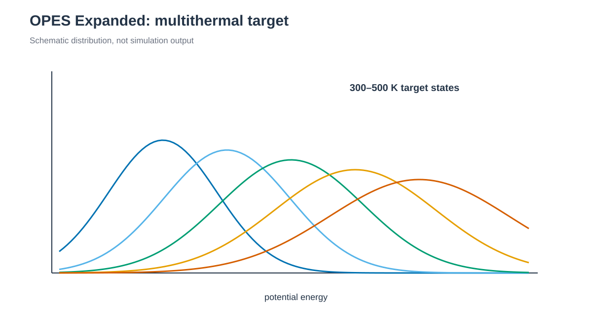

# OPES Expanded Multithermal



*Potential-energy sample로 `ΔF_n(T)`를 추정한 뒤 300–500 K expanded target에 필요한 bias를 계산합니다. / Potential-energy samples estimate `ΔF_n(T)`, from which the bias for a 300–500 K expanded target is calculated.*

## 한국어

OPES_EXPANDED와 `ECV_MULTITHERMAL`을 연결해 300–500 K의 potential-energy
distribution을 한 simulation에서 sampling합니다. Temperature replica를 만드는
REMD와 달리 하나의 walker가 expanded target distribution을 따라갑니다.
OPES_METAD처럼 CV probability distribution을 kernel density estimate로
구성하지 않습니다. Potential-energy data로 temperature state별 free-energy
offset `ΔF_n(T)`를 추정하고, 이 state들을 잇는 multithermal bias를 계산합니다.

준비할 software와 AMBER–PLUMED 연결 방식은 [상위 README](../README.md)에 있습니다.

### Script 역할

| 파일 | 역할 |
|---|---|
| `build.sh` | Argument로 받은 capped alanine PDB에서 ff19SB/OPC system을 생성합니다. |
| `check_topology.py` | `build.sh`가 자동 호출하며 capped peptide atom ordering을 검사합니다. |
| `run.sh` | NPT equilibration 후 fixed-volume multithermal production을 1 ns로 실행합니다. |
| `anal.py` | potential energy, expanded CV, bias 범위와 `DELTAFS` state 수를 기록합니다. |

### 실행

PLUMED 2.10은 `opes` module을 기본으로 build하지 않습니다. PLUMED configure에
`--enable-modules=opes`를 추가하고 실행 전에 두 action을 확인합니다. `run.sh`도
같은 검사를 수행합니다.

```bash
plumed manual --action ECV_MULTITHERMAL
plumed manual --action OPES_EXPANDED
```

```bash
cd 1_Simulation/7_MetaD/7.4_OPES_EXPANDED
./build.sh structure/alanine-dipeptide.pdb
./run.sh
python3 anal.py
```

### 주요 output

| 파일 | 내용 |
|---|---|
| `work/COLVAR` | Potential energy `ene`, expanded CV `ecv.ene`, `opes.bias` |
| `work/DELTAFS` | Temperature state별 `ΔF_n(T)` |
| `work/opes.state` | 마지막 adaptive state(`STATE_WFILE`) |
| `work/analysis/production_summary.tsv` | Energy, `ecv.ene`, bias 범위와 `DELTAFS` state 수 |

`ecv.ene`는 expanded CV이며 instantaneous physical temperature가 아닙니다.
`anal.py`는 `COLVAR`의 header와 finite 값을 확인하고, 잘못된 input이면 기존
analysis 결과를 교체하지 않습니다.

### 결과 확인과 해석

`run.sh`는 `1 ns OPES Expanded production completed: .../work/production.nc`로
끝나고 `python3 anal.py`는 `OPES Expanded diagnostics results: .../work/analysis`로
끝납니다. 처음 100 ps는 PLUMED 기본 observation 구간이라 `opes.bias`가 0입니다.

Temperature `T`의 observable은 `COLVAR`의 `ene`와 `opes.bias`(둘 다 kJ/mol)로
reweight합니다(Invernizzi, Piaggi & Parrinello, *Phys. Rev. X* 10:041034, 2020).
안내용 식이며 이 repository는 구현하지 않았습니다.

```text
w_T ∝ exp(β₀ · opes.bias − (β_T − β₀) · ene)
β = 1 / (k_B T), k_B = 0.0083144626 kJ mol⁻¹ K⁻¹, T₀ = 300 K
```

Observation 구간은 제외하고, `T`는 300–500 K 안에서만 고릅니다. 1 ns와
10 ps 간격 `COLVAR`(약 100행)로는 온도별 평균의 오차가 큽니다.

### 주요 option

| Keyword | 값 | Unit | 의미 |
| --- | --- | --- | --- |
| `ECV_MULTITHERMAL TEMP` | 300 | K | 실제 thermostat 온도 |
| `TEMP_MIN`, `TEMP_MAX` | 300, 500 | K | Multithermal target 범위 |
| `TEMP_STEPS` | 미지정 | – | PLUMED가 temperature 수를 자동으로 정합니다. State 수는 `DELTAFS`에서 확인합니다. |
| `PACE` | 500 | step(1 ps) | `ΔF_n(T)`와 bias update 간격 |
| `OBSERVATION_STEPS` | 미지정(PLUMED 기본 100) | `PACE` 단위 | Bias 없이 grid를 준비하는 처음 100 ps |
| `STATE_WSTRIDE` | 50000 | step(100 ps) | `opes.state` 쓰기 간격 |
| `PRINT STRIDE` | 5000 | step(10 ps) | `COLVAR` 출력 간격 |
| Production `ntb`, `ntp` | 1, 0 | – | Box volume을 고정한 NVT |
| Production `nstlim`, `dt` | 500000, 0.002 | step, ps | 1 ns production |

Production 전 100 ps NPT equilibration은 `skinnb=5.0 Å`로 GPU pair-list 여유를
늘립니다. 같은 solvent box를 사용하는 WT-MetaD에서 확인한 설정이며 실제
cutoff는 `cut=10.0 Å`로 유지됩니다.

Parse-only 검사는 별도 임시 filename을 사용하므로 production의 `DELTAFS`,
`opes.state`와 `COLVAR`를 생성하거나 partial production으로 판정하지 않습니다.

### 문제 해결

| Error message | 확인할 것 |
| --- | --- |
| `PLUMED action ECV_MULTITHERMAL is unavailable`, `PLUMED action OPES_EXPANDED is unavailable` | PLUMED 2.10을 `--enable-modules=opes`로 다시 build합니다. |
| `PLUMED input check failed: .../plumed.parse.dat` | `work/plumed.parse.log` |
| `production failed. Engine output: .../production.out` | PLUMED error는 `work/engine.production.log`에 있습니다. |
| `Partial production output already exists and is retained` | Error에 출력된 `mv` command로 `DELTAFS`, `opes.state`를 포함한 partial output을 옮기고 `./run.sh`를 다시 실행합니다. |

### 주의

1 ns는 state 파일과 fixed-volume workflow를 학습하기 위한 길이입니다.
Keyword는 PLUMED 2.10
[`OPES_EXPANDED`](https://www.plumed.org/doc-v2.10/user-doc/html/_o_p_e_s__e_x_p_a_n_d_e_d.html)와
[`ECV_MULTITHERMAL`](https://www.plumed.org/doc-v2.10/user-doc/html/_e_c_v__m_u_l_t_i_t_h_e_r_m_a_l.html)을
기준으로 작성했습니다.

실행 상태, 실패 후 재실행, 동시 실행 보호는 [GUIDE.md 부록](../../../GUIDE.md#4-부록-실행-상태와-복구)을
참고합니다.

## English

This example combines OPES_EXPANDED with `ECV_MULTITHERMAL` to sample the
300–500 K potential-energy distribution in one simulation. Unlike REMD, which
creates temperature replicas, a single walker follows the expanded target
distribution. OPES_EXPANDED does not build a kernel-density estimate of a CV
probability distribution as OPES_METAD does. It estimates the temperature-state
free-energy offsets `ΔF_n(T)` from potential-energy samples and calculates the
multithermal bias that connects those states.

Required software and the AMBER–PLUMED coupling are described in the
[parent README](../README.md).

### Script roles

| File | Role |
|---|---|
| `build.sh` | Builds the ff19SB/OPC system from the capped alanine PDB given as an argument. |
| `check_topology.py` | Called by `build.sh`; checks the capped peptide atom ordering. |
| `run.sh` | Runs NPT equilibration and then 1 ns of fixed-volume multithermal production. |
| `anal.py` | Records potential energy, expanded CV, bias ranges and the number of `DELTAFS` states. |

### Run

PLUMED 2.10 does not build the `opes` module by default. Configure PLUMED with
`--enable-modules=opes` and check both actions before running. `run.sh` performs
the same check.

```bash
plumed manual --action ECV_MULTITHERMAL
plumed manual --action OPES_EXPANDED
```

```bash
cd 1_Simulation/7_MetaD/7.4_OPES_EXPANDED
./build.sh structure/alanine-dipeptide.pdb
./run.sh
python3 anal.py
```

### Main outputs

| File | Content |
|---|---|
| `work/COLVAR` | Potential energy `ene`, expanded CV `ecv.ene`, `opes.bias` |
| `work/DELTAFS` | `ΔF_n(T)` per temperature state |
| `work/opes.state` | Final adaptive state (`STATE_WFILE`) |
| `work/analysis/production_summary.tsv` | Energy, `ecv.ene` and bias ranges and the number of `DELTAFS` states |

`ecv.ene` is an expanded CV, not an instantaneous physical temperature.
`anal.py` checks the `COLVAR` header and finite values and leaves previous
analysis results in place on invalid input.

### Success check and interpretation

`run.sh` ends with
`1 ns OPES Expanded production completed: .../work/production.nc`, and
`python3 anal.py` ends with
`OPES Expanded diagnostics results: .../work/analysis`. The first 100 ps are
PLUMED's default observation period, so `opes.bias` is zero there.

Reweight observables at temperature `T` with `ene` and `opes.bias` from
`COLVAR`, both in kJ/mol (Invernizzi, Piaggi & Parrinello, *Phys. Rev. X*
10:041034, 2020). The formula is guidance; this repository does not implement
it.

```text
w_T ∝ exp(β₀ · opes.bias − (β_T − β₀) · ene)
β = 1 / (k_B T), k_B = 0.0083144626 kJ mol⁻¹ K⁻¹, T₀ = 300 K
```

Exclude the observation period and choose `T` only within 300–500 K. With 1 ns
and a 10 ps `COLVAR` interval (about 100 rows), temperature averages carry large
errors.

### Key options

| Keyword | Value | Unit | Meaning |
| --- | --- | --- | --- |
| `ECV_MULTITHERMAL TEMP` | 300 | K | Actual thermostat temperature |
| `TEMP_MIN`, `TEMP_MAX` | 300, 500 | K | Multithermal target range |
| `TEMP_STEPS` | Not set | – | PLUMED chooses the number of temperatures; read the state count from `DELTAFS`. |
| `PACE` | 500 | step (1 ps) | `ΔF_n(T)` and bias-update interval |
| `OBSERVATION_STEPS` | Not set (PLUMED default 100) | `PACE` units | First 100 ps without bias while the grid is prepared |
| `STATE_WSTRIDE` | 50000 | step (100 ps) | `opes.state` write interval |
| `PRINT STRIDE` | 5000 | step (10 ps) | `COLVAR` interval |
| Production `ntb`, `ntp` | 1, 0 | – | NVT at fixed box volume |
| Production `nstlim`, `dt` | 500000, 0.002 | step, ps | 1 ns production |

The 100 ps NPT equilibration before production uses `skinnb=5.0 Å` to enlarge
the GPU pair-list margin. The setting was checked with WT-MetaD on the same
solvent box, and the physical cutoff stays at `cut=10.0 Å`.

The parse-only check uses separate temporary filenames, so it neither creates
production `DELTAFS`, `opes.state` or `COLVAR` nor counts as partial production.

### Troubleshooting

| Error message | What to check |
| --- | --- |
| `PLUMED action ECV_MULTITHERMAL is unavailable`, `PLUMED action OPES_EXPANDED is unavailable` | Rebuild PLUMED 2.10 with `--enable-modules=opes`. |
| `PLUMED input check failed: .../plumed.parse.dat` | `work/plumed.parse.log` |
| `production failed. Engine output: .../production.out` | PLUMED errors are in `work/engine.production.log`. |
| `Partial production output already exists and is retained` | Move the partial output, including `DELTAFS` and `opes.state`, with the printed `mv` command and rerun `./run.sh`. |

### Cautions

The 1 ns run teaches the state files and the fixed-volume workflow. Keywords
follow PLUMED 2.10
[`OPES_EXPANDED`](https://www.plumed.org/doc-v2.10/user-doc/html/_o_p_e_s__e_x_p_a_n_d_e_d.html)
and
[`ECV_MULTITHERMAL`](https://www.plumed.org/doc-v2.10/user-doc/html/_e_c_v__m_u_l_t_i_t_h_e_r_m_a_l.html).

See [GUIDE.md appendix](../../../GUIDE.md#4-appendix-run-state-and-recovery) for run state, reruns after failure and
concurrent-run protection.
