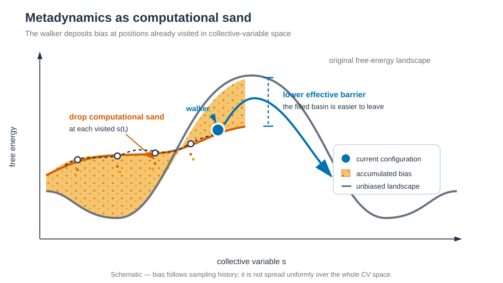

# Metadynamics and OPES / Metadynamics 및 OPES

*방문한 CV 위치에 computational sand처럼 bias를 쌓아 basin을 채우고 effective barrier를 낮춥니다. / Bias is deposited like computational sand at visited CV positions, filling the basin and lowering the effective barrier.*

## 한국어

AMBER가 MD를 계산하고 PLUMED가 collective variable(CV)과 bias를 처리합니다.
WT-MetaD, Funnel MetaD와 OPES_METAD는 선택한 CV 공간의 barrier를 낮춥니다.

MetaD를 computational sand에 비유하면, simulation walker가 방문한 CV 위치마다
sand에 해당하는 bias를 떨어뜨립니다. 방문이 반복된 basin이 채워지면 effective
barrier가 낮아져 다른 영역으로 이동하기 쉬워집니다. Bias를 CV 공간 전체에 미리
적용하는 것은 아닙니다.

OPES_METAD는 방문 data를 reweighting하여 unbiased probability distribution
`P_n(s)`를 먼저 추정하고, 그 분포를 well-tempered target distribution으로 바꾸는
bias를 계산합니다. OPES_EXPANDED는 kernel density estimate 대신 expanded
state별 free-energy offset `ΔF_n(λ)`를 추정하여 target bias를 계산합니다.

Funnel MetaD는 ligand의 solvent 탐색 부피를 cone과 cylinder로 제한합니다.
OPES Expanded example은 CV 공간 대신 300–500 K multithermal target을
구성합니다. 서로 다른 목표를 가진 method이므로 bias 크기만으로 성능을
비교하지 않습니다.

| Directory | Method | Bias 대상 | 상태 파일 |
|---|---|---|---|
| `7.1_WT-MetaD/` | well-tempered MetaD | φ, ψ | `HILLS` |
| `7.2_funnel-MetaD/` | funnel MetaD | trypsin–BEN binding 경로 | `HILLS`, `FUNNEL_GRID` |
| `7.3_OPES_METAD/` | OPES_METAD | φ, ψ | `opes.state`, `KERNELS` |
| `7.4_OPES_EXPANDED/` | multithermal OPES_EXPANDED | potential energy | `opes.state`, `DELTAFS` |

7.1, 7.3과 7.4는 ff19SB/OPC capped alanine dipeptide(ACE-ALA-NME)를 사용합니다.
`structure/alanine-dipeptide.pdb`는 AmberTools 26 tleap의
`sequence { ACE ALA NME }`로 만든 22-atom 구조입니다. 7.2는 ff19SB/GAFF2/OPC
trypsin–benzamidine를 사용합니다. 네 system 모두 solute와 box edge 사이에
20 Å OPC buffer를 둡니다.

각 runnable directory에서 `build.sh`, `run.sh`, `python3 anal.py` 순서로
실행합니다. `build.sh`의 첫 argument는 준비한 PDB입니다. Funnel MetaD는 ligand
SDF도 두 번째 argument로 받습니다. Production은 나누지 않고 1 ns를 한 번에
실행하며 output과 PLUMED state를 각 tutorial의 `work/`에 직접 저장합니다.
완료된 production을 다시 실행하면 engine을 호출하지 않고 건너뛴 뒤
`python3 anal.py`를 안내합니다. 완료 표시 없이 production output이 남아 있으면
AMBER restart와 `HILLS`, `opes.state` 같은 bias state를 덮어쓰지 않도록
중단합니다. Engine stdout/stderr는 `work/engine.<stage>.log`에 이어서 기록하며,
pmemd 안에서 난 PLUMED error도 `work/engine.production.log`에 남습니다.

### 준비

| 항목 | 조건 |
| --- | --- |
| MD engine | PLUMED가 연결된 Amber `pmemd.cuda`(기본). AmberTools만 있으면 PLUMED를 포함해 build한 `sander`를 `AMBER_ENGINE=sander`로 지정합니다. |
| PLUMED | PLUMED 2.10. Funnel MetaD는 optional `funnel`, 두 OPES example은 optional `opes` module이 필요합니다. 네 example을 모두 실행하려면 configure에 `--enable-modules=funnel+opes`를 지정합니다. Parse 검사와 FES 계산의 executable은 `PLUMED`로 바꿉니다. |
| AmberTools | `tleap`. Funnel MetaD는 `antechamber`, `parmchk2`도 사용합니다. |
| Python | `numpy`, `parmed` |

설치한 engine이 PLUMED 연동을 지원하는지는 짧은 coupled run으로 확인합니다.

### AMBER와 PLUMED 연결

`run.sh`는 `inputs/plumed.dat.template`에서 `work/plumed.dat`을 만듭니다. Funnel MetaD는
`build.sh`가 `setup_funnel.py`로 만듭니다.
Production input의 `&cntrl`에 있는 `plumed=1`, `plumedfile='plumed.dat'`가
AMBER에서 PLUMED를 호출합니다. Minimization, heating과 equilibration에는 PLUMED를
쓰지 않습니다. 이 두 keyword는 Amber 26 manual에서 확인하지 못했으며 실제
coupled run은 미검증입니다.

PLUMED input은 PLUMED 기본 unit인 energy kJ/mol, length nm, time ps를 씁니다.
AMBER의 kcal/mol과 Å은 MD engine interface가 변환하므로 `COLVAR`, `HILLS`,
`fes.dat`의 energy도 kJ/mol입니다.

Tutorial production은 한 번만 실행합니다. `run.sh`(Funnel은 `setup_funnel.py`)가
template의 `@RESTART@`와 `@STATE_RFILE@` 자리를 비워 빈 bias에서 시작합니다. `RESTART`, `HILLS`/`KERNELS`와
`STATE_RFILE`/`STATE_WFILE`로 bias를 이어받는 segment 실행은
[MetaD template](../../3_Templates/7_MetaD/README.md)에 있습니다.

### 계산량

모든 stage는 2 fs timestep으로 한 GPU에서 한 번씩 실행합니다.

| Stage | 길이 | 설정 |
| --- | --- | --- |
| Minimization | 5000 cycles(steepest descent 2500) | Funnel MetaD는 solvent minimization(complex heavy atom 10.0 kcal mol⁻¹ Å⁻² restraint)을 먼저 실행합니다. |
| Heating | 100,000 steps(200 ps) | NVT, 10 → 300 K, heavy atom restraint 2.0 kcal mol⁻¹ Å⁻² |
| Equilibration | 50,000 steps(100 ps) | NPT 1 bar. Funnel MetaD만 0.5 kcal mol⁻¹ Å⁻² restraint를 유지합니다. |
| Production | 500,000 steps(1 ns) | `PACE=500`이면 bias update 1000회. `COLVAR`는 5000 steps마다 1행입니다. OPES Expanded는 NVT입니다. |

실행 상태, 실패 후 재실행, 동시 실행 보호는 [GUIDE.md 부록](../../GUIDE.md#4-부록-실행-상태와-복구)을
참고합니다.

## English

AMBER propagates the MD while PLUMED evaluates the collective variables (CVs)
and bias. WT-MetaD, Funnel MetaD and OPES_METAD lower barriers in the selected
CV space.

Metadynamics can be viewed as adding computational sand: the simulation walker
deposits bias at the CV positions it has visited. As the sampled basin fills,
its effective barrier decreases and escape becomes easier. The bias is not
applied over the full CV space in advance.

OPES_METAD reweights the visited data to estimate the unbiased probability
distribution `P_n(s)`, then calculates the bias that turns it into a
well-tempered target distribution. OPES_EXPANDED does not use a kernel-density
estimate; it estimates the free-energy offsets `ΔF_n(λ)` of expanded states and
calculates the corresponding target bias.

Funnel MetaD restricts the ligand's solvent exploration to a cone and cylinder.
The OPES Expanded example builds a 300–500 K multithermal target instead of a CV
target. The methods have different goals, so do not compare them by bias
magnitude alone.

| Directory | Method | Biased quantity | State files |
|---|---|---|---|
| `7.1_WT-MetaD/` | well-tempered MetaD | φ, ψ | `HILLS` |
| `7.2_funnel-MetaD/` | funnel MetaD | trypsin–BEN binding path | `HILLS`, `FUNNEL_GRID` |
| `7.3_OPES_METAD/` | OPES_METAD | φ, ψ | `opes.state`, `KERNELS` |
| `7.4_OPES_EXPANDED/` | multithermal OPES_EXPANDED | potential energy | `opes.state`, `DELTAFS` |

7.1, 7.3 and 7.4 use an ff19SB/OPC capped alanine dipeptide (ACE-ALA-NME).
`structure/alanine-dipeptide.pdb` is a 22-atom structure generated by
AmberTools 26 tleap `sequence { ACE ALA NME }`. 7.2 uses ff19SB/GAFF2/OPC
trypsin–benzamidine. All four systems use a 20 Å OPC buffer between the solute
and the box edge.

Run `build.sh`, `run.sh` and `python3 anal.py` in a runnable directory. The
first build argument is the prepared PDB; Funnel MetaD also takes the ligand SDF
as its second argument. Production runs as one 1 ns calculation and writes its
outputs and PLUMED state directly under the tutorial `work/` directory.
Rerunning a completed production skips it without engine calls and points to
`python3 anal.py`. Production output without a completion record stops the
workflow before the AMBER restart or bias state such as `HILLS` and
`opes.state` can be overwritten. Engine stdout/stderr are appended to
`work/engine.<stage>.log`; PLUMED errors raised inside pmemd appear in
`work/engine.production.log`.

### Prerequisites

| Item | Requirement |
| --- | --- |
| MD engine | A PLUMED-enabled Amber `pmemd.cuda` (default). With only AmberTools, select a PLUMED-enabled `sander` build with `AMBER_ENGINE=sander`. |
| PLUMED | PLUMED 2.10. Funnel MetaD needs the optional `funnel` module and both OPES examples need the optional `opes` module. Configure with `--enable-modules=funnel+opes` to run all four. `PLUMED` selects the executable for parse checks and FES reconstruction. |
| AmberTools | `tleap`; Funnel MetaD also uses `antechamber` and `parmchk2`. |
| Python | `numpy`, `parmed` |

Confirm with a short coupled run that the installed engine supports PLUMED.

### How AMBER and PLUMED connect

`run.sh` writes `work/plumed.dat` from `inputs/plumed.dat.template`; for Funnel
MetaD, `build.sh` writes it through `setup_funnel.py`.
`plumed=1` and `plumedfile='plumed.dat'` in the production `&cntrl` namelist make
AMBER call PLUMED. Minimization, heating and equilibration do not use PLUMED.
These two keywords were not found in the Amber 26 manual, and a real coupled run
is unverified.

PLUMED inputs use PLUMED's default units: energy kJ/mol, length nm, time ps.
The MD-engine interface converts AMBER's kcal/mol and Å, so energies in
`COLVAR`, `HILLS` and `fes.dat` are in kJ/mol.

The tutorial production runs once. `run.sh` (`setup_funnel.py` for Funnel)
blanks the `@RESTART@` and `@STATE_RFILE@` placeholders, so the bias starts empty. Segmented runs that
continue the bias through `RESTART`, `HILLS`/`KERNELS` and
`STATE_RFILE`/`STATE_WFILE` are in the
[MetaD template](../../3_Templates/7_MetaD/README.md).

### Expected computation

Every stage runs once on one GPU with a 2 fs timestep.

| Stage | Length | Settings |
| --- | --- | --- |
| Minimization | 5000 cycles (2500 steepest descent) | Funnel MetaD first runs a solvent minimization with a 10.0 kcal mol⁻¹ Å⁻² complex heavy-atom restraint. |
| Heating | 100,000 steps (200 ps) | NVT, 10 → 300 K, 2.0 kcal mol⁻¹ Å⁻² heavy-atom restraint |
| Equilibration | 50,000 steps (100 ps) | NPT at 1 bar; only Funnel MetaD keeps a 0.5 kcal mol⁻¹ Å⁻² restraint. |
| Production | 500,000 steps (1 ns) | With `PACE=500`, 1000 bias updates; `COLVAR` gets one row every 5000 steps. OPES Expanded runs NVT. |

See [GUIDE.md appendix](../../GUIDE.md#4-appendix-run-state-and-recovery) for run state, reruns after failure and
concurrent-run protection.
