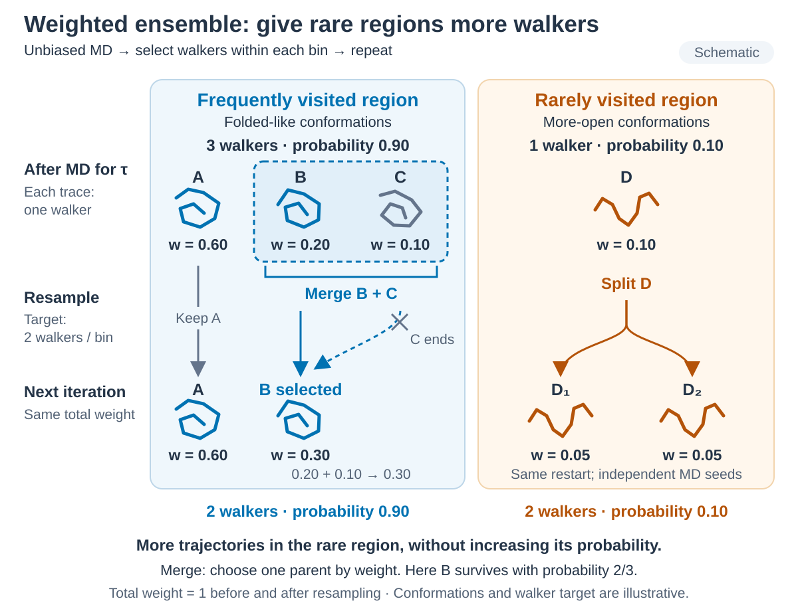

# Weighted ensemble

*점선 상자 안의 B·C만 merge하고 D는 split합니다. Resampling 전후 bin probability는 0.90/0.10, 전체 weight는 1입니다. 구조와 숫자는 schematic이며 walker target은 설명용 2개, 실제 Chignolin 예제는 4개입니다. / Only B and C inside the dashed box are merged; D is split. Bin probabilities stay 0.90/0.10 and total weight stays one. Structures and numbers are schematic; the walker target is two here and four in the Chignolin example.*

## 한국어

Weighted ensemble은 짧은 trajectory segment를 여러 개 전파한 뒤 progress
coordinate bin에서 walker를 split하거나 merge합니다. WESTPA가 walker weight와
resampling을 관리하고 MD engine은 각 segment의 dynamics만 계산합니다.

Split은 parent restart를 복사하고 weight를 child에 나눕니다. Child는 서로 다른
Langevin seed로 이어집니다. Merge는 weight에 비례한 확률로 parent 하나를 선택해
그 restart와 합산한 weight를 이어받습니다. 두 구조의 원자 좌표를 평균내지 않습니다.
그림의 B와 C는 같은 bin에 속한 merge 대상이며, B가 선택될 확률은
`0.20 / (0.20 + 0.10) = 2/3`입니다. 선택된 B는 기존 구조와 합산한 weight 0.30으로
이어지고 C의 trajectory는 종료됩니다. D의 두 child는 각각 weight 0.05를 받습니다.
그림의 bin 안 위치는 schematic이며 resampling 자체는 physical time을 전진시키지
않습니다. Target recycling은 이 그림에서 생략했습니다.

- [WESTPA + AMBER](7.1_WESTPA_AMBER/): Explicit-solvent Chignolin Cα RMSD sampling

이 예제는 WESTPA–AMBER 연결, restart 전달, weight 보존과 weighted bin
occupancy 분석을 다룹니다. Partially unfolded target은 학습용 정의이며 target
도달 횟수를 folding 또는 unfolding rate로 해석하지 않습니다.

### 준비

| 항목 | 조건 |
| --- | --- |
| WESTPA | WESTPA 2. `w_init`, `w_run`이 같은 environment의 `PATH`에 있어야 합니다. 미완료 segment 처리 설명은 WESTPA 2022.15 동작 기준입니다. |
| AMBER | AmberTools `tleap`, `cpptraj`와 `pmemd.cuda`. `TLEAP`, `CPPTRAJ`, `AMBER_ENGINE`으로 executable을 바꿀 수 있습니다. |
| Python | `anal.py`가 `h5py`로 `west.h5`를 읽습니다. |

WESTPA 설치는 저장소 [README](../../README.md)의 Conda 예시를 따릅니다.

## English

Weighted ensemble propagates many short trajectory segments and then splits or
merges walkers within progress-coordinate bins. WESTPA manages walker weights
and resampling; the MD engine computes only the dynamics of each segment.

Splitting copies the parent restart and divides its weight among children, which
continue with different Langevin seeds. Merging selects one parent with
probability proportional to its weight and retains that parent's restart with
the combined weight; atomic coordinates are not averaged. In the diagram, B and
C form the selected pair within one bin. B survives with probability
`0.20 / (0.20 + 0.10) = 2/3`, retaining its structure with combined weight 0.30;
C's trajectory ends. Each child of D receives weight 0.05. Positions within bins
are schematic, and resampling itself does not advance physical time. Target
recycling is omitted from the diagram.

- [WESTPA + AMBER](7.1_WESTPA_AMBER/): Explicit-solvent Chignolin Cα RMSD sampling

The example covers the WESTPA–AMBER coupling, restart handoff, weight
conservation and weighted bin-occupancy analysis. The partially unfolded target
is a teaching definition; target arrival counts are not a folding or unfolding
rate.

### Prerequisites

| Item | Requirement |
| --- | --- |
| WESTPA | WESTPA 2, with `w_init` and `w_run` on the `PATH` of the same environment. The incomplete-segment behavior described here follows WESTPA 2022.15. |
| AMBER | AmberTools `tleap` and `cpptraj`, plus `pmemd.cuda`. Override them with `TLEAP`, `CPPTRAJ` and `AMBER_ENGINE`. |
| Python | `anal.py` reads `west.h5` with `h5py`. |

Install WESTPA as in the Conda example of the repository [README](../../README.md).
