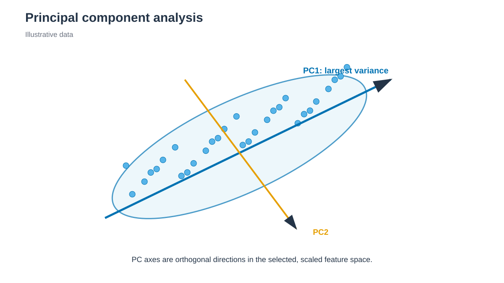

# PCA / 주성분 분석



*PC1은 선택하고 scaling한 feature에서 가장 큰 분산 방향을 나타냅니다. / PC1 is the largest-variance direction in the selected and scaled feature space.*

## 한국어

Chignolin residue 2–9의 φ/ψ를 sine/cosine feature로 바꾼 뒤 표준화하고 PCA를
적용합니다. PCA는 원래 feature의 분산을 가장 많이 설명하는 직교 축을 찾는
선형 방법입니다.

`run.sh`는 [Chignolin conventional MD](../../../1_Simulation/1_MD/1.1_Soluble_Protein/README.md)의
`work/system.parm7`과 `work/production.nc`를 직접 읽습니다. 아래 command는 이
directory에서 실행합니다.

```bash
./run.sh
python3 anal.py
```

`python3 anal.py --save-figure figures`처럼 실행하면 figure를 화면에 표시하면서
`figures/pca.png`(150 dpi)로도 저장합니다. 저장 directory는 `output/` 밖에
둡니다. Option이 없으면 image file을 만들지 않습니다. TSV 결과는 figure 창을
열기 전에 `output/`에 기록됩니다.

`run.sh`는 cpptraj으로 `output/phi_psi.dat`을 만듭니다. `anal.py`는
`features.tsv`, `projection.tsv`와 `explained_variance.tsv`를 기록하고 scree
plot 및 PC1–PC2 projection을 표시합니다. `anal.py`는 읽은 frame 수를
`Frames: N`으로 출력합니다. PCA는 frame 수와 feature 수 중 작은 값만큼
component를 계산하므로 frame 수에 맞출 parameter가 없고, frame이 2개 미만이면
중단합니다.

| Output | Column | 단위 |
| --- | --- | --- |
| `phi_psi.dat` | `Frame`, `phi:2`, `psi:2` … `phi:9`, `psi:9`(cpptraj) | degree |
| `features.tsv` | `frame`, `sin_phi:2`, `cos_phi:2` …: 표준화한 sine/cosine feature(angle 16개 × 2) | 단위 없음 |
| `projection.tsv` | `frame`, `PC1`부터 min(frame 수, feature 수)번째 PC까지 | 단위 없음 |
| `explained_variance.tsv` | `component`, `explained_variance_ratio`, `cumulative_ratio` | 0–1 |

`explained_variance_ratio`는 PC 번호가 커질수록 작아지고, `cumulative_ratio`는
마지막 component에서 1이 됩니다.

다른 system은 `run.sh` 상단의 두 경로와 `inputs/cpptraj.in`의 residue 범위를
함께 수정합니다. Feature scaling 여부와 atom/residue selection이 바뀌면 서로
다른 PCA basis가 되므로 projection을 직접 비교하지 않습니다.

결과 게시, 실패 log(`output.failed/`), 동시 실행 보호(`writer_guard.py`)는
[GUIDE.md 부록](../../../GUIDE.md#4-부록-실행-상태와-복구)을 참고합니다.

## English

Cpptraj calculates residue 2–9 φ/ψ angles. Python converts them to standardized
sine/cosine features and performs PCA, a linear method that finds orthogonal
axes of maximum variance.

`run.sh` reads `work/system.parm7` and `work/production.nc` from the
[Chignolin conventional-MD tutorial](../../../1_Simulation/1_MD/1.1_Soluble_Protein/README.md).
Run `./run.sh` and then `python3 anal.py` from this directory.

`python3 anal.py --save-figure figures` also saves the figure as
`figures/pca.png` (150 dpi) while displaying it. Keep that directory outside
`output/`; without the option no image file is written. TSV results are written
to `output/` before the figure window opens.

`run.sh` writes `output/phi_psi.dat`. `anal.py` writes `features.tsv`,
`projection.tsv`, and `explained_variance.tsv` (individual and cumulative) and
displays a scree plot and the PC1–PC2 projection. It prints the number of
frames read (`Frames: N`). PCA keeps min(frames, features) components, so no
parameter depends on the trajectory length; fewer than two frames stop the run.

| Output | Columns | Unit |
| --- | --- | --- |
| `phi_psi.dat` | `Frame`, `phi:2`, `psi:2` … `phi:9`, `psi:9` (cpptraj) | degree |
| `features.tsv` | `frame`, `sin_phi:2`, `cos_phi:2`, …: standardized sine/cosine features (16 angles × 2) | dimensionless |
| `projection.tsv` | `frame`, `PC1` up to PC min(frames, features) | dimensionless |
| `explained_variance.tsv` | `component`, `explained_variance_ratio`, `cumulative_ratio` | 0–1 |

`explained_variance_ratio` decreases with the PC index, and `cumulative_ratio`
reaches 1 at the last component.

For another system, edit the two paths in `run.sh` and the residue range in
`inputs/cpptraj.in`. PCA bases from different feature scaling or selections are
not directly comparable.

Result publication, failure logs (`output.failed/`) and concurrent-run
protection (`writer_guard.py`) are described in [GUIDE.md appendix](../../../GUIDE.md#4-appendix-run-state-and-recovery).
