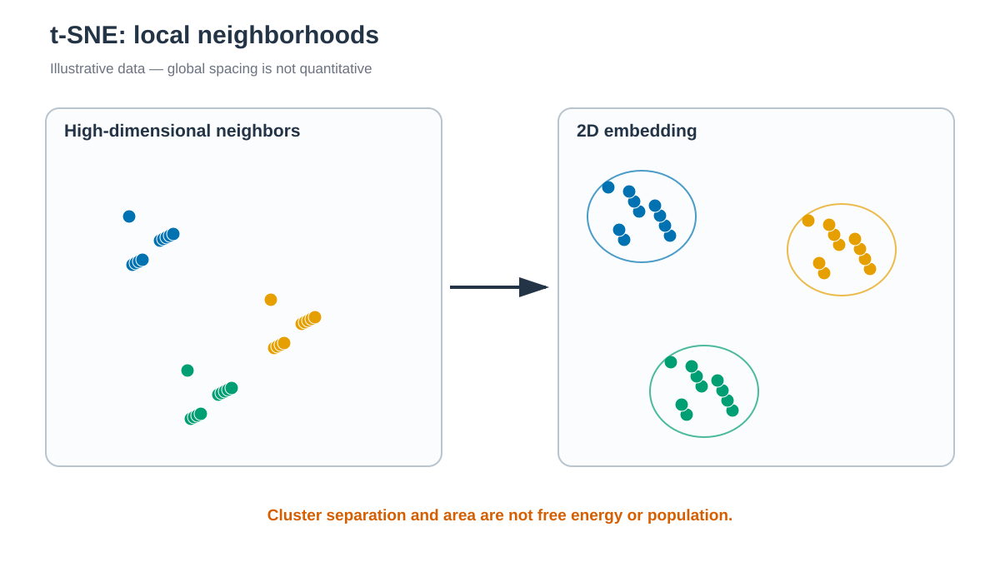

# t-SNE



*가까운 이웃은 강조되지만 cluster 사이 거리와 면적은 정량적으로 해석하지 않습니다. / Nearby observations are emphasized, but inter-cluster distances and areas are not quantitative.*

## 한국어

t-SNE는 고차원에서 가까운 frame이 2차원에서도 이웃이 되도록 확률 분포를
맞추는 nonlinear embedding입니다. Chignolin backbone dihedral feature를
표준화해 사용합니다.

`run.sh`는 [Chignolin conventional MD](../../../1_Simulation/1_MD/1.1_Soluble_Protein/README.md)에서
residue 2–9 φ/ψ(`output/phi_psi.dat`)를 계산합니다. 아래 command는 이
directory에서 실행합니다.

```bash
./run.sh
python3 anal.py
```

`python3 anal.py --save-figure figures`처럼 실행하면 figure를 화면에 표시하면서
`figures/tsne.png`(150 dpi)로도 저장합니다. 저장 directory는 `output/` 밖에
둡니다. Option이 없으면 image file을 만들지 않습니다. TSV 결과는 figure 창을
열기 전에 `output/`에 기록됩니다.

| Output | Column | 단위 |
| --- | --- | --- |
| `phi_psi.dat` | `Frame`, `phi:2`, `psi:2` … `phi:9`, `psi:9`(cpptraj) | degree |
| `embedding.tsv` | `frame`, `tSNE1`, `tSNE2` | 임의 단위 |
| `metadata.tsv` | `parameter`, `value`: scikit-learn version, perplexity, `random_state`, scaling | — |

`anal.py`는 frame 순서로 색칠한 embedding을 표시합니다. 비슷한 색의 점이 한
영역에 모이면 그 시간 구간의 dihedral feature가 서로 비슷하다는 뜻입니다.

기본값은 `perplexity=30`, `learning_rate="auto"`, `init="pca"`,
`max_iter=1000`, `random_state=20260809`입니다. Perplexity와 seed는 `anal.py`
상단의 `PERPLEXITY`, `RANDOM_STATE`에서 바꿉니다. Perplexity는 유효 이웃 수와
관련된 parameter이며 frame 수보다 작아야 합니다. 기본값은 100-frame 예제
trajectory를 기준으로 하므로 더 긴 trajectory에서는 키워야 할 수 있습니다.
`anal.py`는 읽은 frame 수(`Frames: N`)를 출력하고, frame이 부족하면 값을 자동으로
낮추지 않고 계산 전에 중단합니다.

Seed와 perplexity가 다른 embedding의 회전, 모양과 cluster 간 거리를 정량
비교하지 않습니다.

결과 게시, 실패 log(`output.failed/`), 동시 실행 보호(`writer_guard.py`)는
[GUIDE.md 부록](../../../GUIDE.md#4-부록-실행-상태와-복구)을 참고합니다.

## English

Scikit-learn t-SNE embeds standardized periodic backbone-dihedral features so
that frames close in high dimension stay neighbors in two dimensions.

`run.sh` calculates residue 2–9 φ/ψ (`output/phi_psi.dat`) from the
[Chignolin conventional-MD tutorial](../../../1_Simulation/1_MD/1.1_Soluble_Protein/README.md).
Run `./run.sh` and then `python3 anal.py` from this directory.

| Output | Columns | Unit |
| --- | --- | --- |
| `phi_psi.dat` | `Frame`, `phi:2`, `psi:2` … `phi:9`, `psi:9` (cpptraj) | degree |
| `embedding.tsv` | `frame`, `tSNE1`, `tSNE2` | arbitrary |
| `metadata.tsv` | `parameter`, `value`: scikit-learn version, perplexity, `random_state`, scaling | — |

`anal.py` plots the embedding colored by frame. Points of similar color grouped
in one region mean that the dihedral features of that time interval are
similar.

`python3 anal.py --save-figure figures` also saves the figure as
`figures/tsne.png` (150 dpi) while displaying it. Keep that directory outside
`output/`; without the option no image file is written. TSV results are written
to `output/` before the figure window opens.

The defaults are `perplexity=30`, `learning_rate="auto"`, `init="pca"`,
`max_iter=1000`, and `random_state=20260809`; edit `PERPLEXITY` and
`RANDOM_STATE` at the top of `anal.py`. Perplexity must be smaller than the
frame count. The defaults assume the 100-frame example and may need scaling
for longer trajectories. `anal.py` prints `Frames: N` and stops before fitting
rather than silently lowering the perplexity.

Embedding distance and density are not free energies or populations.

Result publication, failure logs (`output.failed/`) and concurrent-run
protection (`writer_guard.py`) are described in [GUIDE.md appendix](../../../GUIDE.md#4-appendix-run-state-and-recovery).
