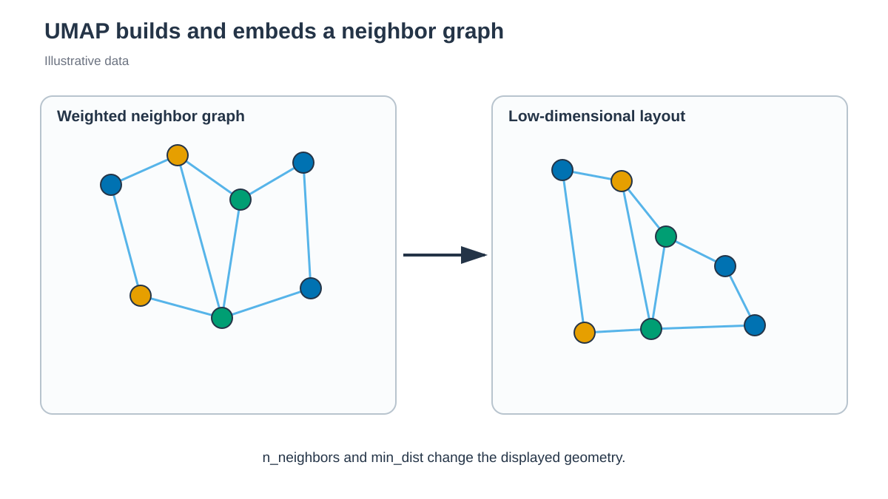

# UMAP



*UMAP은 고차원 neighbor graph의 연결 관계를 저차원에 배치합니다. / UMAP arranges high-dimensional neighbor-graph connectivity in a low-dimensional space.*

## 한국어

UMAP은 이웃 graph를 만든 뒤 저차원에서 그 연결 관계를 보존하는 nonlinear
embedding입니다. 입력은 표준화한 Chignolin backbone dihedral feature입니다.

`run.sh`는 [Chignolin conventional MD](../../../1_Simulation/1_MD/1.1_Soluble_Protein/README.md)에서
residue 2–9 φ/ψ(`output/phi_psi.dat`)를 계산합니다. 아래 command는 이
directory에서 실행합니다.

```bash
./run.sh
python3 anal.py
```

`python3 anal.py --save-figure figures`처럼 실행하면 figure를 화면에 표시하면서
`figures/umap.png`(150 dpi)로도 저장합니다. 저장 directory는 `output/` 밖에
둡니다. Option이 없으면 image file을 만들지 않습니다. TSV 결과는 figure 창을
열기 전에 `output/`에 기록됩니다.

| Output | Column | 단위 |
| --- | --- | --- |
| `phi_psi.dat` | `Frame`, `phi:2`, `psi:2` … `phi:9`, `psi:9`(cpptraj) | degree |
| `embedding.tsv` | `frame`, `UMAP1`, `UMAP2` | 임의 단위 |
| `metadata.tsv` | `parameter`, `value`: umap-learn version, `n_neighbors`, `min_dist`, `random_state`, scaling | — |

`anal.py`는 frame 순서로 색칠한 embedding을 표시합니다. 비슷한 색의 점이 한
영역에 모이면 그 시간 구간의 dihedral feature가 서로 비슷하다는 뜻입니다.
UMAP은 Numba cache를 system temporary directory에 만들며 repository에는 cache를
남기지 않습니다.

기본값은 `n_neighbors=15`, `min_dist=0.1`, `metric="euclidean"`,
`random_state=20260809`이며 `anal.py` 상단의 `N_NEIGHBORS`, `MIN_DIST`,
`RANDOM_STATE`에서 바꿉니다. `n_neighbors`는 local/global structure의 균형에,
`min_dist`는 저차원에서 point가 모일 수 있는 정도에 영향을 줍니다.
`n_neighbors`는 frame 수보다 작아야 합니다. 기본값은 100-frame 예제 trajectory를
기준으로 하므로 더 긴 trajectory에서는 조정해야 할 수 있습니다. `anal.py`는
`Frames: N`을 출력하고 조건이 맞지 않으면 계산 전에 중단합니다.

Parameter가 다른 embedding의 거리와 밀도를 정량 비교하지 않습니다.

결과 게시, 실패 log(`output.failed/`), 동시 실행 보호(`writer_guard.py`)는
[GUIDE.md 부록](../../../GUIDE.md#4-부록-실행-상태와-복구)을 참고합니다.

## English

UMAP builds a neighbor graph from standardized periodic dihedral features and
embeds it in two dimensions while preserving its connectivity.

`run.sh` calculates residue 2–9 φ/ψ (`output/phi_psi.dat`) from the
[Chignolin conventional-MD tutorial](../../../1_Simulation/1_MD/1.1_Soluble_Protein/README.md).
Run `./run.sh` and then `python3 anal.py` from this directory.

`python3 anal.py --save-figure figures` also saves the figure as
`figures/umap.png` (150 dpi) while displaying it. Keep that directory outside
`output/`; without the option no image file is written. TSV results are written
to `output/` before the figure window opens.

| Output | Columns | Unit |
| --- | --- | --- |
| `phi_psi.dat` | `Frame`, `phi:2`, `psi:2` … `phi:9`, `psi:9` (cpptraj) | degree |
| `embedding.tsv` | `frame`, `UMAP1`, `UMAP2` | arbitrary |
| `metadata.tsv` | `parameter`, `value`: umap-learn version, `n_neighbors`, `min_dist`, `random_state`, scaling | — |

`anal.py` plots the embedding colored by frame. Points of similar color grouped
in one region mean that the dihedral features of that time interval are
similar. The Numba cache is placed under the system temporary directory, not
the repository.

The defaults are `n_neighbors=15`, `min_dist=0.1`, `metric="euclidean"`, and
`random_state=20260809`; edit `N_NEIGHBORS`, `MIN_DIST`, and `RANDOM_STATE` at
the top of `anal.py`. `n_neighbors` balances local and global structure, and
`min_dist` controls how tightly points may pack. `n_neighbors` must be smaller
than the frame count; the defaults assume the 100-frame example and may need
scaling for longer trajectories. `anal.py` prints `Frames: N` and stops before
fitting when the condition fails.

Embedding geometry is not a thermodynamic observable.

Result publication, failure logs (`output.failed/`) and concurrent-run
protection (`writer_guard.py`) are described in [GUIDE.md appendix](../../../GUIDE.md#4-appendix-run-state-and-recovery).
