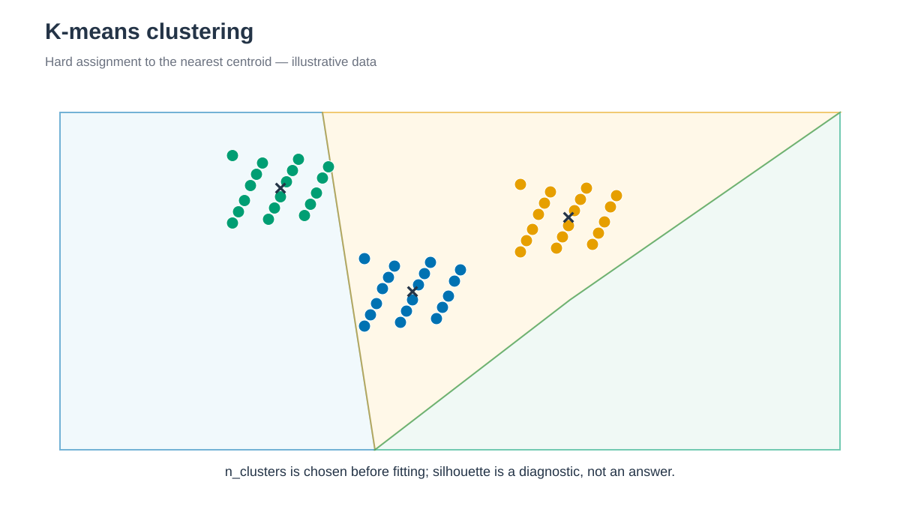

# K-means clustering



*각 frame은 가장 가까운 centroid의 cluster 하나에 배정됩니다. / Each frame is assigned to one cluster represented by its nearest centroid.*

## 한국어

K-means는 cluster 내부의 centroid distance 제곱합을 줄이도록 frame을 나눕니다.
구형이고 크기가 비슷한 cluster를 선호하며 cluster 수를 미리 정해야 합니다.

`run.sh`는 [Chignolin conventional MD](../../../1_Simulation/1_MD/1.1_Soluble_Protein/README.md)에서
residue 2–9 φ/ψ(`output/phi_psi.dat`)를 계산합니다. 아래 command는 이
directory에서 실행합니다.

```bash
./run.sh
python3 anal.py
```

`python3 anal.py --save-figure figures`처럼 실행하면 figure를 화면에 표시하면서
`figures/kmeans.png`(150 dpi)로도 저장합니다. 저장 directory는 `output/` 밖에
둡니다. Option이 없으면 image file을 만들지 않습니다. TSV 결과는 figure 창을
열기 전에 `output/`에 기록됩니다.

| Output | Column | 단위 |
| --- | --- | --- |
| `phi_psi.dat` | `Frame`, `phi:2`, `psi:2` … `phi:9`, `psi:9`(cpptraj) | degree |
| `pca_projection.tsv` | `frame`, `PC1` … `PC5`(다시 standardize하기 전) | 단위 없음 |
| `cluster_labels.tsv` | `frame`, `cluster`(0부터), `centroid_distance` | 단위 없음 |
| `cluster_summary.tsv` | `cluster`, `frames`, `population`, `representative_frame` | population 0–1 |
| `representative_frames.tsv` | `cluster`, `frame` | — |
| `silhouette.tsv` | `clusters`(k=2–8), `silhouette_score` | −1–1 |

Representative frame은 cluster 평균에 가장 가까운 frame입니다. `population`의
합은 1입니다. Silhouette score는 1에 가까울수록 cluster가 잘 분리되었고, 0
근처이면 경계가 겹친다는 뜻입니다. PDB 추출은 [Clustering README](../README.md#representative-frame-추출)를 참고합니다.

기본값은 PCA component 5개(`PCA_COMPONENTS`), `n_clusters=3`(`CLUSTER_COUNT`),
`n_init=20`(`KMEANS_N_INIT`), silhouette 범위 k=2–8(`SILHOUETTE_MAX_CLUSTERS`),
`random_state=20260809`이며 모두 `anal.py` 상단에서 바꿉니다. 기본값은 100-frame
예제 trajectory를 기준으로 합니다. `anal.py`는 `Frames: N`을 출력하고, PCA
component 수가 frame 수나 feature 수보다 크거나 cluster 수가 frame 수를 넘거나
`SILHOUETTE_MAX_CLUSTERS`가 frame 수 이상이면 계산 전에 중단합니다.

Silhouette maximum만으로 cluster 수를 확정하지 않습니다. 시간 순서와 구조를
확인한 뒤 필요하면 `CLUSTER_COUNT`를 수정합니다.

결과 게시, 실패 log(`output.failed/`), 동시 실행 보호(`writer_guard.py`)는
[GUIDE.md 부록](../../../GUIDE.md#4-부록-실행-상태와-복구)을 참고합니다.

## English

K-means partitions frames to minimize the within-cluster sum of squared
distances to each centroid. It favors spherical clusters of similar size and
needs the cluster count in advance.

`run.sh` calculates residue 2–9 φ/ψ (`output/phi_psi.dat`) from the
[Chignolin conventional-MD tutorial](../../../1_Simulation/1_MD/1.1_Soluble_Protein/README.md).
Run `./run.sh` and then `python3 anal.py` from this directory.

`python3 anal.py --save-figure figures` also saves the figure as
`figures/kmeans.png` (150 dpi) while displaying it. Keep that directory outside
`output/`; without the option no image file is written. TSV results are written
to `output/` before the figure window opens.

| Output | Columns | Unit |
| --- | --- | --- |
| `phi_psi.dat` | `Frame`, `phi:2`, `psi:2` … `phi:9`, `psi:9` (cpptraj) | degree |
| `pca_projection.tsv` | `frame`, `PC1` … `PC5` (before re-standardization) | dimensionless |
| `cluster_labels.tsv` | `frame`, `cluster` (from 0), `centroid_distance` | dimensionless |
| `cluster_summary.tsv` | `cluster`, `frames`, `population`, `representative_frame` | population 0–1 |
| `representative_frames.tsv` | `cluster`, `frame` | — |
| `silhouette.tsv` | `clusters` (k=2–8), `silhouette_score` | −1 to 1 |

The representative frame is the member nearest to the cluster mean.
Populations sum to 1. Silhouette scores near 1 indicate well-separated
clusters; values near 0 indicate overlapping boundaries. To save a representative frame as PDB, see the [Clustering README](../README.md#extracting-a-representative-frame).

The defaults are five PCA components (`PCA_COMPONENTS`), three clusters
(`CLUSTER_COUNT`), 20 initializations (`KMEANS_N_INIT`), silhouette scan up to
k=8 (`SILHOUETTE_MAX_CLUSTERS`), and `random_state=20260809`, all at the top of
`anal.py`. They assume the 100-frame example. `anal.py` prints `Frames: N` and
stops before fitting if PCA components exceed the frame or feature count, the
cluster count exceeds the frame count, or `SILHOUETTE_MAX_CLUSTERS` is not
smaller than the frame count.

Silhouette scores are diagnostics rather than an automatic model choice; check
time order and structures before changing `CLUSTER_COUNT`.

Result publication, failure logs (`output.failed/`) and concurrent-run
protection (`writer_guard.py`) are described in [GUIDE.md appendix](../../../GUIDE.md#4-appendix-run-state-and-recovery).
