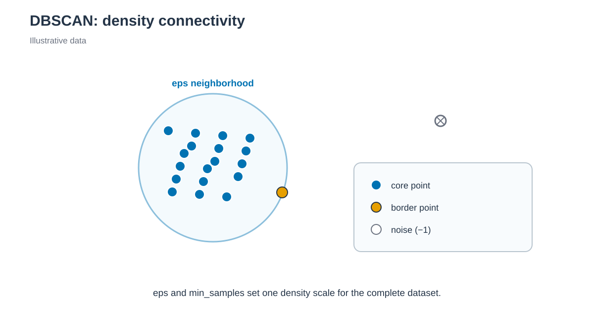

# DBSCAN clustering



*eps neighborhood와 min_samples가 하나의 density cutoff를 정합니다. / The eps neighborhood and min_samples define one density cutoff.*

## 한국어

DBSCAN은 `eps` 안에 `min_samples` 이상의 이웃이 있는 영역을 연결하고 희박한
frame을 noise로 분류합니다. Cluster 수를 미리 정하지 않지만 하나의 density
threshold를 사용합니다.

`run.sh`는 [Chignolin conventional MD](../../../1_Simulation/1_MD/1.1_Soluble_Protein/README.md)에서
residue 2–9 φ/ψ(`output/phi_psi.dat`)를 계산합니다. 아래 command는 이
directory에서 실행합니다.

```bash
./run.sh
python3 anal.py
```

`python3 anal.py --save-figure figures`처럼 실행하면 figure를 화면에 표시하면서
`figures/dbscan.png`(150 dpi)로도 저장합니다. 저장 directory는 `output/` 밖에
둡니다. Option이 없으면 image file을 만들지 않습니다. TSV 결과는 figure 창을
열기 전에 `output/`에 기록됩니다.

| Output | Column | 단위 |
| --- | --- | --- |
| `phi_psi.dat` | `Frame`, `phi:2`, `psi:2` … `phi:9`, `psi:9`(cpptraj) | degree |
| `pca_projection.tsv` | `frame`, `PC1` … `PC5`(다시 standardize하기 전) | 단위 없음 |
| `cluster_labels.tsv` | `frame`, `cluster`(noise는 `-1`) | — |
| `cluster_summary.tsv` | `cluster`, `frames`, `population`, `representative_frame`(noise는 `NA`) | population 0–1 |
| `representative_frames.tsv` | `cluster`, `frame` | — |
| `k_distance.tsv` | `sorted_index`, `k_distance`: `MIN_SAMPLES`번째 이웃까지 distance의 오름차순 | 단위 없음 |

`anal.py`는 label과 k-distance 곡선을 표시합니다. Representative frame은 cluster
평균에 가장 가까운 frame이며 noise에는 없습니다. `population`은 noise를 포함해
합이 1입니다. PDB 추출은 [Clustering README](../README.md#representative-frame-추출)를 참고합니다.

기본값은 `eps=1.2`, `min_samples=10`, PCA component 5개이며 `anal.py` 상단의
`EPS`, `MIN_SAMPLES`, `PCA_COMPONENTS`에서 바꿉니다. `EPS`는 각 PC를 다시
분산 1로 표준화한 5차원 공간의 Euclidean distance이므로 단위가 없습니다. Å나
degree가 아니므로 `k_distance.tsv`의 곡선과 비교해 정합니다. `MIN_SAMPLES`는
100-frame 예제 trajectory를 기준으로 하며 frame 수가 늘면 함께 키워야 할 수
있습니다. `anal.py`는 `Frames: N`을 출력하고 `MIN_SAMPLES`나 PCA component 수가
frame 수를 넘으면 계산 전에 중단합니다.

Cluster가 없는 경우도 parameter 또는 sampling에 대한 결과이므로 label과 noise
fraction을 그대로 기록합니다.

결과 게시, 실패 log(`output.failed/`), 동시 실행 보호(`writer_guard.py`)는
[GUIDE.md 부록](../../../GUIDE.md#4-부록-실행-상태와-복구)을 참고합니다.

## English

DBSCAN connects regions with at least `min_samples` neighbors within `eps` and
labels sparse frames as noise. It needs no preset cluster count but uses a
single density threshold.

`run.sh` calculates residue 2–9 φ/ψ (`output/phi_psi.dat`) from the
[Chignolin conventional-MD tutorial](../../../1_Simulation/1_MD/1.1_Soluble_Protein/README.md).
Run `./run.sh` and then `python3 anal.py` from this directory.

`python3 anal.py --save-figure figures` also saves the figure as
`figures/dbscan.png` (150 dpi) while displaying it. Keep that directory outside
`output/`; without the option no image file is written. TSV results are written
to `output/` before the figure window opens.

| Output | Columns | Unit |
| --- | --- | --- |
| `phi_psi.dat` | `Frame`, `phi:2`, `psi:2` … `phi:9`, `psi:9` (cpptraj) | degree |
| `pca_projection.tsv` | `frame`, `PC1` … `PC5` (before re-standardization) | dimensionless |
| `cluster_labels.tsv` | `frame`, `cluster` (noise is `-1`) | — |
| `cluster_summary.tsv` | `cluster`, `frames`, `population`, `representative_frame` (`NA` for noise) | population 0–1 |
| `representative_frames.tsv` | `cluster`, `frame` | — |
| `k_distance.tsv` | `sorted_index`, `k_distance`: ascending distance to the `MIN_SAMPLES`-th neighbor | dimensionless |

`anal.py` plots the labels and the k-distance curve. The representative frame
is the member nearest to the cluster mean; noise has none. Populations,
including noise, sum to 1. To save a representative frame as PDB, see the [Clustering README](../README.md#extracting-a-representative-frame).

The defaults are `eps=1.2`, `min_samples=10`, and five PCA components; edit
`EPS`, `MIN_SAMPLES`, and `PCA_COMPONENTS` at the top of `anal.py`. `EPS` is a
Euclidean distance in the 5-PC space after each PC is re-standardized to unit
variance, so it is dimensionless (not Å or degrees); choose it from the
`k_distance.tsv` curve. `MIN_SAMPLES` assumes the 100-frame example and may
need scaling for longer trajectories. `anal.py` prints `Frames: N` and stops
before fitting if `MIN_SAMPLES` or the PCA component count exceeds the frame
count.

A no-cluster result is preserved rather than hidden.

Result publication, failure logs (`output.failed/`) and concurrent-run
protection (`writer_guard.py`) are described in [GUIDE.md appendix](../../../GUIDE.md#4-appendix-run-state-and-recovery).
