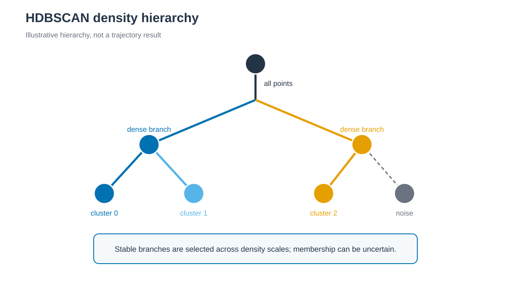

# HDBSCAN clustering



*여러 density scale에서 안정적인 branch를 cluster로 선택하고 나머지는 noise로 둘 수 있습니다. / Stable branches across density scales are selected as clusters while other points may remain noise.*

## 한국어

HDBSCAN은 여러 density scale의 hierarchy에서 안정적인 cluster를 선택하고
나머지 frame을 noise로 둘 수 있습니다. Scikit-learn 구현을 사용합니다.

`run.sh`는 [Chignolin conventional MD](../../../1_Simulation/1_MD/1.1_Soluble_Protein/README.md)에서
residue 2–9 φ/ψ(`output/phi_psi.dat`)를 계산합니다. 아래 command는 이
directory에서 실행합니다.

```bash
./run.sh
python3 anal.py
```

`python3 anal.py --save-figure figures`처럼 실행하면 figure를 화면에 표시하면서
`figures/hdbscan.png`(150 dpi)로도 저장합니다. 저장 directory는 `output/` 밖에
둡니다. Option이 없으면 image file을 만들지 않습니다. TSV 결과는 figure 창을
열기 전에 `output/`에 기록됩니다.

| Output | Column | 단위 |
| --- | --- | --- |
| `phi_psi.dat` | `Frame`, `phi:2`, `psi:2` … `phi:9`, `psi:9`(cpptraj) | degree |
| `pca_projection.tsv` | `frame`, `PC1` … `PC5`(다시 standardize하기 전) | 단위 없음 |
| `cluster_labels.tsv` | `frame`, `cluster`(noise는 `-1`), `membership_probability` | 0–1 |
| `cluster_summary.tsv` | `cluster`, `frames`, `population`, `mean_membership_probability`, `representative_frame`(noise는 `NA`) | 0–1 |
| `representative_frames.tsv` | `cluster`, `frame` | — |
| `metadata.tsv` | `parameter`, `value`: scikit-learn version, `min_cluster_size`, `min_samples`, `cluster_selection_method` | — |

Representative frame은 membership probability가 가장 큰 frame입니다. Noise
frame의 membership probability는 0입니다. PDB 추출은 [Clustering README](../README.md#representative-frame-추출)를 참고합니다.

기본값은 `min_cluster_size=10`, `min_samples=5`,
`cluster_selection_method="eom"`이며 `anal.py` 상단의 `MIN_CLUSTER_SIZE`,
`MIN_SAMPLES`에서 바꿉니다. 1 ns 예제 trajectory는 100 frame(`ntwx=5000`)이므로
10 frame(100 ps 분량) 이상 모인 state를 cluster로 봅니다. Frame 수가 달라지면
두 값을 frame 수에 비례해 조정합니다. `anal.py`는 `Frames: N`을 출력하고 두 값이나
PCA component 수(`PCA_COMPONENTS=5`)가 frame 수를 넘으면 계산 전에 중단합니다.

Scikit-learn 1.9는 별도 `hdbscan` package의 `cluster_persistence_`를 제공하지
않으므로 persistence를 임의로 계산하지 않습니다.

결과 게시, 실패 log(`output.failed/`), 동시 실행 보호(`writer_guard.py`)는
[GUIDE.md 부록](../../../GUIDE.md#4-부록-실행-상태와-복구)을 참고합니다.

## English

HDBSCAN selects stable clusters from a hierarchy across density scales and may
leave other frames as noise. This example uses the scikit-learn implementation.

`run.sh` calculates residue 2–9 φ/ψ (`output/phi_psi.dat`) from the
[Chignolin conventional-MD tutorial](../../../1_Simulation/1_MD/1.1_Soluble_Protein/README.md).
Run `./run.sh` and then `python3 anal.py` from this directory.

| Output | Columns | Unit |
| --- | --- | --- |
| `phi_psi.dat` | `Frame`, `phi:2`, `psi:2` … `phi:9`, `psi:9` (cpptraj) | degree |
| `pca_projection.tsv` | `frame`, `PC1` … `PC5` (before re-standardization) | dimensionless |
| `cluster_labels.tsv` | `frame`, `cluster` (noise is `-1`), `membership_probability` | 0–1 |
| `cluster_summary.tsv` | `cluster`, `frames`, `population`, `mean_membership_probability`, `representative_frame` (`NA` for noise) | 0–1 |
| `representative_frames.tsv` | `cluster`, `frame` | — |
| `metadata.tsv` | `parameter`, `value`: scikit-learn version, `min_cluster_size`, `min_samples`, `cluster_selection_method` | — |

The representative frame has the highest membership probability in its
cluster. Noise frames have membership probability 0. To save a representative frame as PDB, see the [Clustering README](../README.md#extracting-a-representative-frame).

`python3 anal.py --save-figure figures` also saves the figure as
`figures/hdbscan.png` (150 dpi) while displaying it. Keep that directory outside
`output/`; without the option no image file is written. TSV results are written
to `output/` before the figure window opens.

The defaults are `min_cluster_size=10`, `min_samples=5`, and
`cluster_selection_method="eom"`; edit `MIN_CLUSTER_SIZE` and `MIN_SAMPLES` at
the top of `anal.py`. The 1 ns example has 100 frames (`ntwx=5000`), so a
cluster needs at least 10 frames (100 ps of sampling). Scale both values with
the frame count for other trajectories. `anal.py` prints `Frames: N` and stops
before fitting if either value or the PCA component count (`PCA_COMPONENTS=5`)
exceeds the frame count.

Scikit-learn 1.9 does not expose the separate `hdbscan` package's
`cluster_persistence_`, so this tutorial does not fabricate that quantity.

Result publication, failure logs (`output.failed/`) and concurrent-run
protection (`writer_guard.py`) are described in [GUIDE.md appendix](../../../GUIDE.md#4-appendix-run-state-and-recovery).
