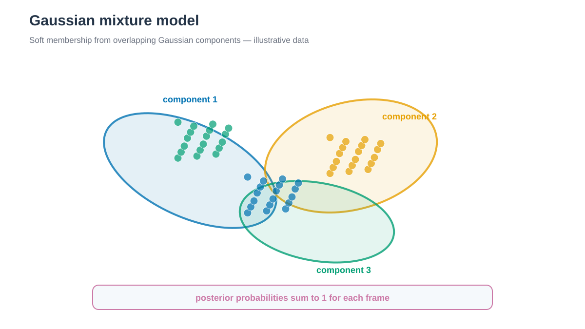

# Gaussian mixture model clustering



*Gaussian component가 겹치는 영역에서는 한 frame이 여러 component에 posterior probability를 가집니다. / In overlapping regions, one frame has posterior probabilities for multiple components.*

## 한국어

GMM은 feature 분포를 여러 Gaussian component의 합으로 나타냅니다. K-means와
달리 covariance와 frame별 posterior probability를 제공합니다.

`run.sh`는 [Chignolin conventional MD](../../../1_Simulation/1_MD/1.1_Soluble_Protein/README.md)에서
residue 2–9 φ/ψ(`output/phi_psi.dat`)를 계산합니다. 아래 command는 이
directory에서 실행합니다.

```bash
./run.sh
python3 anal.py
```

`python3 anal.py --save-figure figures`처럼 실행하면 figure를 화면에 표시하면서
`figures/gmm.png`(150 dpi)로도 저장합니다. 저장 directory는 `output/` 밖에
둡니다. Option이 없으면 image file을 만들지 않습니다. TSV 결과는 figure 창을
열기 전에 `output/`에 기록됩니다.

| Output | Column | 단위 |
| --- | --- | --- |
| `phi_psi.dat` | `Frame`, `phi:2`, `psi:2` … `phi:9`, `psi:9`(cpptraj) | degree |
| `pca_projection.tsv` | `frame`, `PC1` … `PC5`(다시 standardize하기 전) | 단위 없음 |
| `cluster_labels.tsv` | `frame`, `cluster`, `posterior_probability`(가장 큰 posterior) | 0–1 |
| `cluster_summary.tsv` | `cluster`, `frames`, `population`, `mean_probability`, `representative_frame` | 0–1 |
| `representative_frames.tsv` | `cluster`, `frame` | — |
| `model_selection.tsv` | `components`(1–8), `AIC`, `BIC` | 단위 없음 |

Representative frame은 해당 component의 posterior probability가 가장 큰
frame입니다. AIC와 BIC는 값이 낮을수록 선호되는 model입니다. PDB 추출은 [Clustering README](../README.md#representative-frame-추출)를 참고합니다.

기본값은 PCA component 5개(`PCA_COMPONENTS`), Gaussian component 3개
(`COMPONENT_COUNT`), full covariance(`COVARIANCE_TYPE`), `n_init=10`
(`GMM_N_INIT`), `reg_covar=1e-6`(`REG_COVAR`), AIC/BIC 범위 1–8
(`MODEL_SELECTION_MAX_COMPONENTS`), `random_state=20260809`이며 모두 `anal.py`
상단에서 바꿉니다. 기본값은 100-frame 예제 trajectory를 기준으로 합니다.
`anal.py`는 `Frames: N`을 출력하고 component 수가 frame 수를 넘으면 계산 전에
중단합니다.

Gaussian mixture가 실제 metastable state와 일치한다고 가정하지 않습니다.
Component 수, covariance type과 trajectory 구간을 바꿔 sensitivity를 확인합니다.

결과 게시, 실패 log(`output.failed/`), 동시 실행 보호(`writer_guard.py`)는
[GUIDE.md 부록](../../../GUIDE.md#4-부록-실행-상태와-복구)을 참고합니다.

## English

A Gaussian mixture represents the feature distribution as a sum of Gaussian
components. Unlike K-means, it reports covariances and per-frame posterior
probabilities.

`run.sh` calculates residue 2–9 φ/ψ (`output/phi_psi.dat`) from the
[Chignolin conventional-MD tutorial](../../../1_Simulation/1_MD/1.1_Soluble_Protein/README.md).
Run `./run.sh` and then `python3 anal.py` from this directory.

`python3 anal.py --save-figure figures` also saves the figure as
`figures/gmm.png` (150 dpi) while displaying it. Keep that directory outside
`output/`; without the option no image file is written. TSV results are written
to `output/` before the figure window opens.

| Output | Columns | Unit |
| --- | --- | --- |
| `phi_psi.dat` | `Frame`, `phi:2`, `psi:2` … `phi:9`, `psi:9` (cpptraj) | degree |
| `pca_projection.tsv` | `frame`, `PC1` … `PC5` (before re-standardization) | dimensionless |
| `cluster_labels.tsv` | `frame`, `cluster`, `posterior_probability` (largest posterior) | 0–1 |
| `cluster_summary.tsv` | `cluster`, `frames`, `population`, `mean_probability`, `representative_frame` | 0–1 |
| `representative_frames.tsv` | `cluster`, `frame` | — |
| `model_selection.tsv` | `components` (1–8), `AIC`, `BIC` | dimensionless |

The highest-posterior frame represents each component. Lower AIC and BIC values
indicate the preferred model. To save a representative frame as PDB, see the [Clustering README](../README.md#extracting-a-representative-frame).

The defaults are five PCA components (`PCA_COMPONENTS`), three Gaussian
components (`COMPONENT_COUNT`), full covariance (`COVARIANCE_TYPE`),
`n_init=10` (`GMM_N_INIT`), `reg_covar=1e-6` (`REG_COVAR`), AIC/BIC for 1–8
components (`MODEL_SELECTION_MAX_COMPONENTS`), and `random_state=20260809`, all
at the top of `anal.py`. They assume the 100-frame example. `anal.py` prints
`Frames: N` and stops before fitting if a component count exceeds the frame
count.

Gaussian components are not automatically metastable molecular states. Check
sensitivity to the component count, covariance type, and trajectory interval.

Result publication, failure logs (`output.failed/`) and concurrent-run
protection (`writer_guard.py`) are described in [GUIDE.md appendix](../../../GUIDE.md#4-appendix-run-state-and-recovery).
