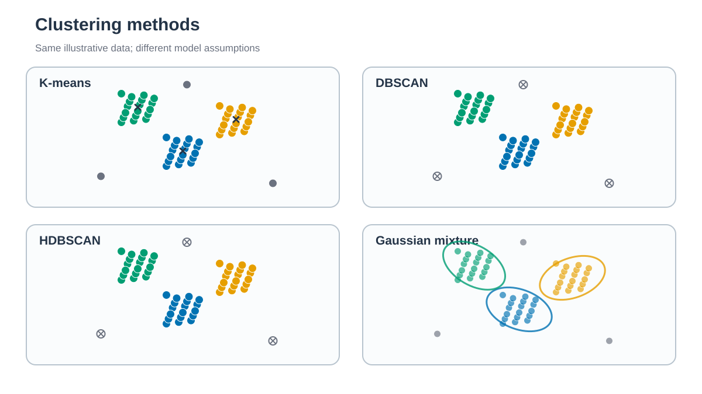

# Clustering / 군집화



*각 방법은 cluster shape, density와 membership에 서로 다른 가정을 둡니다. / Each method makes different assumptions about cluster shape, density, and membership.*

## 한국어

Chignolin backbone dihedral을 sin/cos feature로 바꾸고 standardize한 뒤 PCA
5차원으로 줄입니다. 5개 PCA component를 다시 standardize해 네 가지 방법으로
clustering합니다. 각 leaf는 feature와 PCA projection을 직접 계산하며 t-SNE나
UMAP embedding을 clustering input으로 사용하지 않습니다.

- [K-means](5.1_KMeans/)
- [DBSCAN](5.2_DBSCAN/)
- [HDBSCAN](5.3_HDBSCAN/)
- [Gaussian mixture model](5.4_GMM/)

Cluster label은 구조 state의 정답이 아닙니다. Parameter sensitivity, 시간에 따른
전이, representative frame과 독립 trajectory에서의 재현성을 함께 확인합니다.

### Representative frame 추출

`representative_frames.tsv`의 `frame`은 1부터 시작하는 cpptraj frame 번호이며
`run.sh`가 읽은 trajectory의 순서와 같습니다. 예를 들어 frame 46을 water와 ion
없이 PDB로 저장하려면 leaf directory에서 실행합니다.

```bash
cpptraj \
    -p ../../../1_Simulation/1_MD/1.1_Soluble_Protein/work/system.parm7 \
    -y ../../../1_Simulation/1_MD/1.1_Soluble_Protein/work/production.nc <<'EOF'
autoimage anchor :1-10
strip :WAT,Na+,Cl-
trajout cluster0_frame46.pdb pdb onlyframes 46
run
EOF
```

PDB는 `output/` 밖에 저장합니다. `output/`에 file을 추가하면 기록된 generation
hash와 맞지 않게 됩니다.

## English

Chignolin backbone dihedrals are converted to sin/cos features, standardized,
and reduced to five PCA components. Four methods cluster these components
after standardizing them again. Each leaf is independent and
does not cluster t-SNE or UMAP coordinates. Labels require parameter and
trajectory-sensitivity checks before structural interpretation.

### Extracting a representative frame

The `frame` values in `representative_frames.tsv` are 1-based cpptraj frame
numbers in the order of the trajectory read by `run.sh`. To save frame 46 as a
PDB without water and ions, run this from the leaf directory:

```bash
cpptraj \
    -p ../../../1_Simulation/1_MD/1.1_Soluble_Protein/work/system.parm7 \
    -y ../../../1_Simulation/1_MD/1.1_Soluble_Protein/work/production.nc <<'EOF'
autoimage anchor :1-10
strip :WAT,Na+,Cl-
trajout cluster0_frame46.pdb pdb onlyframes 46
run
EOF
```

Write the PDB outside `output/`; extra files there no longer match the recorded
generation hashes.
